# Compass: feature catalogue

This catalogue lists every feature the demo has **in code today** (read from `bff/`, `web/`, `services/` and `shared/` on 2026-09-17). Each entry gives the user stories with their Playwright spec, the tech stack it uses, a diagram and the technical details: endpoints, events, MCP tools, models and key files.

> [!IMPORTANT]
> The catalogue and queries are the public Amazon ESCI dataset. Price, promo, stock, stores, eligibility, sponsored flags and mandates are **synthetic commerce data (ESCI has no price or stock)**. Every number here comes from `data/coverage.json` or `docs/evidence/*`, with its n. User story ids (S1, C2, AI6 …) link to [`USER_STORIES.md`](USER_STORIES.md), which is the source of truth for acceptance criteria. For MLOps stage by stage, see [`MLOPS_SUMMARY.md`](MLOPS_SUMMARY.md).

> [!NOTE]
> Section 8 covers the Phase 1 to 3 work: **streaming** (ST1, ST2), **token optimisation** (measured before/after, n = 1 run per arm) and the **Ops Copilot top 10** (OPS1 to OPS10). Section 9 covers the **MLOps top 10** (MLO1 to MLO10): pre-screen interleaving, CUPED + sequential A/B, training-serving skew, lineage, retrain trigger, fairness/exposure, config governance, SLO/error-budget freeze, golden-set regression and shadow deployment.

## Contents

- [0. Architecture and tech stack](#0-architecture-and-tech-stack)
- [1. Storefront](#1-storefront-shop)
- [2. Shared session, views and constraints](#2-shared-session-views-and-constraints)
- [3. Catalogue services and triage](#3-catalogue-services-and-triage)
- [4. Compass chat AI capabilities](#4-sparky-chat-ai-capabilities)
- [5. Demo beats](#5-demo-beats)
- [6. Ops Copilot (beats 8a, 8b, 8c)](#6-ops-copilot-beats-8a-8b-8c)
- [7. Gates, coverage board, replay, presenter](#7-gates-coverage-board-replay-presenter)
- [8. Ops Copilot top 10, streaming, token optimisation](#8-ops-copilot-top-10-streaming-token-optimisation)
- [9. MLOps top 10 (MLO1 to MLO10)](#9-mlops-top-10-mlo1-to-mlo10)

---

**Coverage ids.** Sections below may carry a `**Coverage.**` line: the machine-checked join into `data/coverage.json`, where `#n` is a `techniques[].id` row and `MLOn` a `mlops_top10.rows[].id` row. `scripts/build_features_json.py` copies these into each feature's `coverage_ids[]` in `docs/features.json`, and `make docs-check` fails on any id that does not exist in `data/coverage.json`. A capability with no genuine measured row carries no line and gets an empty array — it is never linked to a near-miss.

## 0. Architecture and tech stack

### 0.1 Containers

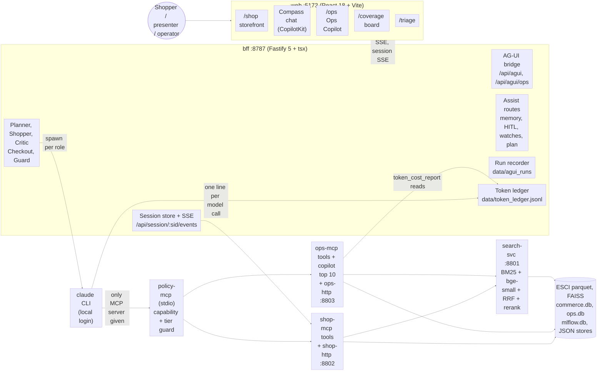

[Zoom viewer](https://mermaid.live/view#pako:eNpdVW1vEzEM_ivWSZM6caWMF62qENKoGBQGTL3BFw5NuZzbhuWSI8ltlLH_jp3cet0-9OLYfhzHfuLeZtLWmM0gOzi4VUaFGdyWWdhgg9-FU6LS6MssKlfWhEL9Rd6W2ctp-6fM7u7uDg5Ks9L2Rm6EC3C2LA1A59GNfpRZsbFtiw4m0Dr0aEKULalEsK7Mfh6yt--qtRPtBm6wAkLxMnt1dPwCRksUMsDRFJ7AdxXwkCCMIAxFJtcJr-ApGK4c5bezUzaBE2iFu9rGHYzmtlXahk8qDHFs6zkMLfCVfr3LEMZes5kWSnmNUFnh6p01OMVWWsjWa9HUD-5UrVZ8J15m0-PpMYxOhQ9qtYVXdKng_wy5iHXH8U7ej78toHKqXuPryk3eTESrJmzMYSdyxkMx0PMtClqUNakcFLwo3g14n4yTmVf1BK-pFwNekMlzuU6iAM52AX3ENthYt83hw-LiLIcbEeQGfQ6tFmYHd5ZIQuhzUhp0OfRtz2HuVFAyBppvUF5R3Bzed_s1dCgJuuwMS9bV6KJ7LYKIF710nRky1UhFcQS4sFdo-u0ACKy9TNqnv7w1-mFXpOYCSy26GmF-tojIkbZSaNB2rcx9M1qrldySbxLGjWxh5EOt7GHESNGKSmkVttxERbRe792KSUkIgrMUwcFanSr6JJrHmxBaYsT02fMeRA1NGBIGCIWXiZO0b-HoWR-DnXYhXtyfi8LJDR8bhbG_ltF-FEFvPz9nylVrHPtGaE3ycnlKX0fcNld9DK7jj1GZvSvmC6DX87tD6tnpyaIo0s1t06CT-LSucs6C1kQUzUMgaj8WX78kElLjDn_eDwQYj9_wE-c9P3Ha_iuzDxcX5zkkzhNhc-iJypsy-8fvhwGRYz3Et-LGAM8V1rIT9bVvb-9iDYJW9GGvhiacBuqxZt_EjqHiPSJRR1ofLh22lkaZQ1H7h4j9A_QWPs_PKV13ze1X9KTYORFm4FC8dU-IR9p0fmqc948dezGpYz8f5ryn3Hfl_j1yvFclwE6V5ZBRKxuhah7waejzP0GNK9HpQMP9PyomByY)

The `claude` CLI is only ever given **policy-mcp** (`config.policyMcpDir`). policy-mcp proxies shop-mcp and ops-mcp tools and refuses blocked or unapproved calls before they reach the underlying tool.

**User stories.** [ARCH1](USER_STORIES.md#presenter) every service in the container map responds when the stack is up (no e2e spec asserting the container map itself). [ARCH2](USER_STORIES.md#presenter) the claude CLI's only MCP server is policy-mcp (no e2e spec).

### 0.2 Tech stack (verified from package files)

| Layer | Technology | Where |
|---|---|---|
| Web UI | React 18.3, Vite 6, TypeScript 5.6 | `web/package.json` |
| Styling | Tailwind CSS v4 (`@tailwindcss/vite`), `tw-animate-css` | `web/src/index.css`, `web/src/styles/theme.css` |
| Components | shadcn-style primitives on `radix-ui`, `class-variance-authority`, `cmdk` (command palette) | `web/src/components/ui/*` |
| Icons, charts | `lucide-react`, `recharts` | `web/src/ops`, `web/src/components/charts` |
| Routing | React Router 7 (`createBrowserRouter`, lazy routes) | `web/src/router.tsx` |
| Agent UI protocol | CopilotKit `@copilotkit/react-core` / `@copilotkit/runtime` 2.0.0-next.1, AG-UI `@ag-ui/client` 0.0.42 | `bff/src/copilotRuntime.ts`, `bff/src/agui/bridge.ts` |
| Generative UI | A2UI v0.9 subset, own renderer (surfaces arrive as AG-UI `CUSTOM` events named `a2ui`) | `web/src/a2ui/Renderer.tsx`, `bff/src/agui/a2ui.ts`, `bff/src/ops/a2uiOps.ts` |
| BFF | Node 20+, Fastify 5, tsx, SSE, OpenTelemetry GenAI spans | `bff/src/server.ts`, `bff/src/otel.ts` |
| LLM | local Claude Code CLI (`claude -p --output-format stream-json --include-partial-messages`), spawned per role; `MAX_THINKING_TOKENS=0` for short JSON roles | `bff/src/llm/claudeCode.ts` |
| Token ledger | one JSONL line per model call (tokens, cache read/creation, cost, first-token ms), run id from `AsyncLocalStorage` | `bff/src/llm/ledger.ts` → `data/token_ledger.jsonl` |
| Ops Copilot top 10 | 11 ops-mcp tools in `copilot.py` (incident, metrics, runbooks, release notes, compare, drift, eval clusters, tokens, replay, watch), proxied by policy-mcp | `services/ops-mcp/src/ops_mcp/copilot.py`, `server.py`, `http_app.py` `/copilot/*` |
| Services | Python with `uv`; FastAPI (search-svc), FastMCP stdio servers + HTTP apps | `services/*/pyproject.toml` |
| MCP servers | `search-svc` :8801 (HTTP, not MCP), `shop-mcp` (stdio) + `shop-http` :8802, `ops-mcp` (stdio) + `ops-http` :8803, `policy-mcp` (stdio proxy) | `Makefile` `dev` target |
| Data | ESCI parquet (`products`, `queries`, `qrels_*`), BM25 index, `embeddings.npy` + `faiss.index`, SQLite (`commerce.db`, `ops.db`, `mlflow.db`), MLflow runs, JSON/JSONL stores | `data/` |
| Testing | Playwright + `@axe-core/playwright` (web E2E), Node built-in test runner via `node --import tsx --test` (bff unit), pytest (`services/ops-mcp/tests`, `services/policy-mcp/tests`) | `web/e2e`, `bff/package.json`, `services/*/tests` |

### 0.3 Models per role (`bff/src/config.ts`)

| Role | Env var | Default |
|---|---|---|
| Planner | `PLANNER_MODEL` | `haiku` |
| Shopper | `SHOPPER_MODEL` → `AGENT_MODEL` | `sonnet` |
| Critic | `CRITIC_MODEL` | `haiku` |
| Ops Copilot | `OPS_MODEL` → `AGENT_MODEL` | `sonnet` |
| Assist JSON calls (follow-ups) | uses `config.models.critic` | `haiku` |
| Photo extraction | uses `config.models.shopper` | `sonnet` |

Token settings (§8.3): the intent router skips the Planner on add / remove / show cart / compare / help and runs show cart + help on haiku (`OPT_ROUTER`); the Critic runs only when needed (`OPT_CRITIC_GATE`); no extended thinking for Planner, Critic, follow-ups and CaMeL roles (`OPT_THINKING_OFF`); from 80% of `SESSION_COST_BUDGET_USD` (default $3) every role drops to economy mode.

Other settings: `ROLE_MODE` `split` (three CLI runs) or `single`; `LEAN_CLI` on by default; `AGENT_MAX_TURNS` 16; idle timeout 90 s; hard timeout 240 s.

---

## 1. Storefront (`/shop`)

All storefront pages are lazy routes under `web/src/store/StoreLayout.tsx`. They share the header (search box `search-input`, `store-picker`, `cart-count`) and the Site / Chat / Split toggle.

### 1.1 Home

**User stories.** [S13](USER_STORIES.md#shopper-on-the-site) Given the home page, when it loads, then it has one h1 and passes the same axe check as every other store page. `a11y.spec.ts`. [S14](USER_STORIES.md#shopper-on-the-site) category tiles and mission cards link into a search (not yet asserted by a spec).

**Tech stack.** React, Tailwind, shadcn `Card`, lucide icons, React Router.

**Atlas nodes.** 0.1#shop, 1.1#home


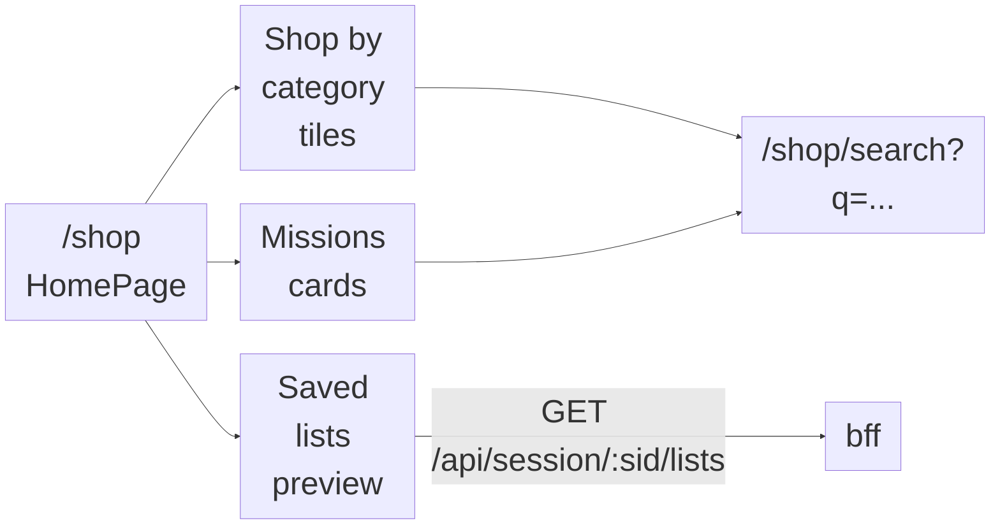

[Zoom viewer](https://mermaid.live/view#pako:eNplkE9LxDAQxb_KMNCb2148SEE9iXtQEFe8mD2kzXQ70DY1ibuu3X5386cFwUvIm_zevPAmrLUiLAGzbOKBXQmTQNdST-_SsKw6sgLjsNGD2_EPBSnw-mb8FjjPc5aJoen0qW6lcfD0KgaAVvf0IbCwrR5h68WLPHjfHjabO6ils_5xF96qc5B00OYMjmPWfl0Q4Z6tZT0Ew_Ny9Q6j_oEd27RWHkklBaOhI9NpQUNuRC1JU7fr_4ok7z9v8zxf0DX1Dx7GaaufXQQ-PrxBIUf29sgWpWVVRELgBaqm8QH-9BvxCrAn00tWocnUbqhcUSO_Oudb_AXQwoMx)

**Technical details.**
- File: `web/src/store/pages/HomePage.tsx`. Static `CATEGORIES` and four `MISSIONS` (nut-free lunches, coffee and #4 filters, puppy kit, desk setup), each linking to a search.
- Saved lists read through `shop.lists()` → `GET /api/session/:sid/lists` → shop-http `GET /sessions/{sid}/lists`.

### 1.2 Search, facets, relaxation and sponsored disclosure

**User stories.**
- [S1](USER_STORIES.md#shopper-on-the-site) Given the home page, when I search "peanut butter", then ESCI result cards show price, rating and pickup status. `site-search.spec.ts`
- [S2 / S3](USER_STORIES.md#shopper-on-the-site) Given results, when I tick a dietary facet, sort and page, then cards carry the tag, prices are non-decreasing and page 2 is `aria-current`. `site-facets.spec.ts`
- [S4](USER_STORIES.md#shopper-on-the-site) Given filters that match nothing, when the result set is empty, then I see the closest relaxation and its count, apply it in one click, and a triage record is filed. `site-zero-result.spec.ts`
- [M1](USER_STORIES.md#merchandiser--retail-media-sponsored-disclosure) Given sponsored listings, when they render, then each is labelled "Sponsored" and at most 1 in 8 is sponsored. `sponsored.spec.ts`

**Coverage.** #7, #8

**Atlas nodes.** 0.1#search, 1.1#search, 1.7#q, 1.7#sf, 1.7#prod, 2.3#eff, tracing-deep-tracing#search


**Tech stack.** React, Tailwind, bff session routes, shop-http storefront, search-svc hybrid retrieval.

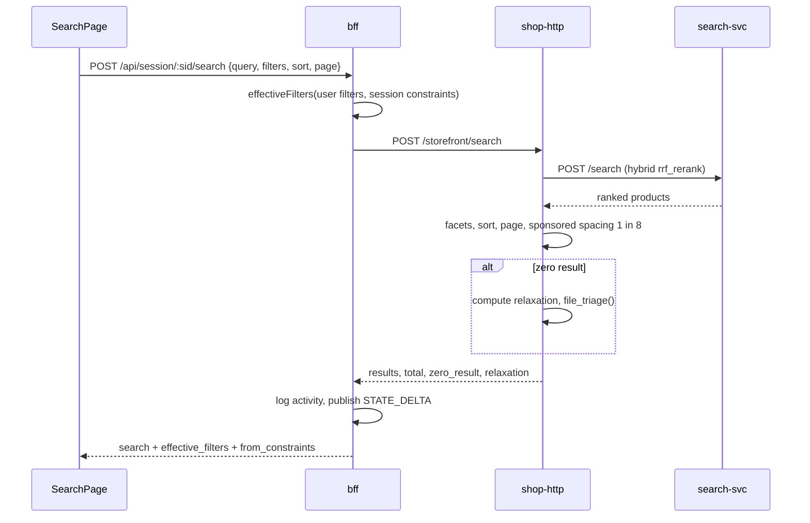

[Zoom viewer](https://mermaid.live/view#pako:eNpdUtGK2zAQ_JXFEEipQyj04fDDwYW7PhV6xKF5MZiNvLJFbcldrY-7C_n3SlZyl-bNnhmNRrN7zJRrKCsgWyyOxhop4Fhl0tFAv5ENHnryVTaD2lkpzTvF3yr7fje-VtnpdFosKuvp70RW0aPBlnGoLMCILEaZEa3AHtBDSciqe8aWbulNpA9a3-JlxH3nxlUnMt6y25mdTVf-RUV6v7q_3xTw_KvcwRpHs_bkvXF2XXjTrJMWjiEqv-WgTS_EPgfvWPJg3dIpmmySCWlNSswL_Ui65eSJrw4lZ1DOemE0VvyXy-nyEsGLY9IcejtfHhVlUGw_FCnTsns7sGmAWddMjPbPbLZdJbcIUAMju2ZS4i8ugdGoSP57Q_geQ6ZwcRO-UBnbwjcwFu7iMewF3okdMPmplwh9eCk3jJNQoHp8RQmvm0uiWsIetLScI5Ft0vWppWQTAogT7PPZu05gfmV01WvvWsBYrJEwhHE69MZ3UO4edk_149PP3UPSBvG-OI8Xvn5Ooz5PIGCh2KG-6j_LIRuIBzRNXNi0xHGzG9IYAoVl_QfmPwAp)

**Technical details.**
- Web: `web/src/store/pages/SearchPage.tsx`, `ProductCard.tsx`.
- bff: `POST /api/session/:sid/search` in `bff/src/session/routes.ts`; constraint filters merged by `effectiveFilters()` in `bff/src/session/constraints.ts`.
- Service: `services/shop-mcp/src/shop_mcp/storefront.py` (facets, sort, pagination, relaxation, `_space_sponsored(per=8)`, `file_triage`), exposed by `POST /storefront/search` and `GET /storefront/suggest` in `http_app.py`.
- Retrieval: `services/search-svc/engine.py` `Engine.search(mode="rrf_rerank")`. Measured NDCG@10 for this path is 0.6027 (n=200, coverage technique 7).

### 1.3 Product page (PDP) with trust tiers

**User stories.**
- [S5](USER_STORIES.md#shopper-on-the-site) Given a product page, when it loads, then attributes carry T1/T2/T3 trust badges with a legend, store stock and pickup ETA, and the synthetic data label. `site-pdp.spec.ts`
- [S12](USER_STORIES.md#shopper-on-the-site) Given the promo service is down, when I open a product, then the page says promo is unavailable and still shows list price and stock. `site-pdp.spec.ts`

**Tech stack.** React, Tailwind, shadcn tooltip/badge, shop-http catalogue services.

**Atlas nodes.** 1.3#pdp, 3.1#pdp


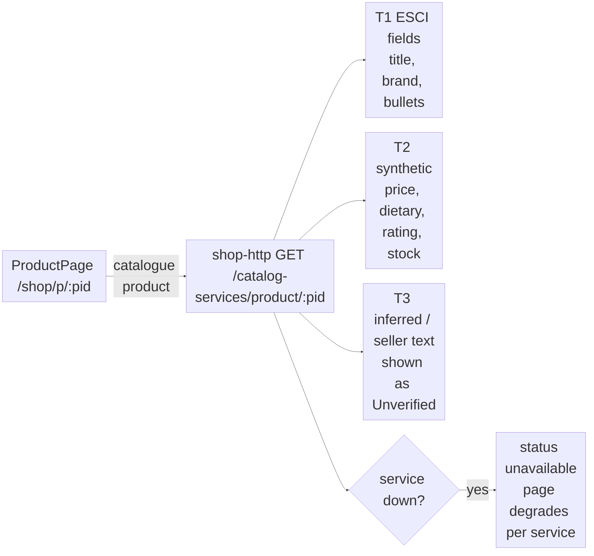

[Zoom viewer](https://mermaid.live/view#pako:eNpdUslOwzAQ_ZWRpd4SRSwHVKFyQBVC4lDRwgVzcO1JMsJ1LHvShbb_jp2GA5ziOG-ZeS9HoTuDYgpiMjmSI57CUQpucYPvKpBaW4xSDJd153hJ35hfpbi983spzufzZCJdbbudblVgeHmVDsAb_yHFInSm17xQDUIV285Xvpp6MlJ8QlnOTlJoxcp2TY_gL1gpTqBj4mZ42TJ7eJqvoBqBZcSwJY2xGvG_etlUx6wKGDUlgdUVzJePz1ATWhPv16GaMbHFAtZBOZMevbXI8S85HlzmXudDCoFJD0wfkmkBhpBVOBQQFJNrCojc6a-_CuTqrHCTDxgCGqggYrIKwLjnQS4tt3OgIry5LQZKI_7boVa95ZgyH_cFkwgPKe6MuXwcEzzkek5gsMmhseI-Qu_UVpHN3V2mzwUkRFAGI_g0ySibTEUBYoNho8jkli_N59_B4OCTGv4Bs626WQ)

**Technical details.**
- Web: `web/src/store/pages/ProductPage.tsx` (`pdp-attr`, `pdp-trust-tier`), tier legend `TIER_TEXT` in `web/src/store/ui.tsx`: T1 = published ESCI field, T2 = synthetic/derived, T3 = unverified/inferred, "never shown as fact".
- Service: attributes with `tier` and `source` built in `services/shop-mcp/src/shop_mcp/storefront.py`; quote and product endpoints in `catalog_services.py` (`GET /catalog-services/product/{pid}`, `GET /catalog-services/quote/{pid}`).

### 1.4 Cart

**User stories.** [S6](USER_STORIES.md#shopper-on-the-site) Given a product, when I add, change quantity and remove it, then the header cart count follows each step. `site-cart.spec.ts`. [S6b](USER_STORIES.md#shopper-on-the-site) the cart count carries unchanged into checkout. `site-checkout.spec.ts`

**Tech stack.** React, bff session routes, shop-http cart, catalogue inventory quote.

**Atlas nodes.** 2.3#cart


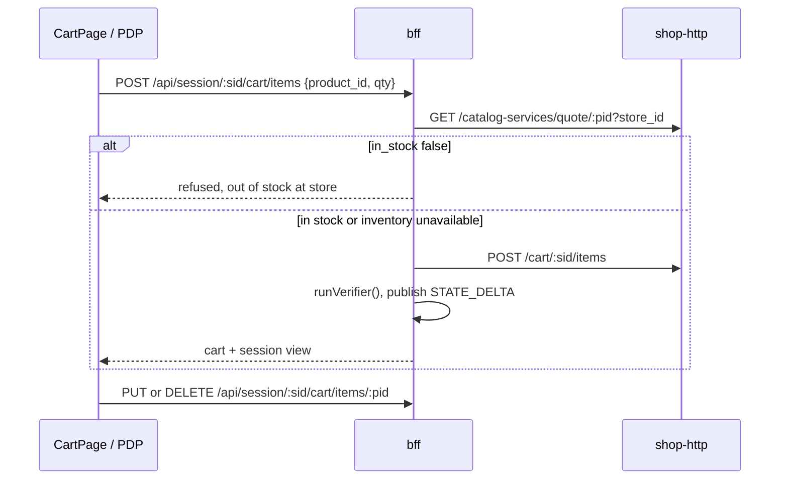

[Zoom viewer](https://mermaid.live/view#pako:eNp9Uk1r40AM_StiINCyCb70sPjQpWlML4UN2G0uhqDYciJqz0zmI2035L-vxmnpbg69aZ7eeyM9dFSNaUnloCaTI2sOORxrFXY00DM6xk1PvlYj2BkdSv5D6Vmrm5_2rVan02kyqbWnfSTd0IJx63CoNYBFF7hhizrACtDDvQBL3BJksFwsLynzRNl03SVeJtzvjJ3tQrCpu5rd3s5zWP4uK8jQcubJezY6yz23WSPajAMNHo7WmTY2Yc3tFPbh_ZTUc1GXOTwUIm4wYG-2M0_uwA35bB9NoCy33P7ywTgSZdJgH4D1WqDmBTrsPSU0eYnZKgdHXfQkn5gYwHRwJmKA0SRxSTRi8dExTuoDaem-Q9R4QO5T0J-u44Tn_cZ1xsXGnb4YkoCL-pkcd0zu6noKNm569jsoq7uqWC-Kx-ru_zGTF_yAj7jgwPQ6zqbbf2N9qtJ8Ii-q4tt8x5zUFNRAbkAp5UjOh5OuqaUOYx_kQP4CaZPLfQ)

**Technical details.** bff `POST/PUT/DELETE /api/session/:sid/cart/items[/:pid]` (`bff/src/session/routes.ts`), shop-http `/cart/{session_id}/items[/{product_id}]`. If inventory is unavailable the add proceeds, marked unverified, and checkout revalidation decides. Web: `web/src/store/pages/CartPage.tsx`.

### 1.5 Checkout mandate (no payment)

**User stories.**
- [S7](USER_STORIES.md#shopper-on-the-site) Given a cart, when I open checkout, then it revalidates, I sign a mandate and see its signature, the page says no payment is taken, and approval creates an order. `site-checkout.spec.ts`
- [S8](USER_STORIES.md#shopper-on-the-site) Given an item that goes out of stock before checkout, then revalidation blocks signing and offers a substitute. `site-checkout.spec.ts`
- [H1](USER_STORIES.md#store-associate-handoff) Given an approved mandate, then order history shows lines, store, total and "no payment taken". `site-checkout.spec.ts`

**Coverage.** #27, #36

**Tech stack.** React, bff, shop-http commerce (mandates in `commerce.db`), policy-mcp T2 tier for the agent path.

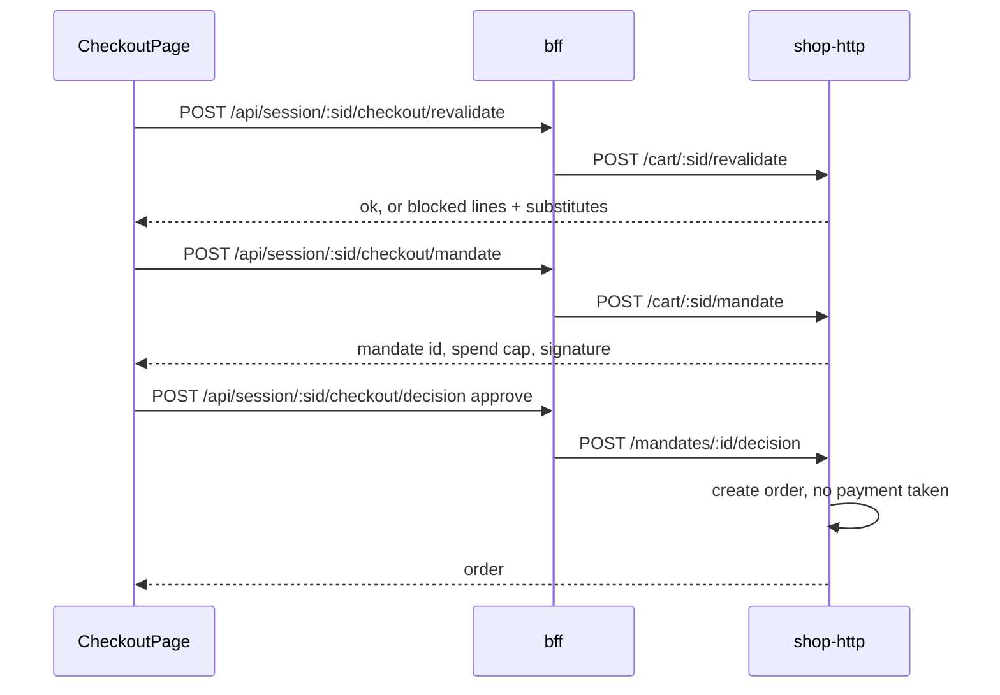

[Zoom viewer](https://mermaid.live/view#pako:eNqVkj9PwzAQxb_KyVInUmVhQBk6FHYqBdEly8W-NKcmtrEvFVD1u2P3j0TLAGz28-_8nu5ur7QzpCpQs9meLUsF-0ZJTyO9YmBsB4qNOoqds1LzJ-Vro-4f_HujDofDbNbYSG8TWU1PjJuAY2MBPAZhzR6twBowwmNPeusmWeGGboFlBtquu9XrrMfe-Xkv4vPrer5YLCtYPdcvUKLnMlKM7GxZRTalPnuUgXY4sEE5Wi1TUX0p0un_E30N1fNErStw2wJcgHZweksGBrYU4Q7i1EZhmST14-85RrS_hPhGXBKcJWBTQPRkDWj06cgbizIF-oe_Ic1ZBvQ-uN3PIGevWFap7EKfwhwpHShHccFQKMC6NJ6PkdJoBLdkr_qWEVWAGimMyCYvzWmR8nYZ6nAaJC3MF9F80kU)

**Technical details.** bff `POST /api/session/:sid/checkout/{revalidate,mandate,decision}`, `GET /api/mandates/:id`, `POST /api/mandates/:id/:decision`. shop-http `/cart/{sid}/revalidate`, `/cart/{sid}/mandate`, `/mandates/{id}/{approve,reject,decision}`, `/sessions/{sid}/orders`. Agent path: MCP tool `create_checkout_mandate` is T2 in `services/policy-mcp/src/policy_mcp/policy.py`; `approve_mandate` is intentionally **not** exposed as an MCP tool (`shop_mcp/server.py`). Web: `web/src/store/pages/CheckoutPage.tsx`.

### 1.6 Orders, stores, lists

**User stories.**
- [S9](USER_STORIES.md#shopper-on-the-site) Given the store picker, when I choose another store, then the header shows it and stock and pickup are computed for it. `site-store.spec.ts`
- [S10](USER_STORIES.md#shopper-on-the-site) Given a product saved to a list, when I reload later, then the list and cart are still there. `site-lists.spec.ts`
- Orders: [H1](USER_STORIES.md#store-associate-handoff) `site-checkout.spec.ts`.

**Tech stack.** React, bff session routes, shop-http SQLite persistence.

**Atlas nodes.** 1.1#lists, 1.6#orders, 1.6#stores, 1.6#lists


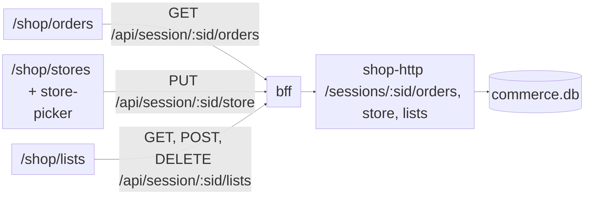

[Zoom viewer](https://mermaid.live/view#pako:eNptkUFrwzAMhf-KEAQ2liyXHUYOOy30UlhZu12qHpxYIWZJHGyPjaX577OTttmgF4sn9D5LvAFLLRkzwCgaVKdcBgOhq7nld2GUKBq2hFOz0p3bqh8OkvDhsf8mHMcxiqirGv1V1sI4WL9SB6CNZGP3hKmtdZ_OkvAASfJ0JFzlO0hFr1LL1irdpZlV8jJ1hKKqvNe_3hJw1mnDC26WcDf3k16VH2wW-ubtGn2aPcEDs1HWLchJ_Vswhs3L1r_P-Trf5VeAJ8sF6EtwQ-B5bihJ7VwPZ5v9e2Y8Lx_D-efpTu-ZGLLY35BPpm3ZlHwvC8LbA8aAXrdCyRDIHFJITnIlPhvnw_gFCbSbFQ)

**Technical details.** Pages `OrdersPage`, `StoresPage`, `ListsPage` in `web/src/store/pages/MiscPages.tsx`. shop-http: `GET /stores`, `GET/PUT /sessions/{sid}/store`, `GET/POST /sessions/{sid}/orders`, `GET/POST /sessions/{sid}/lists`, `POST/DELETE /sessions/{sid}/lists/{name}/items/{pid}`, `DELETE /sessions/{sid}/lists/{name}`. Default store `4108` (`catalog_services.DEFAULT_STORE`).

### 1.7 Help answers (EN / ES)

**User stories.**
- [S11](USER_STORIES.md#shopper-on-the-site) Given the search box, when I type "what is your return policy", then I get a cited answer from the help corpus, not product cards. `site-help.spec.ts`
- [ES1](USER_STORIES.md#spanish-speaking-shopper) Given "¿cómo devuelvo un producto?", then the help intent routes it and the answer is in Spanish with citations. `spanish.spec.ts`

**Tech stack.** shop-http storefront intent routing, `data/help_corpus.json` (written for the demo, not any real retailer's policy), search-svc `/route/intent`.

**Atlas nodes.** 1.7#help, 1.7#page


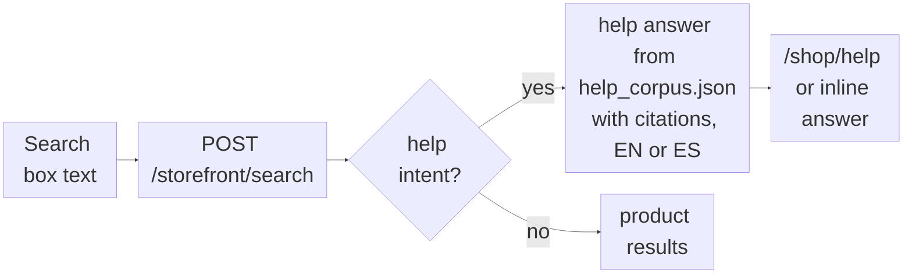

[Zoom viewer](https://mermaid.live/view#pako:eNpVkcFOxCAQhl9lQtLbrr14MBuznvZm1FjjZTGGpcOCaQFhmla7fXeB7cUTmeHjmz_DzKRrke2AVdVsrKEdzJyRxh7fRTDi1GHkrDSVs9SYX8wlZ7d3fuJsWZaq4lZ1bpRaBILHV24Bvo-cNSiC1HByExBOxNkHbLd7iCrdvTw3b1BHcgFVSNo6Fjgx-XVUhTSW0FIarLHza_WQRmbkWmXswtlPjniBjB1XWtg4YoAk70v_U7rgh3jzFZ29P4V6PxrSIA0JMs7GDRyewAU4NGuEf37rst4H1yZ9PgZJEDAOHcWVL0NzaC_OmKg6aufr0k1aYztjcQ2VXrANsB5DL0ybV3tdd_6DFpVI1rTWP6-FiwY)

**Technical details.** `services/shop-mcp/src/shop_mcp/storefront.py` (help answers), shop-http `GET /help/answer`; search results carry `kind: "help"`; bff logs "Shopper asked the help centre". Page `HelpPage` in `MiscPages.tsx`.

---

## 2. Shared session, views and constraints

### 2.1 View toggle and split-view sync

**User stories.**
- [C1](USER_STORIES.md#shopper-in-chat) Given any store page, when I press Alt+2 or pick Chat, then the assistant fills the view and `?view=chat` is in the URL. `layout-toggle.spec.ts`
- [X1 / X2](USER_STORIES.md#shopper-in-split-view) Given split view, when the chat finds and adds a product, then the site navigates to the agent's query, marks picks "Found by Compass" and the cart count updates. `sync-agent-to-site.spec.ts` @agent
- [X3](USER_STORIES.md#shopper-in-split-view) Given an item the agent added, when I remove it on the site, then the agent's next turn is told and re-plans. `sync-site-to-agent.spec.ts` @agent
- [X5](USER_STORIES.md#shopper-in-split-view) Given split view, when I drag or arrow-key the divider, then panes resize; at 390px they stack with tabs. `layout-toggle.spec.ts`
- [A2](USER_STORIES.md#shopper-using-a-screen-reader) Cart changes from the other channel are announced in a polite live region. `a11y.spec.ts`

**Tech stack.** React Router search params, Tailwind responsive layout, EventSource, bff session store.

**Atlas nodes.** 0.1#agui


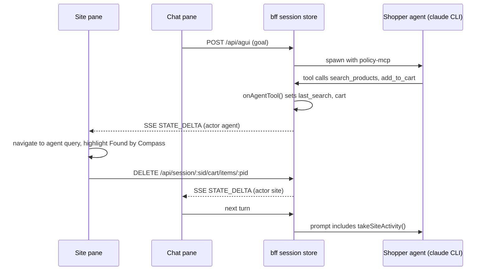

[Zoom viewer](https://mermaid.live/view#pako:eNp1kkFr3DAQhf_KYFjwwgZfcig-BHYTFwqBFmx6MphZSWsPkSVFGidxl_3vlew0Ldv2YIRH3xs9Pc05E1aqrIRsszmTIS7h3GY8qFF9R0941Cq02VI8WcM1_VDpt81uP7m3NrtcLptNa4J6npQR6oGw9zi2BsChZxLk0DDUxAowrGusqGvgfkBOwLL-Czik3ePpBEGFQNZAYOv_ova9MkuferDOKQ-4FHKhcZIK7h-_bJMknXJzd3co4dvXuoECHRXYTwR5b1EvyCHuL91KCA5fDbwSD-CsJjHfjMIlZtlf-7C1GgRqHaJB9GLonLdyEhx2gFJ2bDsRff7qHBXWLPImCvNtFHEAjYG7Vb6D33jkU24l1HUFdbNvqu6hemz2kKOIIax3XEwn7IM2-EI9xrzZvscQn8jPOxioH3T8GD7byUg4zlDHEJ_mP1pEg_GMqqnWcN5DL8pAskjOioiNoSgdyQ-TKdX_mgxRcJW9UW8MPHlzlXdMbnQMZISOjxaA8UklW3vB9EI859tsB9mo_Igk02Su05pGWKoTTprjVP4ElzX1cw)

**Technical details.**
- Toggle: `web/src/store/StoreLayout.tsx` (`?view=site|chat|split`, Alt+1/2/3 on `e.code`, divider keyboard resize).
- Agent-to-site: `onAgentTool()` in `bff/src/session/sessionStore.ts`. Site-to-agent: `takeSiteActivity()` drains site activity into the next prompt.
- Highlight test id `highlight-found-by-sparky`.

### 2.2 Shared session and SSE

**User stories.** Underpins X1–X4 and A2 (`sync-*.spec.ts`, `a11y.spec.ts`). [SS1](USER_STORIES.md#shopper-in-split-view) an agent-side change reaches the site pane over SSE without a reload. `sync-agent-to-site.spec.ts`. [SS2](USER_STORIES.md#shopper-in-split-view) a site-side change reaches the chat pane the same way. `sync-site-to-agent.spec.ts`

**Tech stack.** Fastify raw SSE, browser `EventSource`, JSON snapshot / delta.

**Atlas nodes.** 0.1#sess, 2.2#hydrate, 2.2#events


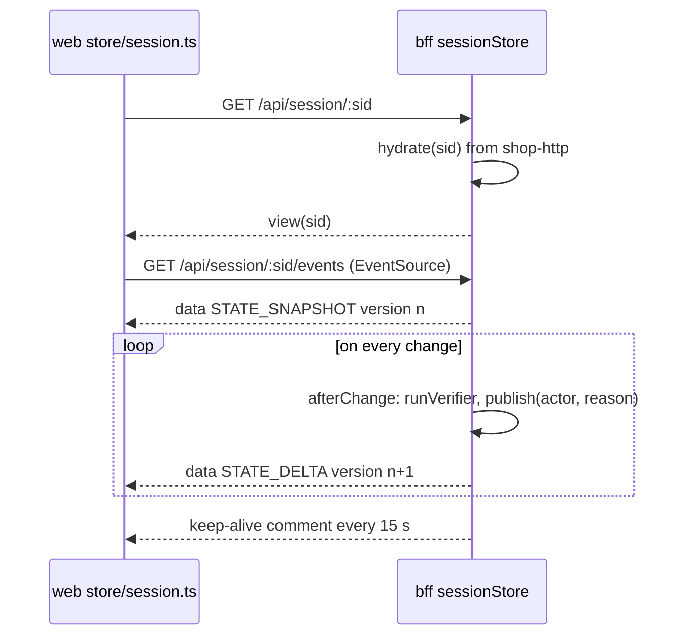

[Zoom viewer](https://mermaid.live/view#pako:eNqFkk1Lw0AQhv_KsBBosTUUFCSHQmuDHkSFBHsJyDSZNIPJ7rq7aa2l_91sP7TowdMyM8--87kVuSpIRCCCYMuSXQTbTLiKGnpBw7ioyWZi7yyVdAl_kjczcXWjPzKx2-2CIJOW3luSOc0YlwabTAJoNI5z1igdzAEtrGkB1ilDoSVrWclLZ3-DUw8uyhKOSOJ5D82H4_E0grs4hRA1nyTCyHLh49NDvNoUBh31Om8fSqMasJXSw8o5faA6bB7Bimm9Z_6TDmlF0lnoxf5NVGty6p8rFegQknSSxq_J4-Q5uX9KYUXGC4D0YK2Uhs7ohMwG8grlct_Qd8lYOjK3e38EppUvZLhkMgPQ7aJmW_Uw76YwAENoleyfPv_JP4sf0slP8ouRJ0kW5-W-Eekh1rwiyFXTdD0dCxtdgxUDEA2ZBrnwCz8cgb-Mgkpsa9ct-wubObiK)

**Technical details.**
- `bff/src/session/sessionStore.ts`: `SiteSession` holds `store_id`, `query`, `filters`, `sort`, `last_search`, `activity[]`, constraint `meta`, `could_not[]`, `verifier {checked_at, verdict}`; `SessionEvent.type` is `STATE_SNAPSHOT` or `STATE_DELTA` with a `version`.
- `bff/src/session/routes.ts`: `GET /api/session/:sid/events` (`text/event-stream`, 15 s keep-alive).
- Web client: `web/src/store/session.ts` (`new EventSource(...)`).

### 2.3 Constraint chips and the session verifier (B09)

**User stories.**
- [C2](USER_STORIES.md#shopper-in-chat) Given chat, when I say "nut-free snacks for school", then a removable nut-free chip appears whose explanation quotes me and says it is a title-keyword check. `chat-constraints.spec.ts` @agent
- [X4](USER_STORIES.md#shopper-in-split-view) Given a chat constraint, when I browse the site, then results are filtered with a removable chip; removing it restores results. `sync-site-to-agent.spec.ts`
- [ES2](USER_STORIES.md#spanish-speaking-shopper) "sin gluten" applies the gluten-free filter. `spanish.spec.ts`

**Tech stack.** bff TypeScript rules (no LLM for the check), shop-http catalogue services for facts.

**Atlas nodes.** 2.3#msg, 2.3#detect, 2.3#merge, 2.3#chips, 2.3#facts, 2.3#verify, 2.3#verdict


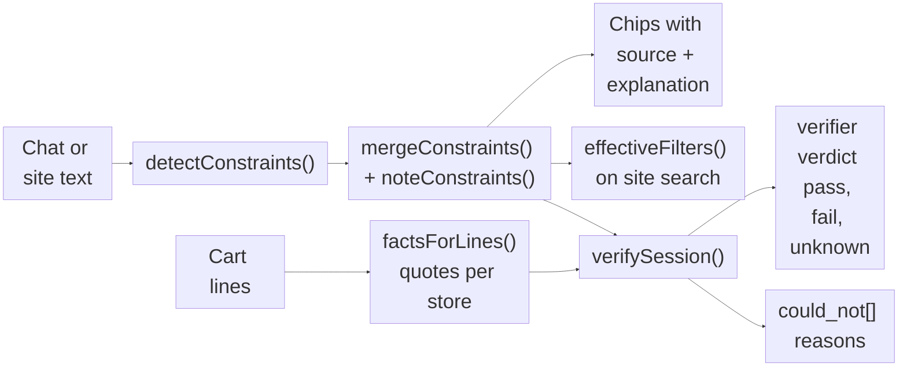

[Zoom viewer](https://mermaid.live/view#pako:eNptUsFuwjAM_RUrUiXQQLvsMKGJCxInTkPahaIppC61liZd4gIb4t_npCBtGpfYsd-L7ReflfEVqhmoojiTI57BuVTcYItvOpDeWYylysHaO17TN6ZrqZ6eu1OpLpdLUZSutv5oGh0YVq-lA2jjflOqRaMZfIBIjMB44lJtYTqdQ4WMhgUxOAvvIgdNjuNoLJj0wpDJ6BbDHgWc7R8sPIDzjPf4GZzppqEu5m7EwpG4gej7YFDYeOqsdprJu388rGthySl90AGXZBlDKurdMFFEHUxz5RkZPhVJGlhySbRh1lobTuWzXfqwSsnR-GUXHuefvXQfoUPRiH3A61sZmskHDFR_CXtw1hijtHpnyCGfYoN3C1aUdc5BkjLXEHQ6xokUIjuB3n04f7wJ8ItvfG8rYWf7LkpvthBQR5FbwGoC6UtaTVXaj2Fn0iJVWOvesuzGD5hqz0Y)

**Technical details.** `bff/src/session/constraints.ts` (`detectConstraints`, `mergeConstraints`, `appliesAs`, `effectiveFilters`); `bff/src/session/verifier.ts` (`verifySession` checks budget, dietary tags, nut terms in titles, per-store stock, SNAP eligibility on synthetic rules); endpoints `POST/DELETE /api/session/:sid/constraints[/:key]`. Unit test `bff/src/session/verifier.test.ts`.

### 2.4 What I could not do

**User stories.** [C3](USER_STORIES.md#shopper-in-chat) Given a nut-free constraint and a cart, when the turn ends, then "What I could not do" says nut-free cannot be verified because the catalogue has no allergen data. `chat-constraints.spec.ts` @agent. [C3B](USER_STORIES.md#shopper-in-chat) the session's own `could_not` list records the same reason; walkthrough test "3 could-not-do" in `walkthrough.spec.ts`.

**Tech stack.** bff verifier, session SSE, React chat panel.

**Atlas nodes.** 2.3#could


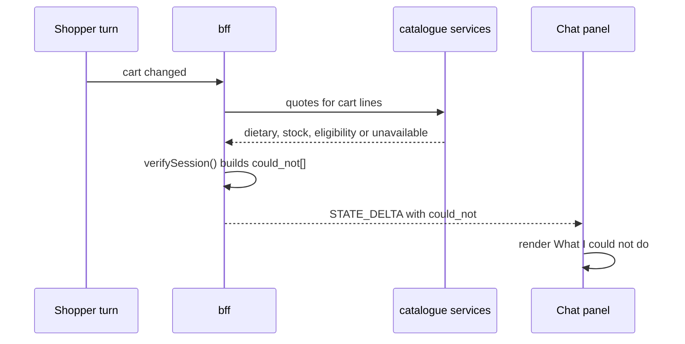

[Zoom viewer](https://mermaid.live/view#pako:eNpdkUFrwzAMhf-KMBQ2aG87jBwKbdZDYLe022EZxYmVRMyxU1vu1pX-99nNxqAXg9_7JFt6Z9FYhSIDMZudyRBncK4E9zjgi3Qka42-ElextYZL-sZ0rcTD4_hVicvlMptVxuMhoGnwiWTn5FAZgFE6poZGaRhWHcZTeih7O47ogIMzt9A6AXXb3up5mYxGstS2Cwge3ZGa-KsbblckLu8lR9mgTv714cVyuc5iA8fQ9NJ0qJK1jnJeZnAIltFDa92EaDJT77xcTJWKkKU7zcGzbT7mgJo6qkkTnyBWBSOPknTa1F_fWHRER-2pRO_Jmrt7qANpFcewQau9sfz2PsGR3hUZlNvVdrN_2jxvV_BJ3P-DCdsVv5hDo-L6XtOQxcRAZEBZMQcxoBskqZTWlGCKVWErg-aY1A--46cs)

**Technical details.** Reasons are fixed strings in `bff/src/session/verifier.ts`, for example "Cannot verify nut-free: the catalogue carries no allergen data, so only product titles were checked. Read the package label." and "Inventory service unavailable: stock could not be checked." A service outage yields an explicit reason, never a guessed pass.

---

## 3. Catalogue services and triage

### 3.1 Catalogue services and fault injection (B15)

**User stories.** [S12](USER_STORIES.md#shopper-on-the-site) `site-pdp.spec.ts`; [AI10](USER_STORIES.md#wave-0b-sparky-chat-and-ai-capabilities) restock via inventory service `ai-watches.spec.ts`; walkthrough "8 simulated feed failure" `walkthrough.spec.ts`.

**Tech stack.** Python shop-http, SQLite `commerce.db` (`cs_faults`), deterministic synthetic derivation.

**Atlas nodes.** 1.3#cs, 1.3#faults, 1.3#deg, 3.1#cs, 3.1#db, 3.1#q, 3.1#svc, 3.1#un, 3.1#val


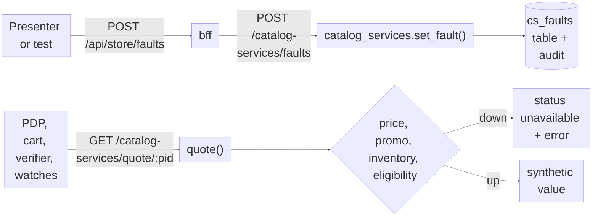

[Zoom viewer](https://mermaid.live/view#pako:eNptUk1rwzAM_SvCUGhZulx2GD3stLHLYGUduzSlOI7SChI7tZV0Xdv_PjnNvmAXY0t6T09PPirjClQzUKPRkSzxDI6Z4i3W-KY96bzCkKk-WDrLC_rA-MzUzW3znqnz-TwaZbas3N5stWd4esksQEvLTM09BrSMHpwHxsCZWsF0eneS1PPiFVLdUBrYeUxL3VYsfU6Ql6VA5ZTiyCS3PxijWVduMw3oOzIYfkFNEOSQX3_lrwPyuq8ZTwZKEyIjFPlyLPXhkg3AcVa4At0WJFInfW1TNHGS-3kCRsZLoENPJaFPYK_ZbKM5X0M9Pvynb9c6xnTWUBE17oStj3yr2fViQmfE4cYLJIHGu9olQLYT-5w_JIAVbSinivggnkeYAIa2hdvbSN1a4Q6suQ1y152mapgIvXd-aPeDa5uI6nQVYQcrK2cy8d3KhlcqAVWjrzUVcfuXHxG_SYG9X7L5T6DnwXA)

**Technical details.** `services/shop-mcp/src/shop_mcp/catalog_services.py`: `SERVICES = ("price", "promo", "inventory", "eligibility")`, `set_fault(service, down, seconds)`, `faults()`. shop-http `GET/POST /catalog-services/faults`, `POST /catalog-services/inventory`, `POST /catalog-services/price`, `POST /catalog-services/quotes`. bff `POST /api/store/faults`, `POST /api/store/inventory`.

### 3.2 Operator triage (`/triage`)

**User stories.** [O1](USER_STORIES.md#operator-triage) Given a zero-result search, when I open `/triage`, then the record shows query, filters, store and relaxation, and I can acknowledge and resolve it. `triage.spec.ts`. [O1B](USER_STORIES.md#operator-triage) the record is filed before any operator looks. `walkthrough.spec.ts`

**Tech stack.** React, bff proxy, shop-http SQLite queue.

**Atlas nodes.** 0.1#tri


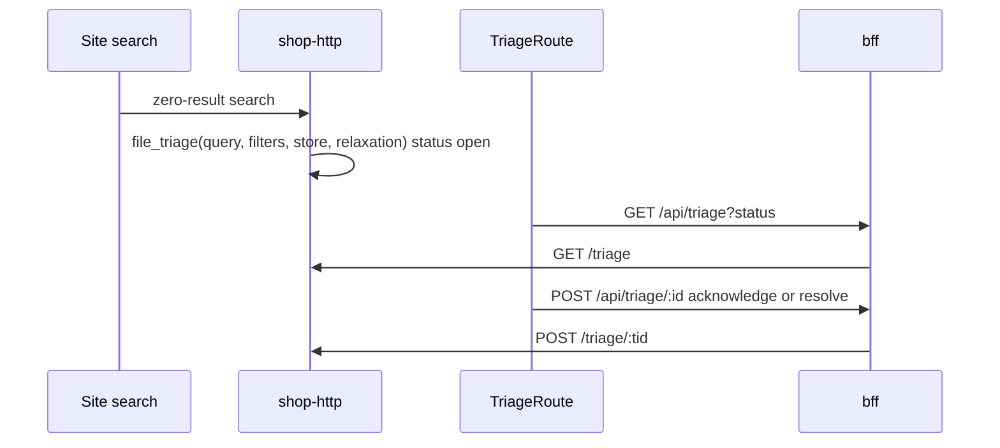

[Zoom viewer](https://mermaid.live/view#pako:eNplUc9LwzAU_lcegYJCxy4epIcJQ_FYscNTQd7a1_Vhm8TkVedG_3eTRWHOW_L9TPiOqjEtqQJUlh1ZsxRwrJX0NNILOsbtQL5WJ7AzWio-ULzW6ubW7ms1z3OW1drT-0S6oXvGncOx1gAWnXDDFrVA1RtryQF6qFgIPKFr-n-qyPsgXfQi9pItbaQ34Uk7ejaT0KVgHflt10X8p3CxWlUFHMiZhSM_DXLWXCWy44Fe5ZR6Ff7gvvIICTmfgxfjKAdHA-5R2OjrAKFMHowlHUNKG1LWBTw-bGCJlpcp6S7JomKdak6CRJ77nsrqj3FZcAvYvGnzOVC7IzAu1HszfNBZWHL9OoRblYMayY0YjmGqNF_ctKUOw7fDTN_p2Kai)

**Technical details.** `web/src/triage/TriageRoute.tsx`, `services/shop-mcp/src/shop_mcp/storefront.py` `file_triage`, shop-http `GET /triage`, `POST /triage/{tid}`, bff `GET /api/triage`, `POST /api/triage/:id` (client in `web/src/store/session.ts`).

---

## 4. Compass chat AI capabilities

Chat UI: `web/src/chat/CompassChat.tsx`, `cards.tsx`, `panels.tsx`, `runs.ts`. Assist routes: `bff/src/assist/routes.ts`, pure logic `bff/src/assist/logic.ts` (unit tests `logic.test.ts`), persisted state `data/assist_state.json` (`bff/src/assist/store.ts`). Agent turns go through `POST /api/agui` (AG-UI SSE) and the Planner → Shopper → Critic roles in `bff/src/agents/roles.ts`.

### 4.1 AI1 How Compass worked (timeline)

**User stories.** [AI1](USER_STORIES.md#wave-0b-sparky-chat-and-ai-capabilities) Given a chat turn, when it finishes, then "How Compass worked" shows plan steps from AG-UI STEP events, each tool call with args and result, the Critic verdict, latency, turn cost, and a link to `/ops/replay/<runId>`. `ai-timeline.spec.ts`. [AI1D](USER_STORIES.md#wave-0b-sparky-chat-and-ai-capabilities) each tool call names the tool. `ai-timeline.spec.ts`

**Tech stack.** AG-UI events, CopilotKit, claude CLI stream-json, OTel spans, cost ledger (`bff/src/metrics.ts`).

**Atlas nodes.** 0.1#roles, 4.1#Planner, 4.1#Shopper, 4.1#Critic, 5.1#Roles


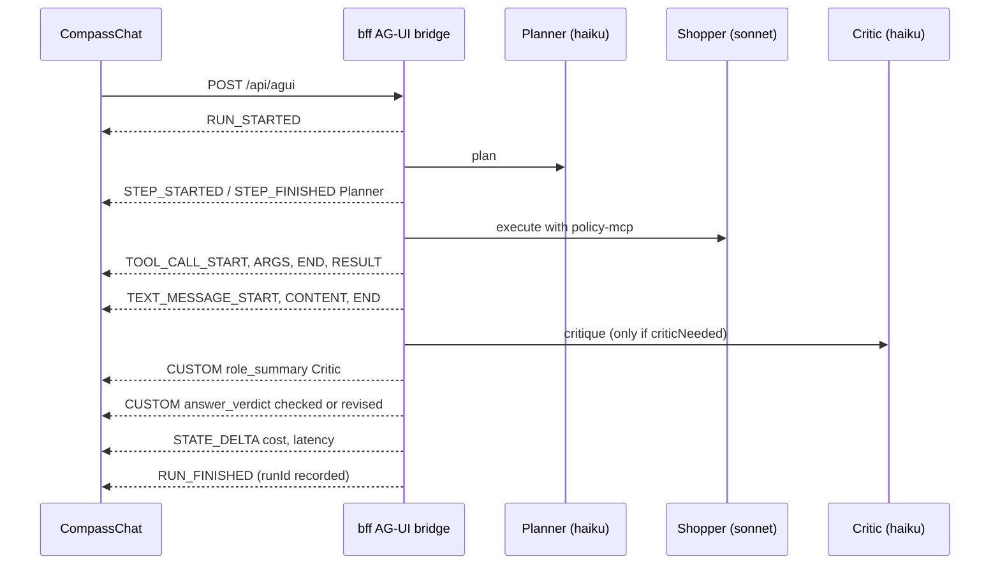

[Zoom viewer](https://mermaid.live/view#pako:eNptkkGPmzAQhf_KCClSViLKZQ8Vh0iEsCkSCyg2VQ9IyDFDsAKGGrO7aZT_XhM2VZPtcd5882yP39nibYGWA9ZsdhZSaAfOmaUrbPAHU4Lta-wz6yqWrdRE_MaxzKznb91HZl0ul9kskz3-GlBy3Ah2UKzJJEDHlBZcdExqSANgPRAjHU9exfRjfz2292UJ7nZh2L0SxQEfoWSEkppJiQrmFRPH4emRIdX1oKrtuhHqWwPrL5Q3Qp4SRvjXKA0Wq9XagSQmFJasE0t2GMTYWS9MJw0c2KVRTqi7o_5m0lerxIHOXOoOI9RPbhwsp_IliALy3dSfT7jNk8oB_EA-aIR3oSvo2lrw06Lh3Z0njeMw99wwnIxtcHdbYoMfbWzY-SQN6T3u_6T5q0-Iu_VvE14cUT-i16Hb8Z4DfNyE-T-Yt7I-gSgnhUeIBRZPd7ZeSmj8CqqtMe-HpmHq9LnJ_2FM9u-o8jdUheAaeIX8iAW0ChS-iR6Lh6251M83fkhd4G2vbaiZNqk6ffmCv7ucq0EGhXHjrRrvatlgNagaJooxs1OOx3AXWLKh1iavfwD2M_AC)

**Technical details.** Event types emitted in `bff/src/agui/bridge.ts`: `RUN_STARTED`, `STATE_SNAPSHOT`, `STATE_DELTA`, `STEP_STARTED`, `STEP_FINISHED`, `TOOL_CALL_START/ARGS/END/RESULT`, `TEXT_MESSAGE_START/CONTENT/END`, `CUSTOM` (`a2ui`, `role_stream`, `role_summary`, `answer_verdict`, `answer_revised`, `budget`; see §8.2), `RUN_FINISHED`, `RUN_ERROR`. The shopper answer streams as it is written and is not held for the Critic; the Critic verdict arrives afterwards as an `answer_verdict` badge on the answer and a `role_summary` line in "How Compass worked" (`critic-verdict`), not as text in the chat answer. Runs recorded by `recording()` in `bff/src/replay/eventLog.ts`. Test ids `run-cost`.

### 4.2 AI2 Photo to products

**User stories.** [AI2](USER_STORIES.md#wave-0b-sparky-chat-and-ai-capabilities) Given a photo, when I attach it, then Claude extracts items and attributes, search-svc matches each by text, and the card says matching is text-based because ESCI has no images. `ai-photo.spec.ts`. [AI2B](USER_STORIES.md#wave-0b-sparky-chat-and-ai-capabilities) the cost note says "synthetic commerce data". `ai-photo.spec.ts`

**Coverage.** #9

**Tech stack.** Browser upload, bff, claude CLI with the `Read` tool only, search-svc.

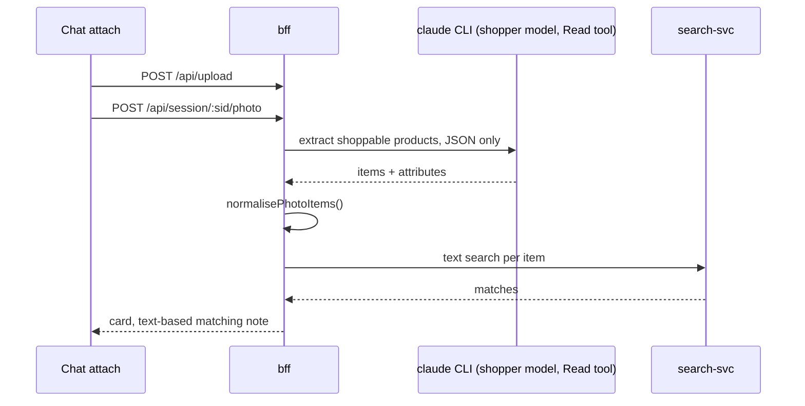

[Zoom viewer](https://mermaid.live/view#pako:eNptUrtuAjEQ_JWVpZNA4USTIrqCAtJchAKCkOqaPXvhLPlsx96LSBD_HptHg1J6ZnZmHz4J6RSJCkRRnLTVXMGpEdxRT58YNLaGYiMu4N5Z3upfys9GPL_4YyPO53NRNDbS10BW0qvGQ8C-sQAeA2upPVqGXQ0YYdEhAzKj7B4F88y3-_0jvsy4NDgogsWyhlHsnPcUoE9NmwlsCBWwc2b8WLnJlZEwyK6M3zLTu7qczeYVrFfbD5ii19PBG4fqfy5SjNrZaRW1mvrOscu6eZItK6AjB5QMl3byjsAHpwbJcQJv29U7OGt-sn5ZXn01Ux_hKY8fdDtwWurNLZHWhR6NjrTOMXWWjsZ3flMBp7jbLJCHz2aZ3tzMe2TZ3R0TtKsrkBjU5FJZthhJXUXaHlIak5iA6CmlapVve713_gSK9jgYTnf9A5nIs3w)

**Technical details.** `POST /api/session/:sid/photo` in `bff/src/assist/routes.ts` (`jsonCall` with system prompt "You extract shoppable products from a photo…", `model: config.models.shopper`, `tools: "Read"`); uploads in `data/uploads`. With `?stream=1` the route answers as SSE (`delta | item | done | error`): each item is matched as soon as its JSON object is complete (`lib/partialJson.ts`).

### 4.3 AI3 Voice in and out, EN/ES

**User stories.** [AI3](USER_STORIES.md#wave-0b-sparky-chat-and-ai-capabilities) Without the Web Speech API the mic says "not supported"; the transcript stays editable; no audio is stored. [AI3b](USER_STORIES.md#wave-0b-sparky-chat-and-ai-capabilities) Spanish input gets a Spanish reply. `ai-voice.spec.ts`

**Tech stack.** Browser Web Speech API (`SpeechRecognition`, `speechSynthesis`), bff language detection.

**Atlas nodes.** 4.3#mic, 4.3#sr, 4.3#tr, 4.3#lang, 4.3#reply


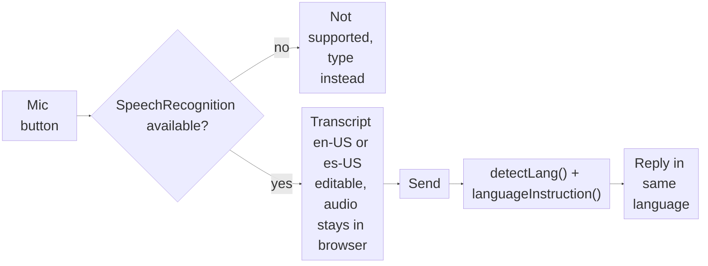

[Zoom viewer](https://mermaid.live/view#pako:eNpVUU1LAzEQ_StDYKHFFi8epEg9F6qHrnoxHrLJtA3sJmEya13b_ncn2yp4ms_33gzvqGx0qBagqurog-cFHLXiPXb4ZsibpsWs1djcxsC1_8ZSanV3n760Op_PVaXDto0HuzfEsN7oANB5-67Vk7fQ9MwxaPUB8_kSMglPnRDtfoM27kTPxwDm0_i2SD0KY8FnKusnrULU6gQhC9tzZMh9SpEY3Qx4SAg-ZEbjhP4faig3n4BJYC9kQrbkEwOG-WsNkQCzJA8N3S7ReS7CMzC98xEymyELLTQUDxnpysx0OR-DE8pawq-kpOOoNWEnI4eMltdSTKZwM3Z7s8OV3Em9Lc9OpldomY1QwtQOgt2UWLSz6fAPKttqBqpD6ox3xYmLO8Uyh1vTtywu_ABanZmy)

**Technical details.** `web/src/chat/CompassChat.tsx` (`SR` detection, `lang` `en-US` / `es-US`); `detectLang`, `languageInstruction` in `bff/src/assist/logic.ts`.

### 4.4 AI4 Grounded claims (citations)

**User stories.** [AI4](USER_STORIES.md#wave-0b-sparky-chat-and-ai-capabilities) Claim chips show the PDP attribute with trust tier and link to it; T3-only claims read "Possibly … (unverified)". `ai-citations.spec.ts`. [AI4B](USER_STORIES.md#wave-0b-sparky-chat-and-ai-capabilities) the citation link matches the cited product's PDP anchor. `ai-citations.spec.ts`

**Tech stack.** bff assist logic, PDP attribute tiers from shop-http.

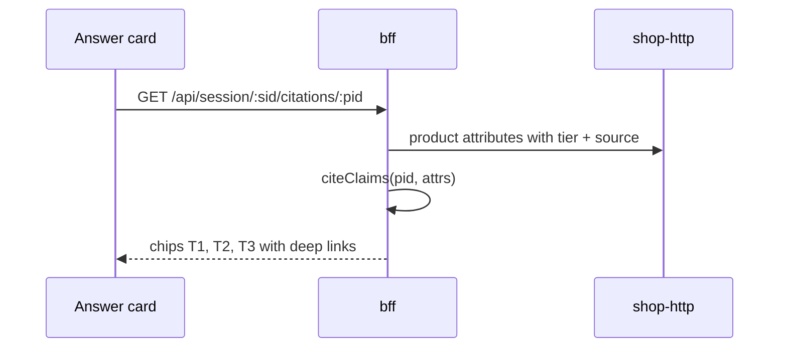

[Zoom viewer](https://mermaid.live/view#pako:eNpdkD9rw0AMxb-KODC01MH0z1A8BOq2lMxJOnlR7uRY1D5fTzIpNfnuPcd0yaBBTz89iTcZOzgyJZgsm9izljDVRlvq6RMj46Ejqc1FbAavW_6lua3N03P4qc35fM6y2gt9j-QtvTEeI_a1BwgYlS0H9Ar7DaDAi5cTRbAY3TVQzfND01zr21mXdgirVjXM0_1mtV5XJXy876DAwIWQCA--KIVdYVlRUydFGfhypUr4toQQBzdaBVSNfBiVBE6sLSinj-5AhjFa-ueTfTKi1w65l5tklF_25HYBErHfJKTlILC7z2H3kOpxMXREATr2X2JyMD3FHtnN-S2ZzkE7anDsNGX3B8W-f64)

**Technical details.** `citeClaims()` in `bff/src/assist/logic.ts` (names `dietary`, `price`, `stock_qty`, `rating`, `snap_eligible`, `may_contain_nuts`, `bullets`); route `GET /api/session/:sid/citations/:pid`.

### 4.5 AI5 Compare mode

**User stories.** [AI5](USER_STORIES.md#wave-0b-sparky-chat-and-ai-capabilities) Given a search, when I type `/compare`, then an A2UI table shows price, size, unit price, dietary, rating and stock with a recommendation and reason. `ai-compare.spec.ts`. [AI5B](USER_STORIES.md#wave-0b-sparky-chat-and-ai-capabilities) every row carries a unit price label. `ai-compare.spec.ts`

**Tech stack.** A2UI renderer, bff deterministic comparison, catalogue services.

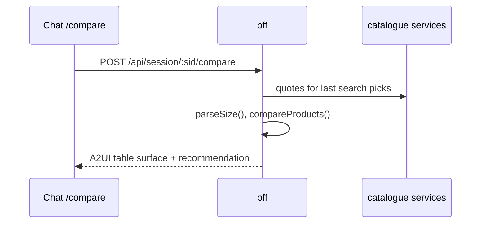

[Zoom viewer](https://mermaid.live/view#pako:eNpdkMFqwzAMhl9FGAItawmMHUYOhaW75LRC1p1yUR2lFUvs1FLGWMm7z143GD1a-vRb-i7G-pZMASbLLuxYC7g0Rk800BsGxkNP0pifYued1vxF6dmYh8fxszHzPGdZ44TOEzlLz4zHgEPjAEYMypZHdAr7ClBge0KF3PohtugWKRNx6Lrb-rZODYuKvT9OBELhg23cKXL7ar3ZlAXsXupXyHHkXEiEvcsL4fb_T2UEt3UB58krCXQ-QI-iMQ2DPcHI9l3-uBgYx4TSqYvlCn5jdsG3k1VZLK9gJPdVAU_38ThNmkCm0KEluINAcWgg16LGbcwKzEBhQG6TyKvcZLylDqdeo8RvkLKD4g)

**Technical details.** `compareProducts`, `parseSize` in `bff/src/assist/logic.ts`; `POST /api/session/:sid/compare`; renderer `web/src/a2ui/Renderer.tsx`. MCP tool `compare_products` also exists for the agent path.

### 4.6 AI6 Editable mission plan

**User stories.** [AI6](USER_STORIES.md#wave-0b-sparky-chat-and-ai-capabilities) Given `/plan pasta night for 4`, I can change quantities, swap or remove lines before anything reaches the cart, and the B09 verifier re-runs on every edit. `ai-planner.spec.ts`. [AI6B](USER_STORIES.md#wave-0b-sparky-chat-and-ai-capabilities) removing a line re-verifies the plan. `ai-planner.spec.ts`

**Tech stack.** MCP `plan_meal`, bff plan store, session verifier.

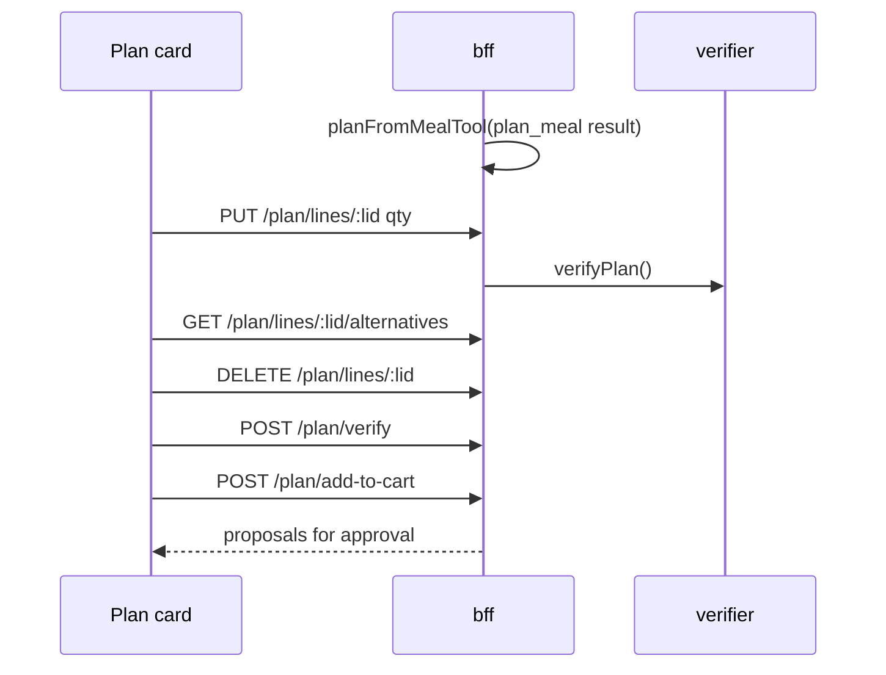

[Zoom viewer](https://mermaid.live/view#pako:eNp1UcFqwzAM_RVhCHSwkMsOI4ceQrNR2FihTU6BocbKJnDs1HbLupJ_n71QWFt21HtP0pPeSbRGkshBJMmJNfscTo3wn9RTjZZxq8g14hfsjPZr_qZYNuLhcfhqxDiOSdJoR7s96ZYWjB8W-0YDDGg9tzyg9lAtAR2sFGpo0cpruojstuuu8TriB7LcMdlIFul8XuQwhEFP1vSvhGpjjJpF4L0PFVhye-XvorhaTupVtYEsKjLFmlyWK5aw88fzwDqfdhyjv9lF63N525qh8mQ1ej6Ez_wRL8qXclPe6C-svK3PA6eV_5AoZepNGn7lJ5dBUS3D4dYMxqFy0BkLOIT6gErcg-jJ9sgyBjWFFxOV1GH4RgjpBzVwoM8)

**Technical details.** `planFromMealTool`, `editPlan` (`qty`, `remove`, `swap`) in `logic.ts`; `verifyPlan` in `sessionStore.ts`; routes under `/api/session/:sid/plan/...`.

### 4.7 AI7 HITL approvals with undo

**User stories.** [AI7](USER_STORIES.md#wave-0b-sparky-chat-and-ai-capabilities) Agent-proposed cart changes do nothing until approved; approve applies, undo reverses, reject leaves the cart; the audit log records each step. `ai-hitl.spec.ts`, `sync-agent-to-site.spec.ts`; walkthrough "2 approval and undo". [AI7B](USER_STORIES.md#wave-0b-sparky-chat-and-ai-capabilities) reject leaves the cart untouched. `ai-hitl.spec.ts`

**Tech stack.** bff pending-action state machine, shop-http cart, React approval cards.

**Atlas nodes.** tracing-deep-tracing#hitl


```mermaid
%%{init: {"themeVariables": {"fontSize": "48px"}}}%%
stateDiagram-v2
  [*] --> pending: propose()
  pending --> approved: POST actions/:aid/approve
  pending --> rejected: POST actions/:aid/reject
  pending --> failed: apply error
  approved --> undone: POST actions/:aid/undo
  approved --> [*]
  rejected --> [*]
  undone --> [*]
  failed --> [*]
```

[Zoom viewer](https://mermaid.live/view#pako:eNptkcFqwzAQRH9lWTC0pSYQeig69NR7Aim5RD1srXW6wZaErIS0xv9eyY4hpDnqzeysNOqxcoZRARZFL1aigl5j_OaWtxSEvhruNI6wdjZu5JfzUePLqz9rHIahKLTtIkV-F9oHasvTUluA3dMnlOUbeLZG7F6BD867jh8es3qho4N8kk5sFKxXmw-gKoqz3UKRmMVFux0JfOAq3h-ZtNuJmqTJ_hTY_ACH4EK2zLtHz9EaZ_leZlb-2dMLM5vvcs2mpGsy7Z8JPgO2HNqUnbud-s6fYLimYxNTr39OYYaX)

**Technical details.** `PendingAction`, `propose`, `transition`, `audit` in `bff/src/assist/logic.ts`; `POST /api/session/:sid/actions/:aid/:decision`; test id `approval-card`.

### 4.8 AI8 Memory the shopper controls

**User stories.** [AI8](USER_STORIES.md#wave-0b-sparky-chat-and-ai-capabilities) Add, edit, delete dietary needs, brands, store, household size with source and date; inferred needs are quarantined "Not saved" until confirmed; only confirmed memory reaches the agent. `ai-memory.spec.ts`. [AI8B](USER_STORIES.md#wave-0b-sparky-chat-and-ai-capabilities) an inferred need is quarantined until confirmed. `ai-memory.spec.ts`

**Tech stack.** bff assist store (`data/assist_state.json`), React memory panel.

**Atlas nodes.** 4.8#stated, 4.8#conf, 4.8#chat, 4.8#quar, 4.8#prompt


```mermaid
%%{init: {"themeVariables": {"fontSize": "48px"}}}%%
flowchart LR
  stated["User adds item"] -->|"addStated"| conf["confirmed"]
  chat["Constraint in chat"] -->|"inferFromConstraints + addInferred"| quar["quarantined: Not saved"]
  quar -->|"POST memory/:mid/confirm"| conf
  conf -->|"memoryPromptLines()"| prompt["Agent prompt"]
  quar -.->|"never sent"| prompt
```

[Zoom viewer](https://mermaid.live/view#pako:eNpVUU1LxDAQ_StDoKDouhcP0oMggiAsulj1YvYQm6kbaJKazK4f3f53J2m1eBrmzZv3HjO9qL1GUYIoit44QyX0UtAWLT6rYNRri1GKDDbeUWW-MbVSnF90n1IMw1AU0jWt_6i3KhCsHqQDiKQI9YsUTxEDKK0jGEIrxQYWi8uDFAxVmSPFAWrvGuamYoJN2CaJsCAxfO1dpKCMIzAug7OMcQ2Gm-DtTIpwkgxv0ySM-u87FVgoFeXIONQl3HmCqPZ_Zmk4ia7vq0ewaH34WpbW6OUU7DdqzsZ1oo_MNYfoaMXi8eg4MbsMsO3VG3L0sf1ndpbXHe75RJE585Y4BZYNVhmdTj--I_1IY6N2LfHZfwB-oJfG)

**Technical details.** `MEMORY_KEYS = dietary, brands, store, household_size`; `validMemory`, `confirmMemory`, `editMemory`, `deleteMemory` in `logic.ts`; routes `POST/PUT/DELETE /api/session/:sid/memory[/:mid]`, `POST .../confirm`.

### 4.9 AI9 Follow-ups and one clarifying question

**User stories.** [AI9](USER_STORIES.md#wave-0b-sparky-chat-and-ai-capabilities) Given an ambiguous goal, at most one clarifying question with option chips and/or follow-up chips; clicking one sends it. `ai-followups.spec.ts`. [AI9B](USER_STORIES.md#wave-0b-sparky-chat-and-ai-capabilities) clicking a chip sends it verbatim. `ai-followups.spec.ts`

**Tech stack.** claude CLI JSON call (critic model), React chips.

**Atlas nodes.** 8.3#fu


```mermaid
%%{init: {"themeVariables": {"fontSize": "48px"}}}%%
sequenceDiagram
  participant UI as Chat
  participant B as bff
  participant L as claude CLI (haiku)
  UI->>B: POST /api/session/:sid/followups
  B->>L: jsonCall follow-ups
  L-->>B: raw JSON
  B->>B: normaliseFollowUps() max one question
  B-->>UI: chips + model, cost_usd, latency_ms
```

[Zoom viewer](https://mermaid.live/view#pako:eNpdkE1Lw0AQhv_KsBBosSUXD5JDD60IkWCFGk-BMiYTM7ofMbOh1dL_7m6jlx7n_ZhhnpOqXUMqA5UkJ7bsMzhVyndk6BUHxjdNUqmL2Drrd_xDcazU7V1_rNT5fE6Sygp9jWRrumd8H9BUFqDHwXPNPVoPZQ4osOnQXzvraLy17bVeRL3WODYEmyKHWYf8Oc5jrMyXq9U6g-ft7gVS7DkVEmFn00y4SVuntTuMvcTsOkSLDD7E2Q1qDZO5_HOL5bRpwAM87rZP_40gWTcY1Cz0cGmUvczmYPAIzhKEX8WHg1M-FMo8g7rjXuAGTMCpF1A78ftRmgVo9AHN996IWoAyFBZzE4lOlCP6hloctQ80fwHcMoV9)

**Technical details.** `normaliseFollowUps` in `logic.ts`; `jsonCall` defaults to `config.models.critic` and records cost in `metrics.record("claude", …)`. The call runs without extended thinking and is cached by input hash for 10 min (hits are labelled `cached` with their age). With `?stream=1` the route answers as SSE (`partial | done | error`), sending chips as each one completes.

### 4.10 AI10 Watches and reorder

**User stories.** [AI10](USER_STORIES.md#wave-0b-sparky-chat-and-ai-capabilities) A back-in-stock watch fires an in-app notification (labelled synthetic) after the inventory service restocks; "reorder my usual" proposes past items for approval. `ai-watches.spec.ts`, `ai-hitl.spec.ts`. [AI10B](USER_STORIES.md#wave-0b-sparky-chat-and-ai-capabilities) the watch baseline comes from the price service. `ai-watches.spec.ts`

**Tech stack.** bff timer, catalogue quotes, HITL proposals.

```mermaid
%%{init: {"themeVariables": {"fontSize": "48px"}}}%%
sequenceDiagram
  participant UI as Chat
  participant B as bff
  participant CS as catalogue services
  UI->>B: POST /api/session/:sid/watches
  loop timer or Check now
    B->>CS: quote(pid, store)
    alt service down
      B->>B: leave watch untouched
    else restocked
      B->>B: evaluateWatch() creates notification
    end
  end
  UI->>B: GET /api/session/:sid/reorder
  B->>B: usualBasket(orders)
  UI->>B: POST /api/session/:sid/reorder
  B-->>UI: proposals for approval
```

[Zoom viewer](https://mermaid.live/view#pako:eNqNUsFqAjEQ_ZUhsKBg8dJD2YOHtaV4asHaXvYyZmc1GJOYTLRU_PfOulqo9NBTmHlv5uUN76i0b0iVoIriaJzhEo614jVt6R2jwaWlVKtzs_WO5-aLurJW9w_hs1an06koapdol8lpejS4iritHUDAyEabgI5hMQNMMF0j3yJVByzb9rY_nXeARkbrV5kgUdwbLV8R3mJ2N5lUJby-zN9gjMGME6VkvBuXyTTjA7Je90zrfQA2W4rgo-iT3oDzhw4CqGTLdF7CLnumQTDNCBL7SMMeRstXVWj8wfXdfkzELeGe4KwF2bHPotn0HLKJIJIs05tr72eO9mgzMn10k4Mh6EhSJfkWm9aIYfFxWePOs5fnavr56S_PkXxsKHbEi05OGW2FaUM8OGNp-I_b_dojzMWshBB98AltglaOiEFq8aBGoOSuWzRNl44-MV2MGmoxW5ZkfAP8yckE)

**Technical details.** `newWatch`, `evaluateWatch`, `usualBasket` in `logic.ts`; `evaluateWatches()` on `setInterval` in `routes.ts`; routes `POST/DELETE /watches`, `POST /watches/evaluate`, `POST /notifications/read`, `GET/POST /reorder`.

### 4.11 Feedback, edit, regenerate, stop, language

**User stories.** [AI1b](USER_STORIES.md#wave-0b-sparky-chat-and-ai-capabilities) 👎 with a reason is stored as an online-eval sample in `data/online_feedback.jsonl`. [AI1c](USER_STORIES.md#wave-0b-sparky-chat-and-ai-capabilities) Edit and resend replaces the message and regenerates; Stop halts generation. `ai-timeline.spec.ts`. [AI3b](USER_STORIES.md#wave-0b-sparky-chat-and-ai-capabilities) language auto-detect `ai-voice.spec.ts`. [A3](USER_STORIES.md#wave-0b-sparky-chat-and-ai-capabilities) accessible chat chrome `a11y.spec.ts`.

**Coverage.** #29

**Atlas nodes.** 4.11#thumbs, 4.11#fs, 4.11#jsonl, 4.11#edit, 4.11#regen, 4.11#stop, 4.11#abort, tracing-deep-tracing#fb


**Tech stack.** CopilotKit / AG-UI run control, bff JSONL append.

```mermaid
%%{init: {"themeVariables": {"fontSize": "48px"}}}%%
flowchart LR
  thumbs["Thumb + reason"] -->|"POST /api/session/:sid/feedback"| fs["feedbackSample() + appendFeedback()"]
  fs --> jsonl[("data/online_feedback.jsonl")]
  edit["Edit last message"] --> regen["Replace + new AG-UI run"]
  stop["Stop"] -->|"POST /api/agui/stop threadId"| abort["stopRun() aborts the CLI mid-stream"]
```

[Zoom viewer](https://mermaid.live/view#pako:eNptUcFOwzAM_RXLUqVNUHrhgHZAQgjQpEmgdXBZEHIbdws0adSkGmLbv-OU7cYpjp_9nu23x7rTjDPALNsbZ-IM9grjli2_UW-oajkoHJNN52Jpfjh9FV7f-G-Fx-Mxy5Rr2m5Xb6mPsFgqBxC3g63CWuEqBXABPVPonMJ3yPPbg8KX53IFBXlTBA7BdK6YBaOLhllXVH8pPECT-s-JkqxveTIVKvKenX48AZOpkCbJJiRq-BSZdj1RqClSIbFx_HFmuRpRhdOxg7WJIvEgD7QUIlgZhTZ8mlJm3rCTgiX7lmoWacc7uHvKX-fQD-6kG2LnpaiU57_1aDPIjgLKTeQIeq7TblR1fdJOwHJwsteYCVLEcL-YgzU6D1EarJDiJaDl3pLRyYk_d5Jlmhsa2igu_ALxB5hc)

**Technical details.** `feedbackSample` in `logic.ts`, `FEEDBACK_PATH` in `assist/store.ts`. Feedback feeds technique 29 (online evals); see `MLOPS_SUMMARY.md`.

---

## 5. Demo beats

Beats are defined once in `shared/src/index.ts` (`BEATS`) and routed at `/shopper/:beat` and `/ops/:beat` (`web/src/routes/ShopperRoute.tsx`, `OpsRoute.tsx`).

| Beat | Plane | Title | What it shows | Spec |
|---|---|---|---|---|
| 1 | shopper | Goal to cart | Planner → Shopper → Critic, ledger, cart. Prompt: coffee + #4 cone filters under $25 (B03) | `beat1-headline.spec.ts`, `walkthrough.spec.ts` |
| 2 | shopper | Compare & explain | Why this ranks: BM25 / vector / rerank | `ai-compare.spec.ts` (related) |
| 3 | shopper | Out of stock → substitute | HITL accept / reject, `find_substitutes` | `site-checkout.spec.ts` S8 (related) |
| 4 | shopper | Agent checkout mandate | Checkout agent (T2), spend cap, human approves | `site-checkout.spec.ts` (site path) |
| 5 | shopper | Agent as customer | Signed agent identity, `agent_catalog_feed`, `agent_readiness_score` | none (no dedicated spec) |
| 6 | shopper | Future search | Photo, voice, reasoning rerank, storefront (`FutureSearchBar.tsx`) | `ai-photo.spec.ts`, `ai-voice.spec.ts` |
| 7 | shopper | Trust & safety | Injected seller listing quarantined, blocked in the tool path; CaMeL roles | none (bff unit tests `guard.test.ts`, `camel.test.ts`) |
| 8a | ops | Data quality + labeling | see §6.1 | none |
| 8b | ops | Closed-loop search quality | see §6.2 | `walkthrough.spec.ts` "6 ops eval gate goes red" |
| 8c | ops | FinOps router | see §6.3 | none |

### 5.1 Beat 1 headline (B03)

**User stories.** [B1](USER_STORIES.md#shopper-in-split-view) Given the beat 1 prompt in split view, when proposals arrive and are approved, then the cart meets the goal and budget. `beat1-headline.spec.ts` @agent. [B2](USER_STORIES.md#shopper-in-split-view) the run leaves no pending action and is fully audited. `beat1-headline.spec.ts` @agent

Selection evidence (`docs/evidence/B03_headline_beat_candidates.md`): 2 of 5 candidate goals judged correct (n=5, one run each, no CI); the coffee goal was chosen, turn cost $0.0765 (n=1). Caveat from the evidence: this picks a rehearsal prompt, not a success rate.

```mermaid
%%{init: {"themeVariables": {"fontSize": "48px"}}}%%
sequenceDiagram
  participant P as Presenter
  participant UI as Split view
  participant R as Roles (Planner, Shopper, Critic)
  participant G as policy-mcp guard
  P->>UI: beat 1 prompt
  UI->>R: POST /api/agui
  R->>G: search_products, add_to_cart
  G-->>R: allowed, budget checked
  R-->>UI: approval cards
  P->>UI: Approve each
  UI-->>P: cart meets goal and budget
```

[Zoom viewer](https://mermaid.live/view#pako:eNpdkcFqwzAQRH9lERhacAiFHooPgdJCyKnGbnoyhI20sUVlSZXWSduQf6-U5FBy0-rN7CzMUUinSFQgiuKoreYKjp3ggUb6wKBxayh24vy5c5Zb_Ut57MTjk__uxOl0KorORvqayEp61dgHHDsL4DGwltqjZagBI9SBIlmmcEvXq4xbbzTDXtPhljcZNy4dAne1QWsplNAOzvv8eAk6Ke9vTcts8s5o-TMbpYd-wqCyqJ4tFutVBVtChgfwwY2eM1ivEmkqqN_ad5ij13PsJ51Jk8CygkgY5LBJDjVJjiWgUht2G5lis2w5uyxAY9yBVAnbSfXEIAeSn6Qum67p6NOaPRpIZhX_3_V8JgSEcrielUhdZSXDSMQRepecaNU1QZQgRgojapWburSXK1W0w8lwaukPS8qjvQ)

### 5.2 Beat 7 trust and safety (guard path)

**User stories.** [OTS1](USER_STORIES.md#operator-gates-coverage-finops-data-quality-and-trust--safety) the privileged planner never reads untrusted seller-listing text (unit-tested, no e2e spec). [OTS2](USER_STORIES.md#operator-gates-coverage-finops-data-quality-and-trust--safety) the seed red-team suite blocks 8 of 8 attempts (n=8, technique 27; unit-tested, no e2e spec).

```mermaid
%%{init: {"themeVariables": {"fontSize": "48px"}}}%%
flowchart LR
  listing["get_seller_listing<br/>untrusted text"] --> inj["detect_injection()<br/>shop_mcp/injection.py"]
  inj -->|"quarantined"| camel["CaMeL: quarantined extractor<br/>bff/src/agents/camel.ts"]
  camel --> plan["Privileged planner never reads untrusted text"]
  plan --> addcall["add_to_cart qty 10"]
  addcall --> guard["policy-mcp + guarded_add_to_cart<br/>budget, untrusted-derived args"]
  guard -->|"blocked"| ev["policy_events.jsonl<br/>PolicyEvents feed"]
```

[Zoom viewer](https://mermaid.live/view#pako:eNplUsFKAzEQ_ZUhUFC0XQUPUsSLeFMQBS9GljSZ3UazyZrMVmvtvztJVy142Wxe5r1585iN0MGgmIOYTDbWW5rDRgpaYoePKlq1cJikKGATPD3YT8xXKc7O-w8pttvtZCJ948K7XqpIcHMvPYCziaxvn6RokeqEzmGsR_BiEavLwVMcEqEBwg-S4hmm00uw_oUpBgk11XzhwwZ_cFgoaRn6utN99fsw69fMzP0YygJfUrwNKirPfdBI8QVadehY80rd4s0c9l6B-0alKcSivmiaKkVdqRY9parwZpRG_XItFnunPOvdRbuyDlvWyYjHCB5X_I2oTIJ_42WRXFg0lDFauWyL_2oKtc7JvdEaTk_G2rGklLds2nBxH5zV6ylHAEc7EE29p7CbYzAc-fGfg6lB9spOVGx_xinkMbCFC_p1FxaufrvUPAznMHtJwbsifFfw6wJDg5nxLI5BdBg7ZU1ekd3a5F0y2KjBEa_HN9UV1iM)

**Coverage.** #22, #27, #36

**Atlas nodes.** 0.1#policy, 5.2#inj, 5.2#camel, 5.2#plan, 5.2#addcall, 5.2#guard, 5.2#ev, tracing-deep-tracing#policy, ops1-incident-triage#pol, mlo1-interleave-rankers#pol


**Technical details.** `services/shop-mcp/src/shop_mcp/guard.py`, `injection.py`; `services/policy-mcp/src/policy_mcp/policy.py`; `bff/src/agents/guard.ts`, `camel.ts`; `bff/src/policyEvents.ts` reads `data/policy_events.jsonl`; UI `web/src/components/PolicyEvents.tsx`. Seed red-team suite blocked 8 of 8 (n=8, technique 27).

---

## 6. Ops Copilot (beats 8a, 8b, 8c)

The ten Ops Copilot capabilities added in Phase 3 (incident triage, metrics, runbooks, cost and tokens, alerts and more) are in §8.1.

The Ops Copilot is a claude CLI run (`OPS_MODEL`, default `sonnet`) on `POST /api/agui/ops` with the system prompt in `bff/src/ops/prompt.ts`. Tools reach ops-mcp only through policy-mcp (`POLICY_ROLE=ops`). Approvals arrive over HTTP from the UI to ops-http; the agent cannot approve itself. UI: `web/src/ops/OpsWorkspace.tsx`, `OpsDashboard.tsx`, `LifecycleStepper.tsx`, `OpsEvals.tsx`, `RuntimePanel.tsx`.

### 6.1 Beat 8a Data quality and labeling

**User stories.** [ODQ1](USER_STORIES.md#operator-gates-coverage-finops-data-quality-and-trust--safety) Given the ops plane, when I ask it to validate the catalogue and label recent queries, then a DQ report appears (no e2e spec). [ODQ2](USER_STORIES.md#operator-gates-coverage-finops-data-quality-and-trust--safety) a label below 0.7 confidence goes to a human review queue (no e2e spec).

**Coverage.** #1, #2, #3, #4, #5, #6

**Atlas nodes.** 6.1#run_data_validation, 6.1#label_queries, 6.1#record_labels


**Tech stack.** ops-mcp Python, claude CLI, ops-http SQLite (`ops.db`).

```mermaid
%%{init: {"themeVariables": {"fontSize": "48px"}}}%%
sequenceDiagram
  participant H as Operator
  participant O as Ops Copilot
  participant M as ops-mcp via policy-mcp
  participant X as ops-http
  H->>O: validate + label
  O->>M: run_data_validation (T1)
  M-->>O: missingness, dietary coverage, outliers, dedup
  O->>M: label_queries (T1)
  M-->>O: labels + confidence
  O->>M: record_labels (T2)
  M->>X: approval required
  X-->>H: approval card, review queue for confidence below 0.7
  H->>X: POST /labels/review
```

[Zoom viewer](https://mermaid.live/view#pako:eNplkkFrAjEQhf_KEBAs1dqWQsse9tIevMgWlOJhQcZk1IHdJCZZrRX_e5NdC4s9Tr43b16GOQtpFIkMxGBwZs0hg3Mpwo5q-kLHuK7Il6J93Bgd5vxDqSzFy5v9LsXlchkMSu1p35CW9MG4dViXGsCiCyzZog4wBfRQWHIYjLuFRQc9vBvLlQm3fJa4sX5cSwsHRrCmYnlK5a10-SfdhdDC6TjPiwwOWLHCQHAPFa6pSqiIaJaBa_QqIlxdNWw0DBdPd0kyG3ftNXvPeqvJ-xEopoDuBNIc4n-2NALThIrJJUaqsT3zdtgqrsYx-X-2LfUxkzR6wyrtrx-MpHFqdRUNF8_X3jxfZoDWOhMTR9W-YUcqsWXynfagRKdGUXJgOkJM0RBsjOuNg-htjvD48Pq3rOj9WcwXMOnmTrpmMQJRk6uRVTqF7jzSzSjaYFOFeAa_o4XEkA)

**Technical details.** `dq.py` (`run`, `near_duplicates`, `semantic_duplicates`), `labeling.py` (`LOW_CONFIDENCE = 0.7`, `review_queue`), ops-http `GET /labels/review_queue`, `POST /labels/review`.

### 6.2 Beat 8b Closed-loop search quality

**User stories.** [OCL1](USER_STORIES.md#operator-gates-coverage-finops-data-quality-and-trust--safety) Given drift on the seasonal stream, when I approve a remediation, then a candidate is built and gated on paired NDCG CI, p95 and red-team before it can canary. Walkthrough "6 ops eval gate goes red" in `walkthrough.spec.ts`. [OCL2](USER_STORIES.md#operator-gates-coverage-finops-data-quality-and-trust--safety) a guardrail breach during canary auto-rolls-back (no e2e spec).

**Coverage.** #18, #20, #28, #30, #31, #32

**Atlas nodes.** 6.2#estimate_performance, 6.2#propose_remediation, 6.2#build_candidate, 6.2#run_eval_suite, 6.2#start_canary, 6.2#breach, ops1-incident-triage#svc, mlo1-interleave-rankers#search


**Tech stack.** ops-mcp, search-svc MLOps (registry with MLflow sqlite, bootstrap CIs, MMD drift, canary), ops-http guardrail watcher.

```mermaid
%%{init: {"themeVariables": {"fontSize": "48px"}}}%%
sequenceDiagram
  participant H as Human
  participant O as Ops Copilot
  participant M as ops-mcp
  participant R as search-svc
  participant X as ops-http
  O->>M: compute_drift, estimate_performance (T0)
  M->>R: POST /drift
  O->>M: propose_remediation (T1)
  H->>X: approve remediation
  O->>M: build_candidate (T2)
  M->>R: POST /models/candidate
  O->>M: run_eval_suite (T3 gate)
  M->>R: POST /eval/compare
  alt gate FAIL
    O-->>H: release blocked
  else gate PASS
    H->>X: approve canary
    O->>M: start_canary (T2)
    X->>R: guardrail watcher polls /canary/status
    X->>R: POST /models/rollback on breach (T3)
  end
```

[Zoom viewer](https://mermaid.live/view#pako:eNplkttqGzEQhl9lEBhSiNn0cFH2IhBaigs1DnEovlhYZqWxV0QrqZLWPRi_e0daEpzNpfT_35xPQjpFogaxWJy01amGUyNSTwP9xKCxMxQbUT73zqat_kf52YhPn_2fRpzP58WisZF-jWQlfdV4CDg0FsBjSFpqjzbBCjDCahzQzpVNVjY-whfntXFprq-z7nxcDtLPtYesRcIg-2U8yrm8e0b7lAq7Wd7ermuQbvBjolYFvU_XQDHpAfntKexd4BolwdXjzbuMrBl5qOF-s32EqgAXgXxw3kVqA89KaUzaWQbfF3DFll0N6Nl0JLiwXAToRm1UK9EqrbgChj-8zTrwekysXlwXfBhtS0c0bRx1wT_CgR1vY2RTlfvGUHg0qTjh2933H_kjh2RgxTHJEEaCzjj5RCqLnJ4m-_3ddjvZZ_1xdRj-PkcqxcXEu2gn4aUzgN1U12HEoAJqA78xyZ4CeGdMhGoCKqbTGF8hr8YR2N2hfAKeeRcIZZ_bLznIKnENYiDepVb5dKdzzjeuaI-jSXy2_wGfI_sz)

**Technical details.** Presenter controls: `POST /api/ops/inject-latency` (value `demo_inputs.inject_latency_ms` = 900, an input not a measurement) and the "worse candidate" toggle (`presenter_worse=true`). Full stage detail: [`MLOPS_SUMMARY.md`](MLOPS_SUMMARY.md).

### 6.3 Beat 8c FinOps router

**User stories.** [OFIN1](USER_STORIES.md#operator-gates-coverage-finops-data-quality-and-trust--safety) Given shopper traffic, when I open 8c, then I see the router split between lexical/hybrid/premium/claude arms at the 0.15 confidence margin (no e2e spec). [OFIN2](USER_STORIES.md#operator-gates-coverage-finops-data-quality-and-trust--safety) cost per 1k queries and per fulfilled task is shown for each arm (no e2e spec).

**Coverage.** #26

**Atlas nodes.** 6.3#decide, 6.3#cheap, 6.3#claude, 6.3#margin, 6.3#esc, 6.3#rec, 6.3#rep


**Tech stack.** bff TypeScript router, search-svc timings, route receipts.

```mermaid
%%{init: {"themeVariables": {"fontSize": "48px"}}}%%
flowchart LR
  q["Query"] --> decide["decide(q)<br/>features"]
  decide -->|"keyword lookup"| cheap["lexical / hybrid arm<br/>timed search-svc call"]
  decide -->|"multi-constraint goal"| claude["claude arm"]
  cheap --> margin{"margin below 0.15?"}
  margin -->|"yes"| esc["escalate to premium"]
  margin -->|"no"| rec["route receipt"]
  esc --> rec
  rec --> rep["GET /api/ops/router, GET /api/ops/finops"]
```

[Zoom viewer](https://mermaid.live/view#pako:eNptUktLw0AQ_ivDQkChMQoKUqSexIsXH3hxe5huJs3SfaSbjW1s-9-dTeKh4GXn-X3z2oNQviQxB5FlB-10nMNBiliTpU8MGleGWikGZ-VdfNc_lEwpbu-bvRSn0ynLpKuM36kaQ4SXN-kAtl9SvHYUeimWkOcLKEnpktg7Khfby4dVKBYVYexCqrBMsDGYAEcpNtTvfCjBeL_pGimOoGrChjkM7bVCAwXU_SroEjDYgS5qSyW0hEHVefutgLPMf9y2M1Hnyrs2BtQuwtqjGUoY7IY-RyUxT_ih-DCLxbDWjhcyKrAinh6ur27uHnkhKXcKjLX6NN4RqFVMyy8ajATRQxPI6u6P_wzjfIIESpDgO85nnXQTp2SmGVphbzJZTGZaz_PTBxTY6MI3bTGgwwzOnJV2LJhLzEBYChZ1mW483j19hpIq5B3xfX8B6eO3aQ)

**Technical details.** `bff/src/ops/router.ts` (`ROUTER_POLICY_VERSION` `sparky-router-1.0.0`, arms `lexical|hybrid|premium|claude`, `MARGIN_ESCALATE = 0.15`, `routerReport`), `bff/src/ops/finops.ts`, `POST /api/route`. Measured (technique 26, n=40): routing without cascade saves 78.8% vs always-premium; with the cascade it costs 9.4% more (34 escalations of 40), a negative result shown as such.

---

## 7. Gates, coverage board, replay, presenter

### 7.1 Gates: release, preregistered, bypass-class

**User stories.** [OG1](USER_STORIES.md#operator-gates-coverage-finops-data-quality-and-trust--safety) Given a release gate, when it is broken, then the gate card turns red and shows "FAIL". Walkthrough "6 ops eval gate goes red" (`walkthrough.spec.ts`). [OG2](USER_STORIES.md#operator-gates-coverage-finops-data-quality-and-trust--safety) an override or bypass class is always written to the audit log (no e2e spec).

**Coverage.** #18, #21, #22

**Atlas nodes.** 7.1#btn, 7.1#ops, 7.1#rel, 7.1#byp, 7.1#red, 7.1#green, 7.1#ovr, 7.2#slice


**Tech stack.** Python ops-mcp + search-svc statistics, ops-http, React ops dashboard.

```mermaid
%%{init: {"themeVariables": {"fontSize": "48px"}}}%%
flowchart LR
  btn["Gate a preregistered null"] -->|"POST /api/ops/gate-preregistered"| bff["bff"]
  bff -->|"POST /gates/preregistered/late_interaction"| ops["ops-http gate_preregistered_candidate"]
  ops -->|"POST /eval/late_interaction"| svc["search-svc paired NDCG + CI"]
  svc --> rel{"release gate thresholds"}
  byp["bypass_gate.py open classes per language"] --> rel
  rel -->|"fail"| red["Gate red, release blocked"]
  rel -->|"pass"| green["Gate green"]
  red --> ovr["Named-person override<br/>data/bypass_overrides.json"]
```

[Zoom viewer](https://mermaid.live/view#pako:eNptUk1LJDEQ_StFYE7a9sWDyOJFQRYWFZW9bIahulPdHc0kIcmMO47z361qe4QGL0nq472qeqm9aoMhdQlqsdhbb8sl7LUqA63pLyaLjaOs1ejsgi9P9p3E1Or8Iv7X6nA4LBbady68tQOmAn8etQdoiv-n1S0WAoSYKFFvc-HLgN84p9USqurqQ6uH-6dnqDHaOsRc9wyoZulafUDTdUzGJ8NG8q6boQWV6xmsduxbWc8GtsUGLzxcgXn4rIZSIghsNUOtWvTGGvZPlTh3Vom26H6kztuWqTNhaoeKDYhoZdi7m-tbOIHr3xOhhJgQEjkWlE_CTGMnUIZEeQjOsNyHccxdlLF3EXNeScpZ3HFH5KF17KIMkRI49P0Ge5okFWYB8zV13qF10iK3c_wSfp7CsXjjQvsqQi_nOCkruD4RfX_maHynmrFi2CYO3-GaTMUd5eDZRSlZQ7-aVF-xnlhPYxwD-ewli3JLdQpqTWmN1siSfS2ebKOhDjeu8IJ9Aj3U6O4)

**Technical details.** Release gate thresholds (`coverage.json` `gate_config.release_gate`): NDCG delta CI lower ≥ −0.005, p95 ≤ 150 ms, red-team blocked = 1.0, pass^k ≥ 0.6. Preregistered candidate `late_interaction` (M22): paired delta −0.01315, CI [−0.03164, 0.00427], n=200. Bypass classes: `services/ops-mcp/src/ops_mcp/bypass_gate.py`, `services/policy-mcp/src/policy_mcp/bypass_gate.py`, report `scripts/bypass_gate_report.py` → `data/bypass_gate.json`.

### 7.2 Coverage board (`/coverage`)

**User stories.** [OCOV1](USER_STORIES.md#operator-gates-coverage-finops-data-quality-and-trust--safety) the board tallies real-measured, real-no-metric, script-ready and absent techniques from `data/coverage.json` (no e2e spec). [OCOV2](USER_STORIES.md#operator-gates-coverage-finops-data-quality-and-trust--safety) a missing/malformed `data/coverage.json` refuses with a 503 rather than a placeholder (no e2e spec). Screenshots `docs/ui/01…09`, `28…30`, `33`.

**Tech stack.** React, recharts-free CI strips, bff file read.

**Atlas nodes.** 0.1#cov, 7.2#gen, 7.2#file, 7.2#route, 7.2#sum, 7.2#claims, 7.2#list, 7.2#ce, mlo1-interleave-rankers#evd


```mermaid
%%{init: {"themeVariables": {"fontSize": "48px"}}}%%
flowchart LR
  gen["make smoke-sota / build_coverage.py"] --> file[("data/coverage.json")]
  file -->|"GET /api/coverage, 503 if missing"| bff["bff"]
  bff --> route["CoverageRoute"]
  route --> sum["SummaryBand tally"]
  route --> claims["ClaimsBand must not pretend"]
  route --> list["TechniqueList + TechniqueDetail"]
  route --> slice["SliceAndBypass"]
  route --> ce["CounterEvidence null results"]
```

[Zoom viewer](https://mermaid.live/view#pako:eNplkk1LAzEQhv_KEFhQtFZQQXoQ_MKLJ1u8NCLTzWw7mo81H9W17X83WUsve0nyZp53ZsJkI2qnSExAVNWGLccJbKSIKzL0ip5xoSlI0V82zsYp_1KRUlxetz9S7Ha7qpK20e67XqGP8PwiLcCS7FwKg58EwbhPGgUXEcawSKzVe-3W5HFJZ20nxRuMRjfQsKb5kRQKI44P8Y_grBTHbyVlIQq6leLpcQZjbPkAnsLV-QVwA4ZDYLuUYguLpskt5DWXKP586it5lyLlyP3e-1L0nuljPRWSycw0GYO-u0OrIKLW3YCrNbIJJV1_6EmTQgTrIrSeIlk1MGkOMVtmVK8sfyV6zhpO4KAfKCLrYU-a69L5tOy3Vt11LYYwbOn_dclG8o9rVmRrApu0Bk8h6Vgc4hSEIW-QVZnt_7zLJ1DUYGbyXP8ATDG2KQ)

**Technical details.** `web/src/coverage/*`; bff `GET /api/coverage` refuses with 503 rather than showing a placeholder. Tally: 18 real-measured, 9 real-no-metric, 9 script-ready-not-executed, 0 absent (36 techniques); null or negative rows 6, 8, 9, 16, 19, 21, 22, 26, 29.

### 7.3 Replay (`/ops/replay`, B14)

**User stories.** Linked from [AI1](USER_STORIES.md#wave-0b-sparky-chat-and-ai-capabilities); [REP1](USER_STORIES.md#wave-0b-sparky-chat-and-ai-capabilities) a scrub slider steps through the recorded frames of a run; walkthrough "7 session replay" `walkthrough.spec.ts`.

**Tech stack.** bff SSE frame recorder, JSONL files, React route.

**Atlas nodes.** 0.1#rec, 4.1#RUN_FINISHED


```mermaid
%%{init: {"themeVariables": {"fontSize": "48px"}}}%%
sequenceDiagram
  participant UI as AG-UI client
  participant B as bff recording() wrapper
  participant F as data/agui_runs
  participant R as ReplayRoute
  UI->>B: POST /api/agui or /api/agui/ops
  B->>F: parseSseFrames, append events + index.jsonl
  R->>B: GET /api/replay/runs
  R->>B: GET /api/replay/runs/:id
  B-->>R: recorded events, replayed verbatim
```

[Zoom viewer](https://mermaid.live/view#pako:eNp9kcFOwzAMhl_FilQJxEYvHFAPk5hg006glnGqhLzGHUZtEpJ0DKa9O0m7aVIP3GL78287_0FUWpLIQCTJgRX7DA6l8B_U0htaxk1DrhR9stbKF_xLMSzF3b3Zl-J4PCZJqRx9daQqemTcWmxLBWDQeq7YoPKwXgE6eFhOw6NqmJQfE_MIbOoaLFXaSlbbq2v4tmgM2TG7iKxEjyluO363nXJjJI9ITqbBn1x3nmJ9vZrOZvMMXp6LV0jRcN8O2l6CVJteah7IRRYVHRWOFuEkchOI2ygJtAsHOLgBVpL2t59OqyZ25YP-8ukkb_v56Xm_f8ppxnKYG5g8O30CnUdNYGBDYkd2g55bMQHRkm2RZTRnMCy6KKnGrvHBmD8GY6Br)

**Technical details.** `bff/src/replay/eventLog.ts` (`RunRecorder`, `recording`, `listRuns`, `readRun`), unit test `eventLog.test.ts`; `web/src/ops/ReplayRoute.tsx`. A 404 says only runs streamed since recording was added exist.

### 7.4 Presenter mode and recording fallback

**User stories.** [P1](USER_STORIES.md#operator-gates-coverage-finops-data-quality-and-trust--safety) presenter density mode persists to localStorage; walkthrough "9 presenter mode" (`walkthrough.spec.ts`). [P2](USER_STORIES.md#operator-gates-coverage-finops-data-quality-and-trust--safety) a Playwright-recorded fallback exists for a live demo; `recording.spec.ts`.

**Tech stack.** React preferences (localStorage), Tailwind density tokens, Playwright video.

**Atlas nodes.** 7.4#pref, 7.4#top, 7.4#css, 7.4#rec, 7.4#out, 7.4#fb


```mermaid
%%{init: {"themeVariables": {"fontSize": "48px"}}}%%
flowchart LR
  pref["preferences.tsx<br/>theme system, light, dark<br/>density comfortable, presenter"] --> top["TopBar + CommandPalette toggle"]
  top --> css["theme.css presenter sizing"]
  rec["recording.spec.ts video on 1440x900"] --> out["docs/recording/RECORDED_*.webm + .txt"]
  out --> fb["Fallback: shown only as a recording of a live run"]
```

[Zoom viewer](https://mermaid.live/view#pako:eNpFUd1PwjAQ_1cuTXjROTDhQYnhQcAnEw0aXxgxXXvbGrp2aQ8YEP53bxPxpdf7-H1c7iSU1ygmIAaDk3GGJnDKBFVY45cMRuYWYyb6YuEdfZgjdmkmxg9Nm4nz-TwYZK6wfq8qGQhel5kDaAIWq0x0AQM6hTGl2D7lYTjtqSEeImGdgDVlRQloGTZ9V6OLhg6gfF34QJ180rFFdIQhE2u4u5sC-YbZP33zLAPcwszXtXT6XVokQu6WpWWX684Jj_YQFePqslfK_39OiOZoXHkZD6h4jF8fNFfT2KBi67AzGj14B_fj8ah9HI3-rPgtMUB7FYdX1HC5mL0t54v59026x7xmiym1dJFgRI8scga-SGtzqTYTiJXfO1awB5ARJFzZwBecWrNDCFvHJCIBUWOopdHdYX6X6i6osZBbS3yUH-cbn-s)

**Technical details.** `web/src/shell/preferences.tsx` (`Density = "comfortable" | "presenter"`, key `sparky.density`), `TopBar.tsx`, `CommandPalette.tsx`, `usePlane.ts`. Three recordings exist in `docs/recording/` (timestamps 2026-09-17T01-51, 02-29, 05-06), each with a `.txt` sidecar. They cover the shopper split-view flow only; the ops beats have no recording.

---

### 7.5 Guide tab

**User stories.** [G1 / G2](USER_STORIES.md#guide-tab); specs `guide.spec.ts` and `tracing.spec.ts`.

**Tech stack.** bff `GET /api/guide/features` (serves `docs/features.json`), React route with Radix tabs, `mermaid` npm package (lazy chunk) with zoom/pan/fullscreen, deep links `?chat=` / `?copilot=` that prefill the composer without sending.

**Atlas nodes.** 7.5#gen, 7.5#json, 7.5#api, 7.5#guide, 7.5#link, 7.5#composer


```mermaid
%%{init: {"themeVariables": {"fontSize": "48px"}}}%%
flowchart LR
  gen["build_features_json.py"] --> json[("docs/features.json")]
  json --> api["GET /api/guide/features"]
  api --> guide["/guide/:featureId<br/>Overview · Stories · Stack · Diagram · Try it"]
  guide -->|"Run this"| link["/shopper/1?chat= · /ops/8?copilot="]
  link --> composer["composer prefilled, not sent"]
```

**Technical details.** `bff/src/guide/features.ts` (+ `features.test.ts`), `web/src/guide/GuideRoute.tsx`, `web/src/guide/MermaidView.tsx`; prefill in `web/src/chat/CompassChat.tsx`, `?layout=` on `/shopper` redirects to `/shop?view=`. Trace viewer: `web/src/lib/trace.ts` (ui spans), `web/src/ops/TraceWaterfall.tsx`, `/ops/traces` and the Trace tab on `/ops/replay/:runId`.

## 8. Ops Copilot top 10, streaming, token optimisation

### 8.1 Ops Copilot top 10 (OPS1 to OPS10)

Each capability is a real ops-mcp tool in `services/ops-mcp/src/ops_mcp/copilot.py`, registered in `server.py` and proxied and tier-checked by policy-mcp. Every tool returns an `ops_insight` A2UI card (`bff/src/ops/a2uiOps.ts`, hint in `shared/src/index.ts` `OPS_UI_HINTS`) that names its agent, tier and source and cites its records. The spec backs up and restores `data/registry.json` and `data/ops.db`. Screenshots: `docs/ui/ops_<n>_*.png`.

**User stories.** All in `ops-copilot-top10.spec.ts` (`@llm`, serial).

| ID | Given / When / Then | Tool (tier) |
|---|---|---|
| [OPS1](USER_STORIES.md#ops-copilot-top-10-phase-3) | **Given** the Ops Copilot, **when** I ask it to triage the latest incident, **then** a card correlates the latest drift alert, deploy/canary/gate audit entries and live canary status, ranks findings by severity, cites each record (alert id, `audit#id`, `gate#id`, `/canary/status`) and labels time correlation as not causal. | `incident_triage` (T0) |
| [OPS2](USER_STORIES.md#ops-copilot-top-10-phase-3) | **Given** a metric question, **when** the Copilot answers, **then** an inline chart and table show the real series with n; an unknown metric returns the catalog instead of a guess. | `metric_query` (T0) |
| [OPS3](USER_STORIES.md#ops-copilot-top-10-phase-3) | **Given** a T2 runbook (re-run the eval gate), **when** I ask to run it, **then** an approval card appears that the agent cannot approve; **when** I approve, **then** it runs once and an audit entry with the approval id is written. T0/T1/T3 runbooks run immediately and are audited. | `list_runbooks`, `run_runbook` |
| [OPS4](USER_STORIES.md#ops-copilot-top-10-phase-3) | **Given** a candidate, **when** I ask for release notes, **then** they list the config diff vs the champion, registry metrics, the latest gate with CI and n, and a model card with the ML-BOM path (or say it is not generated). | `release_notes` (T0) |
| [OPS5](USER_STORIES.md#ops-copilot-top-10-phase-3) | **Given** two versions, **when** I compare them, **then** a table shows every registry metric with deltas, the paired NDCG@10 CI from the gate and query-type slices per retrieval mode. | `compare_versions` (T0) |
| [OPS6](USER_STORIES.md#ops-copilot-top-10-phase-3) | **Given** a drift alert, **when** I ask which slices moved, **then** the card shows each query type's share in the reference vs the latest seasonal window, the largest shift, rising terms and example queries from `seasonal_queries`. | `drift_explain` (T0) |
| [OPS7](USER_STORIES.md#ops-copilot-top-10-phase-3) | **Given** the slice report, **when** I ask to cluster eval failures, **then** query types below overall NDCG@10 are listed with n, gap and CI, each with a fix marked proposal only; nothing is changed. | `eval_failure_clusters` (T1) |
| [OPS8](USER_STORIES.md#ops-copilot-top-10-phase-3) | **Given** `data/token_ledger.jsonl`, **when** I ask about cost or open "Cost & tokens", **then** I see cost, tokens and cache hit by role and model, spend per hour and anomaly alerts with their rule. | `token_cost_report` (T0) |
| [OPS9](USER_STORIES.md#ops-copilot-top-10-phase-3) | **Given** a recorded run id, **when** I ask what went wrong, **then** the card lists refused, errored or slow tools, stalls, refusals, guard blocks and Critic rejections, each cited to the run record, or says nothing went wrong. | `replay_summary` (T0) |
| [OPS10](USER_STORIES.md#ops-copilot-top-10-phase-3) | **Given** a red gate, a drift p-value below 0.05 or a canary breach, **when** I open the Alerts bell, **then** each alert shows its record and a suggested next action; clicking it sends that question to the Copilot. Panel and chat are axe clean. | `watch_alerts` (T0) |

**Coverage.** OPS1 -> #30; OPS2 -> #20; OPS3 -> #33; OPS4 -> #35; OPS5 -> #20; OPS6 -> #30; OPS7 -> #20; OPS8 -> #26; OPS9 -> (none); OPS10 -> #30

**Atlas nodes.** OPS1 -> ops1-incident-triage#chat, ops1-incident-triage#cop, ops1-incident-triage#http, ops1-incident-triage#db, ops1-incident-triage#a2ui, 0.1#ops; OPS3 -> ops1-incident-triage#appr, ops1-incident-triage#audit; OPS8 -> ops1-incident-triage#dash, mlo1-interleave-rankers#sess; OPS9 -> ops1-incident-triage#files; OPS10 -> ops1-incident-triage#bell


**Tech stack.** Python ops-mcp (FastMCP stdio) + ops-http FastAPI (`/copilot/watch`, `/copilot/tokens`), SQLite `ops.db` (alerts, audit, gates, approvals), search-svc (`/models`, `/canary/status`), policy-mcp tier guard, claude CLI Ops Copilot (`OPS_MODEL`), bff A2UI builders, React (`OpsTokens.tsx`, `WatchAlerts.tsx`, inline SVG charts).

```mermaid
%%{init: {"themeVariables": {"fontSize": "48px"}}}%%
flowchart LR
  op(["Operator"]) --> chat["Ops Copilot chat<br/>POST /api/agui/ops"]
  op --> bell["Alerts bell<br/>GET /api/ops/watch"]
  op --> dash["Cost and tokens view<br/>GET /api/ops/tokens"]
  chat --> cli["claude CLI<br/>OPS_MODEL"]
  cli --> pol["policy-mcp<br/>tier check"]
  pol --> cop["ops-mcp copilot.py<br/>11 tools"]
  bell --> http["ops-http<br/>/copilot/watch, /copilot/tokens"]
  dash --> http
  http --> cop
  cop --> db[("ops.db<br/>alerts, audit, gates")]
  cop --> svc["search-svc<br/>/models, /canary/status"]
  cop --> files[("token_ledger.jsonl<br/>agui_runs, slice_report.json<br/>seasonal_queries")]
  cop -->|"ops_insight card"| a2ui["A2UI card<br/>agent, tier, sources"]
  cop -->|"T2 runbook"| appr["Approval card<br/>human approves via ops-http"]
  appr --> audit["execute_approved_runbook<br/>audit with approval_id"]
```

[Zoom viewer](https://mermaid.live/view#pako:eNplU2Fr2zAQ_SvCEGghiWnYh1FGoWRlFDJSlm5f6mDO9iXWIkuaJCfN2vz3nc52tq5fLJ_03rt3p9NLUpoKk2uRjEYvUstwLV6yJNTY4A9wEgqFPkt4c2N0WMnfGMMs-fDRPmfJ6XQajTK9UeZQ1uCCWHzLtBDGXjxlydKig2BclqwvxWRyIwgSeN-LubFSmcBbnwqX3jwsV48iBStT2LYyNZbSrjst5haoFHFvFbrgOWLal7ueRYT0AKGs39Iq8DXR5sYHAboSwexQe7GXeHjP7w57geisc60kKZQK2grFfHHPvOXDKv-6_Hy3GNBKMtia6JK-sjxOmtIyOEh0pIflrkfTeSdtLKEpdYTGKPZkao_Muroit0YNfmLJTKpDGFjxl7Fpz-1aMBbn-E1JsRlnibgR18EIVzF0rXi64AzTqmB94LaPBfVAhrHYQohjcbn-l-T3JdnyCK6sJxR0xhoaL-WjI9DgjqkPENpzj3vqRtKYxZRsN1dYbdFNf3qju1uOI5G7VpOOp85i7tAaFxjBAMpKv6DyXy06-c7bKxeTS-3ltqahA1dlyauAWRuv9nb2_Z73-lyoqcR4Z5TNtK7E_-yS2uNMkJ3CmB3rWOuiDi1mD-qvVt02oPnY7DFOHYjh2nrJeMYt4M6SCD5j2QbMe1KV93k6bxEkDjLUvShVLKmUdTIWSYOuAVnFx9o94PiqK9xAqwI91D_Y-lL0)

**Technical details.**

- **OPS1** `incident_triage(hours=72)`: latest alert, audit rows for deploy actions (`DEPLOY_ACTIONS`), gates and `/canary/status`, table of `time, action (tier), subject, outcome, record`. Agent `drift-monitor-agent`.
- **OPS2** `metric_query(metric, versions, limit=12)`: catalog `METRICS` = `ndcg10`, `p95_ms`, `mrr` (registry), `gate_ndcg_delta`, `gate_p95_ms` (ops.db gates), `drift_p_value`, `drift_mmd2` (ops.db alerts), `online_agreement` (`online_eval.agreement`), `slice_ndcg` (`data/slice_report.json`), `token_cost` (ledger). A missing source returns `n=0` with the reason.
- **OPS3** `RUNBOOKS`: `drift_recheck`, `canary_status_check`, `verify_champion_signature` (T0), `draft_remediation` (T1), `clear_injected_latency` (T3), `rerun_eval_gate`, `rollback_candidate` (T2). T2 calls `db.request_approval` and audits `blocked_awaiting_approval`; after a human approves, `execute_approved_runbook(approval_id)` runs it once (`_runbook_done` guards a second run) and audits `runbook:<id>` with the approval id.
- **OPS4 / OPS5** `release_notes(version="candidate", against="champion")`, `compare_versions(a="champion", b="candidate")`: search-svc `/models`, ops.db gates, slice report, ML-BOM path. Agents `release-agent`, `eval-agent`.
- **OPS6** `drift_explain(window=150)`: rules-based query classifier over reference vs latest seasonal window.
- **OPS7** `eval_failure_clusters()`: T1, source `data/slice_report.json (offline, ESCI test split)`, fixes are proposals only.
- **OPS8** `token_cost_report(hours=168)`: by role and model, spend per hour; anomaly rule "cost > 2× role median and robust z > 3.5 (n ≥ 5 per role)". Dashboard tab "Cost & tokens" (`web/src/ops/OpsTokens.tsx`, test id `ops-tokens-summary`).
- **OPS9** `replay_summary(run_id="latest")`: reads `data/agui_runs/<id>.jsonl`; a `hitl.needs_approval` refusal is labelled "waiting for a human, not an error".
- **OPS10** `watch_alerts(p_threshold=0.05, hours=24)`: notes of kind `gate_red`, drift below threshold, `canary_breach`, recent `auto_rollback`, each with `next_action`, `prompt` and `cite`. UI `web/src/ops/WatchAlerts.tsx` (`ops-watch-panel`, `ops-watch-note`).
- Prompt routing hints in `bff/src/ops/prompt.ts`; tool → agent and tier labels in `bff/src/ops/meta.ts`.

### 8.2 Streaming (ST1, ST2)

**User stories.**

- [ST1](USER_STORIES.md#streaming-phase-1) **Given** a shopper or Ops Copilot question, **when** the model starts answering, **then** the first words appear before the answer is complete (with a streaming cursor), screen readers get whole sentences at most every 4 s through a polite live region, and Stop aborts the CLI run mid-stream. `stream-first-token.spec.ts`, `ai-timeline.spec.ts`
- [ST2](USER_STORIES.md#streaming-phase-1) **Given** a streamed shopper answer, **when** the verifier and Critic finish, **then** the answer carries a "checked ✓" or "revised" badge; a rejected draft stays visible struck through as superseded and the revised answer streams below it. Planner and Critic output streams into "How Compass worked". `stream-first-token.spec.ts`

The spec samples the visible answer length every 40 ms and asserts: first token before the final text, first chunk shorter than the answer, at least 3 growth steps, a `stream-cursor` seen, and `run-first-token` shown in the timeline (shopper). Screenshots `docs/ui/stream_shopper.png`, `docs/ui/stream_ops.png`.

**Tech stack.** claude CLI `stream-json` with `--include-partial-messages` (`text_delta`), Fastify SSE, AG-UI events, CopilotKit, React (`VerdictBadge` in `web/src/chat/cards.tsx`).

**Atlas nodes.** 8.2#budget, 8.2#plan, 8.2#draft, 8.2#threadId


```mermaid
%%{init: {"themeVariables": {"fontSize": "48px"}}}%%
sequenceDiagram
  participant UI as Chat
  participant B as bff AG-UI bridge
  participant P as Planner
  participant S as Shopper CLI
  participant C as Critic
  UI->>B: POST /api/agui
  B-->>UI: CUSTOM budget (only if not normal)
  B-->>UI: CUSTOM role_summary Router
  B->>P: plan (skipped on simple intents)
  P-->>B: text deltas
  B-->>UI: CUSTOM role_stream Planner delta
  B-->>UI: CUSTOM role_summary Planner
  B->>S: run with policy-mcp
  S-->>B: text_delta tokens
  B-->>UI: TEXT_MESSAGE_CONTENT per delta
  B->>C: critique draft (criticNeeded)
  C-->>B: deltas and verdict
  B-->>UI: CUSTOM role_stream Critic
  B-->>UI: CUSTOM answer_verdict checked or revised
  alt revised
    B-->>UI: new TEXT_MESSAGE stream below superseded draft
    B-->>UI: CUSTOM answer_revised messageIds
  end
  UI->>B: POST /api/agui/stop threadId (Stop)
```

[Zoom viewer](https://mermaid.live/view#pako:eNqFU8GK2zAQ_ZXBEMhCQy49LD4ENm5YDN0k1E7pwRAUaxyLyJJWGm82Dfn3SnZKE9NlDz6M3tO8N8-ac1RqjlEM0Wh0FkpQDOciohob_MmsYDuJroi6w0orysRvDGURfX0070V0uVxGo0I5fG1RlfhNsL1lTaEADLMkSmGYItikwBwkNaMhMg_Arqrg6XniWTsr-B6HpHUgrSVTCu0QywKW1doYtJB8T4d40ilb4Q8CtEkns9k8hvUqy2HKjJiyfSsCMp94ZJPGkGyyfPUCu9Y7IRhrJU8gKlCa_GcbJh_-R7da4ta1TcPsCX7olnqrc89ax2C8eRi7g_A2OWgFTjRGIghFqMh1HdeT3hrhOwFHScx9LEQWWfM3k579qaubBIOtLAbbKjgKqsFoKcrTpClNQLMbJ9uuN5A-oLr3ky9-5duXRZY9PS-2yWqZL5Y5mHs3s1kSQxnS9-8DuGWVT7SryyUiR95Nnlz1-qGBKQ5vaLko6bMA_v3YIYspd0S7vfaBssbyEKK3YPFNOOThEpN0W950UXi8GxCugjuU-giu9XO64L-faXD53sJVABp0ju0x5V2MqPjH73HqSBug2kvylMM48-VD9AWiBv0DFDzsY7-jYXE5VqyV5HfxD_z5QEw)

**Technical details.**

| Contract | Payload | Where |
|---|---|---|
| `CUSTOM role_stream` | `{role, delta}`: Planner and Critic output into the run timeline | `bridge.ts` |
| `CUSTOM role_summary` | `{role, text}`: Router intent and reason, Planner steps (or "deterministic"), Critic verdict or "skipped: reason" | `bridge.ts` |
| `CUSTOM answer_verdict` | `{messageIds, verdict: checked \| revised \| unchecked, note, issues}` | `bridge.ts`; `unchecked` renders no badge |
| `CUSTOM answer_revised` | `{messageIds}` of the revised answer; the earlier draft is marked superseded, never swapped | `bridge.ts` |
| `CUSTOM budget` | budget state when mode is `economy` or `exhausted` | `bridge.ts`, `agents/budget.ts` |
| `POST /api/agui/stop` | `{threadId}` → `{ok, stopped}`; `stopRun()` aborts the thread's `AbortController` because the CopilotKit proxy does not forward a client disconnect | `bff/src/server.ts`, `bridge.ts` |
| `POST /api/session/:sid/followups?stream=1` | SSE `data:{type}` with `partial \| done \| error` | `bff/src/assist/routes.ts` |
| `POST /api/session/:sid/photo?stream=1` | SSE `data:{type}` with `delta \| item \| done \| error`; each item matched as soon as its JSON object completes | `routes.ts`, `lib/partialJson.ts` |

`runClaudeCode` (`bff/src/llm/claudeCode.ts`) spawns `claude -p --output-format stream-json --verbose --include-partial-messages` by default (`streamPartial`), maps `stream_event` text deltas to `token` events and records `first_token_ms` (spawn to first streamed token) in the ledger. The shopper answer is not held back for the Critic: it streams first and the verdict is attached afterwards.

### 8.3 Token optimisation

**User stories.** [MLTOK1](USER_STORIES.md#operator-gates-coverage-finops-data-quality-and-trust--safety) the optimisation flags are measured before/after in `docs/evidence/token_bench_<name>.json` (no e2e spec; measured by `scripts/token_bench.ts`). [MLTOK2](USER_STORIES.md#operator-gates-coverage-finops-data-quality-and-trust--safety) at 80% of `SESSION_COST_BUDGET_USD` every role drops to economy mode (no e2e spec). Evidence is the bench, not a Playwright spec: `scripts/token_bench.ts` (`npx tsx scripts/token_bench.ts --label <name>`) against the live stack, one fixed session of 10 shopper turns (beat 1 coffee + #4 cone filters and nine follow-on turns, HITL on) and 5 read-only Ops Copilot prompts. The Ops cost view is OPS8 (§8.1). Budget notice: chat test id `budget-notice`.

**Coverage.** #26

**Atlas nodes.** 0.1#ledger, 8.3#q, 8.3#bud, 8.3#pause, 8.3#eco, 8.3#intent, 8.3#skip, 8.3#plan, 8.3#shop, 8.3#gate, 8.3#critic, 8.3#unchecked, 8.3#led


**Tech stack.** bff TypeScript (intent router, Critic gate, budget, TTL cache, prompt builders), claude CLI flags and `MAX_THINKING_TOKENS`, policy-mcp (`POLICY_TOOLS_ALLOW`, `POLICY_TRIM`), JSONL ledger.

```mermaid
%%{init: {"themeVariables": {"fontSize": "48px"}}}%%
flowchart LR
  q["Shopper turn"] --> bud{"Session budget<br/>agents/budget.ts"}
  bud -->|"100%"| pause["Agent paused<br/>store keeps working"]
  bud -->|"80%"| eco["Economy mode<br/>haiku, rules planner and critic"]
  bud -->|"normal"| intent["Intent router<br/>agents/intent.ts"]
  eco --> intent
  intent -->|"add, remove, show cart, compare, help"| skip["Skip LLM Planner<br/>haiku for show cart and help"]
  intent -->|"goal"| plan["Planner haiku<br/>thinking off"]
  skip --> shop["Shopper<br/>per-intent tool allow-list<br/>prompt diet, stable prefix"]
  plan --> shop
  shop --> gate{"criticNeeded?"}
  gate -->|"yes"| critic["Critic haiku<br/>thinking off"]
  gate -->|"no"| unchecked["verdict unchecked"]
  shop --> fu["Follow-ups<br/>TTL cache 10 min"]
  critic --> led[("token_ledger.jsonl")]
  shop --> led
  plan --> led
  fu --> led
```

[Zoom viewer](https://mermaid.live/view#pako:eNp9k21rGzEMx7-KMAQ2SNoU9qKU0THGBoNsjKXsza4M56y78-7O8vzQtEvz3Svbl6WhsFe2ZOsn_WV5J2pSKK5AzGY7bXS4gl0lQocj_pBOy82AvhLZ2ZAJa_0Xk1mJN5f2vhL7_X42q0wz0LbupAuw-l4ZgD8_K7HuyFp0EKIzlbiFxeIaNlExaI3eazLJajG83bjza9miCf68eM4Cp9wnDtsp7rESF8vlrBKPYGX0yPT3KaBYKhN8IIfQI1oPW3K9Ni1nPYVcFgbWxISPNRkaH2Bk_ZnQSd3HObjIksEO0hiuXhoFtdNB1y9ohtwohwTUJnA1zPycN-AoBnTPhZUbWVimcAm5IcWfPGU3oaVSXAiOdIdz8B1toebmzqGm0UrHvg4HmzL7XtvUa15gtfoC30rZRz3QkDsSspwSe_siaUtFTZLOzAkFGZOBodMm9RWoaSZAyp-FcAp7fPR8ndfFlCAQDSAHnpLFoH15cutYTAClkYX5kCYNrMNG30_sVMc_dk7Ga3a0MiDPUXmXr4gK1btpYtLRpOchTe7j9Hpc24e8-b-eZ-GGUnQ0dYd1j4oBd-iUrsPRd2jCoa4m8q1PlHVG63OSm5sVt54D4GIJozZTTKkqRw0Mf8V_jno0v9ho0Z399mT4MV6f8vnwpDGT3cSDJeYgRuSx1Cr92fKP0-dW2Mg4BP6vTxbAVkM)

**Technical details.** Measured before/after, copied from [`TOKEN_OPTIMISATION.md`](TOKEN_OPTIMISATION.md) (raw `docs/evidence/token_bench_before.json`, `token_bench_after_v1.json`, `token_bench_after.json`; coverage block `data/coverage.json` → `token_optimisation`):

| Plane | Arm | Model calls | Input tokens (all) | Cache read | Cache hit | Output tokens | Cost (USD) | First token p50 | Turn p50 | Correctness | n |
|---|---|---:|---:|---:|---:|---:|---:|---:|---:|---:|---:|
| Shopper | before | 44 | 172,417 | 101,839 | 59.1% | 69,718 | 0.6345 | 20.5 s | 45.3 s | 14/14 | 10 turns |
| Shopper | after_v1 | 40 | 149,575 | 85,602 | 57.2% | 11,960 | 0.2933 | 8.0 s | 23.3 s | 14/14 | 10 turns |
| Shopper | **after** | 37 | 126,757 | 69,317 | 54.7% | 11,005 | **0.2649 (−58%)** | 12.2 s | 22.4 s | 14/14 | 10 turns |
| Ops | before | 5 | 74,947 | 42,047 | 56.1% | 3,003 | 0.1700 | 3.6 s | 12.0 s | 5/5 | 5 turns |
| Ops | **after** | 5 | 64,887 | 38,823 | 59.8% | 2,740 | **0.1394 (−18%)** | 3.1 s | 10.4 s | 5/5 | 5 turns |

> [!WARNING]
> **Caveats.** Each arm is **one live run** (n = 1 run per arm: 10 shopper turns / 5 ops turns, 37–44 model calls); latency p50 moves by seconds between identical runs, so treat cost and output tokens as the robust result and latency as indicative. **Shopper cache hit fell** (59.1% → 54.7%): prompts got smaller and the haiku calls are below the minimum cacheable length (Ops rose 56.1% → 59.8%). **Critic revisions rose** (4 → 5 revised answers while Critic calls fell 10 → 7): without thinking the haiku Critic rejects 5 of 7 drafts; re-measure at larger n, and give the Critic thinking back if the false-reject rate holds. The response cache saved 0 in the bench (no repeated inputs), and no per-switch isolation run was done.

| # | Optimisation | Where | Switch |
|---|---|---|---|
| 1 | Rules-first intent router (skip Planner, haiku for show cart / help, help starts no MCP server) | `bff/src/agents/intent.ts`, `agui/bridge.ts` | `OPT_ROUTER=0` |
| 2 | Critic gate: cart changed, dietary / budget / sponsored claims, or a $ figure that is not a known cart amount | `intent.ts criticNeeded` | `OPT_CRITIC_GATE=0` |
| 3 | Per-intent MCP tool allow-lists | `agents/mcpConfig.ts`, policy-mcp `tools_for` (`POLICY_TOOLS_ALLOW`) | via router |
| 4 | Prompt diet: cart summary, `key=value(status)` ledger, trimmed tool results | `agents/prompt.ts`, `ops/prompt.ts`, policy-mcp `forward.trim_result` (`POLICY_TRIM=1`) | `OPT_DIET=0` |
| 5 | Stable cache prefix (byte-identical system prompt, fixed tool order, volatile state last) | `agents/prompt.ts buildPrompt` | always on |
| 6 | Model right-sizing, `MAX_THINKING_TOKENS=0` for Planner, Critic, follow-ups, CaMeL roles | `llm/claudeCode.ts` `thinking` | `OPT_THINKING_OFF=0` |
| 7 | Session budget: economy at 80%, pause at 100% of `SESSION_COST_BUDGET_USD` (default $3) | `agents/budget.ts`, `bridge.ts` | `SESSION_COST_BUDGET_USD` |
| 8 | Response cache by input hash + TTL: follow-ups 10 min, starters 5 min, compare 60 s, labelled `cached` | `lib/ttlCache.ts`, `assist/routes.ts` | `OPT_CACHE=0` |
| 9 | Dead ops-mcp config writer deleted; the CLI only gets policy-mcp | `bff/src/ops/prompt.ts` | – |

Health-gate binary probes (`claude --version`, `uv --version`) are cached for 5 min once they succeed; together with the Planner skip this is most of the first-token drop. Ledger fields (`bff/src/llm/ledger.ts`): `ts, run_id, plane, role, model, input_tokens, output_tokens, cache_read_input_tokens, cache_creation_input_tokens, cost_usd, first_token_ms, total_ms, ok, label`.

## 9. MLOps top 10 (MLO1 to MLO10)

### 9.1 MLOps top 10 (MLO1 to MLO10)

Each capability is a real ops-mcp tool in `services/ops-mcp/src/ops_mcp/mlops_top10.py`, registered in `server.py` and proxied and tier-checked by policy-mcp, same wiring as the Ops Copilot top 10 (§8.1). Every tool returns an `ops_insight` A2UI card that cites its records. Every run writes `docs/evidence/mlops_<n>_<slug>.json`, surfaced in `data/coverage.json` → `mlops_top10` with n and CI (or why there is none). The spec backs up and restores `data/registry.json` and `data/ops.db`. Screenshots: `docs/ui/mlops_<n>_*.png`. Selection rationale and doc citations: [`MLOPS_TOP10_SELECTION.md`](MLOPS_TOP10_SELECTION.md).

**User stories.** All in `mlops-top10.spec.ts` (`@llm`, serial).

| ID | Given / When / Then | Tool (tier) |
|---|---|---|
| [MLO1](USER_STORIES.md#mlops-top-10-mlo1mlo10) | **Given** two live rankers (`rrf_rerank` vs `rrf`), **when** I ask the Copilot to interleave them, **then** a T1 card shows team-draft wins/losses/ties over n ESCI test queries, the sign-test p, a bootstrap CI on the preference and interleave-vs-split-A/B p at growing n; clicks are labelled SIMULATED from ESCI judgments, advancing to an A/B is a human call. | `interleave_rankers` (T1) |
| [MLO2](USER_STORIES.md#mlops-top-10-mlo1mlo10) | **Given** `data/online_sessions.jsonl`, **when** I ask for a CUPED + sequential A/B, **then** a T1 card shows n per arm, the CUPED variance reduction and θ, raw vs CUPED ΔNDCG@10 with CI95, and where the mSPRT always-valid p crossed α (or that it did not); the ship call stays human. | `ab_sequential_test` (T1) |
| [MLO3](USER_STORIES.md#mlops-top-10-mlo1mlo10) | **Given** training features (`products.parquet`) and serving tables (`commerce.db`), **when** I ask for a skew check on a version, **then** a T2 card shows PSI, KS and rows changed per feature; a PSI over threshold opens a `skew_review` approval and blocks `promote` for that version until a human approves. | `skew_check` (T2) |
| [MLO4](USER_STORIES.md#mlops-top-10-mlo1mlo10) | **Given** the registry, MLflow runs and ops.db gates, **when** I ask where the champion came from, **then** a read-only T0 card lists upstream/downstream edges (parent version, index artefacts, remediation, MLflow run, eval gates, serving path), each citing its record, and says which edges are declared from code rather than logged. | `lineage_query` (T0) |
| [MLO5](USER_STORIES.md#mlops-top-10-mlo1mlo10) | **Given** live drift and the label profile, **when** I ask whether to retrain, **then** a T2 card shows each DAG step with status and seconds; a fast-label profile auto-fires, a delayed-label profile opens a `retrain_signoff` approval, and promote is always "requires human". | `retrain_trigger` (T2) |
| [MLO6](USER_STORIES.md#mlops-top-10-mlo1mlo10) | **Given** live rankings and the catalogue's sponsored flag, **when** I ask for a fairness / exposure audit, **then** a T1 card shows position-weighted sponsored exposure share vs a relevance-matched baseline with a bootstrap CI, sponsored slot share vs catalogue rate and brand HHI; it states 1P vs 3P is not measurable (no seller field). | `exposure_audit` (T1) |
| [MLO7](USER_STORIES.md#mlops-top-10-mlo1mlo10) | **Given** the bff prompts/models config, **when** I ask what changed, **then** a T2 card shows the hashed config version, the file/model diff vs the previous version and an eval-on-change over `token_ledger.jsonl`; a regression opens `config_regression` and blocks merge; rolling back opens a `config_rollback` approval and only restores files after a human approves. | `prompt_registry_diff` (T2) |
| [MLO8](USER_STORIES.md#mlops-top-10-mlo1mlo10) | **Given** search-latency and agent-turn SLOs over logged sessions and the token ledger, **when** I ask for SLO / error-budget status, **then** a T2 card shows n, bad fraction (Wilson CI), burn rate and budget left per SLO; an exhausted budget opens a release freeze that blocks `promote` until a human approves `release_freeze_override`. | `slo_budget_status` (T2) |
| [MLO9](USER_STORIES.md#mlops-top-10-mlo1mlo10) | **Given** the ESCI golden set, **when** I ask for a golden-set regression check, **then** a T1 card shows the golden set's hash, a judgment diff vs the previous dataset version (a bump needs human approval), newly failing vs fixed queries between two rankers and ΔNDCG@10 with CI; `make eval-ci` runs the same check and exits non-zero on regression. | `golden_set_diff` (T1) |
| [MLO10](USER_STORIES.md#mlops-top-10-mlo1mlo10) | **Given** logged shopper queries, **when** I ask to shadow a candidate, **then** a T1 card mirrors the queries to champion and candidate arms and shows overlap@10 and the latency difference with CIs, which version params the live path could not apply, and that no shadow result reached a shopper; entering canary is a human decision. | `shadow_deploy_diff` (T1) |

**Coverage.** MLO1 -> MLO1; MLO2 -> MLO2; MLO3 -> MLO3; MLO4 -> MLO4; MLO5 -> #32, MLO5; MLO6 -> MLO6; MLO7 -> #28, MLO7; MLO8 -> MLO8; MLO9 -> #18, MLO9; MLO10 -> #28, MLO10

**Atlas nodes.** MLO1 -> mlo1-interleave-rankers#chat, mlo1-interleave-rankers#mlo, mlo1-interleave-rankers#a2ui, mlo1-interleave-rankers#audit; MLO3 -> mlo1-interleave-rankers#appr; MLO4 -> mlo1-interleave-rankers#reg


**Tech stack.** Python ops-mcp (FastMCP stdio, `mlops_top10.py`) + policy-mcp tier guard, search-svc ESCI index (BM25, embeddings, FAISS) for interleaving/skew/exposure/golden-set/shadow, MLflow (`mlflow.db`, `mlruns`) + `registry.json` for lineage, SQLite `ops.db` for approvals/audit, `data/online_sessions.jsonl` + `data/token_ledger.jsonl` for A/B and SLO stats, bff A2UI builders, React `ops_insight` cards.

```mermaid
%%{init: {"themeVariables": {"fontSize": "48px"}}}%%
flowchart LR
  op(["Operator"]) --> chat["Ops Copilot chat<br/>POST /api/agui/ops"]
  chat --> cli["claude CLI<br/>OPS_MODEL"]
  cli --> pol["policy-mcp<br/>tier check"]
  pol --> mlo["ops-mcp mlops_top10.py<br/>10 tools MLO1-MLO10"]
  mlo --> reg[("registry.json<br/>mlflow.db, ops.db")]
  mlo --> search["search-svc<br/>ESCI queries + judgments"]
  mlo --> sess[("online_sessions.jsonl<br/>token_ledger.jsonl")]
  mlo -->|"ops_insight card"| a2ui["A2UI card<br/>agent, tier, sources"]
  mlo -->|"T2 breach"| appr["Approval card<br/>skew_review, retrain_signoff,<br/>config_rollback, release_freeze_override"]
  appr --> audit["ops.db audit row"]
  mlo --> evd[("docs/evidence/mlops_&lt;n&gt;_*.json<br/>-> coverage.json mlops_top10")]
```

[Zoom viewer](https://mermaid.live/view#pako:eNpdU01v2zAM_SuCgBTt5nxih6EdCgxZDwFSpFi6XerCUGTaUSOLmiQnS9P891Fyhm65iCb9-Eg9igcusQR-zXivd1BGhWt2yHlYQwM_hVNipcHnPAUrNGGpXiG6Of_02f7O-fF47PVyU2ncybVwgc2_54YxtJdPOV9YcCKgy_nzFev3bxlBQop7NkWrNIYU-rJyw9uHxfKRDYVVQ1G3aoiWyj5HrojosrWiZKlFWwKbzmcpbfGwLO4X3-7mf9FaJbBFTWA6ldz3G2kTOChwxAdyc0LT_4RuNBKaakZo9KwvAtrxaGD3KXM8YgFRe3Y_X4z78RidKAicKBzUT5c5J6N8cPvBi0eTUhsd1RmUq4xk8WRzfvVfpgfh5Jrqdx99v5Up8W45nbFfLTgFnn1kL21ZN2CCPyvswftYGY1WBoroKjQ-NaC7a-MGTKGhrMF14bMW3tLdC2W8qtc0E-HKnL8xMWmj4l8nP2YplshETT1kLEqZMY-tk3DWEbE9TtjKgZDrRGOtizRkcCv0O5XfwK5wsFWwy0i_4IQyBbVgsKqyhJBoKlUXDrVeCbmJKA3CQ1E5gFcocAvOqRJODcRKSRN6Iip0EyXBO5c53J1JB9syKlei9ENqowQjYdhN_0KHG3NRh5viw_so4yOMJUmDFPz3pXSS8ozxBlwjVBmXplukuF0lVKLVgRbmD5K2KhY)

**Technical details.** All values below are copied from `data/coverage.json` → `mlops_top10` (source `docs/evidence/mlops_<n>_*.json`), each with n and CI where one exists.

- **MLO1** `interleave_rankers`: n=200 ESCI test queries, wins 78/65, ties 57, sign-test p=0.3156, preference CI95 [-0.05, 0.18]. Not significant at this n — the sensitivity table in the evidence file shows the interleave test crossing p<0.05 by n=25-50 while a split A/B needs far more traffic.
- **MLO2** `ab_sequential_test`: n=400 sessions (193 control / 207 treatment), CUPED variance reduction 64.7% (θ=0.8091), ΔNDCG@10 (CUPED) -0.00651, CI95 [-0.0356, 0.0225]; mSPRT never crossed α. Arms are re-randomised over logged sessions, not the router's own live split.
- **MLO3** `skew_check`: n=11,612 rows on version v46; PSI 0.0021-0.0114 across `price`/`stock_*` features, all below the 0.2 threshold — no `skew_review` opened on this run. PSI is a point statistic, no CI.
- **MLO4** `lineage_query`: 188 nodes / 299 edges from real MLflow run history plus `registry.json`; dataset→index edges are declared from engine code, not logged OpenLineage events.
- **MLO5** `retrain_trigger`: n=8 DAG steps, fast-label profile fired in 3.6 s total on MMD² 0.0471 (p=0.0033); promote step always requires human sign-off regardless of profile.
- **MLO6** `exposure_audit`: n=200 queries, sponsored exposure 4.64% live vs 4.58% relevance-matched baseline, gap CI95 [-0.0015, 0.0027] (not significant), brand HHI 0.0021. 1P/3P exposure is not measurable — ESCI/catalogue has no seller field.
- **MLO7** `prompt_registry_diff`: n=334 ledger turns; current config `cfg1` hash `b182b24b72fb`, one version registered so far, no regressions found; eval-on-change verdict is "pending" until 10+ ledger turns per role accumulate since a change.
- **MLO8** `slo_budget_status`: n=1,070 events across 3 SLOs (search latency ≤150 ms, agent turn success, agent first token ≤10 s), Wilson CIs per SLO in the evidence file; **freeze_active: true** on this run (agent-turn and first-token budgets are burned past 100%, so a `release_freeze_override` approval would gate any promote).
- **MLO9** `golden_set_diff`: n=200 golden queries, hash `8be84512d137`, `rrf` vs `rrf_rerank` ΔNDCG@10 -0.0302, CI95 [-0.0507, -0.0078] (regression: 16 newly failing, 12 fixed) — real ESCI human judgments, no synthetic input. `make eval-ci` runs this same MLO9 check as a CI gate.
- **MLO10** `shadow_deploy_diff`: n=40 shopper queries mirrored to champion (v4, `rrf_rerank`) vs candidate (v2, `rrf`); overlap@10 0.535, CI95 [0.4725, 0.5925]; latency p50 champion 307.6 ms vs shadow 28.6 ms. No shadow result reaches a shopper; entering canary stays a human decision.

**Caveats also carried in `MLOPS_TOP10_SELECTION.md` and `USER_STORIES.md`:** MLO1/MLO2 clicks and re-randomisation are simulated/replayed, not live traffic; MLO4's cross-artefact edges are code-declared, not OpenLineage-logged; MLO6 cannot measure 1P/3P exposure; MLO7's eval-on-change was "pending" (not yet a completed before/after) at the n captured above — none of these are gaps introduced by this refresh, they are the same measured-vs-synthetic honesty rules the rest of the coverage board follows.

---

## 10. Alternative tech stacks

This section is documentation only: it compares the stack actually running in this demo against two alternative shapes for the same four layers (agent runtime, search/retrieval, MLOps and observability). **No benchmarks or numbers below** — nothing here has been built or measured in this repo. Library names for Alt 1 (LangGraph `/langchain-ai/langgraph`, Vercel AI SDK `/vercel/ai`) were verified against current docs via Context7; checked 2026-09-17.

| Layer | Current (this demo) | Alt 1: open-source composable | Alt 2: managed cloud |
|---|---|---|---|
| Agent runtime | Local `claude` CLI spawned per role (Planner/Shopper/Critic/Ops), AG-UI SSE bridge, CopilotKit UI, policy-mcp tier guard | Next.js + Vercel AI SDK for tool calling and streaming UI, LangGraph for the stateful multi-agent graph and human-in-the-loop `interrupt()`/resume | Vertex AI Agent Builder / Agent Engine for the managed agent runtime and session state; Azure AI Foundry Agent Service as a variant on the same shape |
| Search / retrieval | search-svc: BM25 + bge-small embeddings + RRF fusion + cross-encoder rerank, own FAISS index over ESCI | OpenSearch hybrid (BM25 + k-NN) with a BGE or Cohere rerank cross-encoder in front | Vertex AI Search (retail/commerce) for managed relevance, BigQuery holding the catalogue and event data it ranks over |
| MLOps (registry, pipelines, gates) | `registry.json` + SQLite `ops.db` (gates, approvals, audit) + MLflow (`mlflow.db`, `mlruns`) via ops-mcp `mlops_top10.py` | Feast for a feature store, MLflow or Kubeflow Pipelines for training and the model registry | Vertex AI Pipelines + Model Registry for managed training, versioning and promotion gates |
| Observability / tracing | OpenTelemetry GenAI spans (`bff/src/otel.ts`), local Jaeger via `make tracing`, `token_ledger.jsonl` for cost | Langfuse or Arize Phoenix for LLM-specific tracing and eval on top of the same OTel spans | Cloud Trace for span/latency observability, wired to the same Vertex Agent Engine and Pipelines above |

Trade-offs (see `docs/features.json` → `alternatives.alt1` / `alt2` per feature for the per-feature version of this table): Alt 1 stays open-source and portable across clouds but means running and reconciling more separate systems yourself; Alt 2 gets a managed, IAM-governed runtime/pipeline/tracing surface at the cost of locking the stack to one cloud's agent and MLOps lifecycle.

```mermaid
%%{init: {"themeVariables": {"fontSize": "48px"}}}%%
flowchart TB
  subgraph cur ["Current (this demo)"]
    curA["claude CLI + AG-UI + policy-mcp"]
    curS["search-svc: BM25 + bge-small + RRF + rerank"]
    curM["registry.json + ops.db + MLflow"]
    curO["OTel GenAI spans + Jaeger + token ledger"]
  end
  subgraph alt1 ["Alt 1: open-source composable"]
    a1A["Next.js + Vercel AI SDK + LangGraph"]
    a1S["OpenSearch hybrid + BGE/Cohere rerank"]
    a1M["Feast + MLflow / Kubeflow"]
    a1O["Langfuse / Arize Phoenix"]
  end
  subgraph alt2 ["Alt 2: managed cloud"]
    a2A["Vertex AI Agent Builder / Agent Engine<br/>(Azure AI Foundry variant)"]
    a2S["Vertex AI Search + BigQuery"]
    a2M["Vertex AI Pipelines + Model Registry"]
    a2O["Cloud Trace"]
  end
  curA -.->|"same role: agent runtime"| a1A
  curA -.->|"same role"| a2A
  curS -.->|"same role: retrieval"| a1S
  curS -.->|"same role"| a2S
  curM -.->|"same role: MLOps"| a1M
  curM -.->|"same role"| a2M
  curO -.->|"same role: tracing"| a1O
  curO -.->|"same role"| a2O
```

[Zoom viewer](https://mermaid.live/view#pako:dZRdb9owFIb_ylEkpFZbikCbNKGpUqAt6kZG13S9WXbhxIfEq2NH_uigLf99x3x0YSo3ENvPeQ_vm4Ofo1JzjEYQ9XrPQgk3guc8cjU2eM-MYIVEm0ebzYVWLhNPGJZ59OFTu8yj9Xrd6-VqIfWfsmbGwd04VwDWF5VhbQ2lN_AzjybeGFQOTlwtLHBs9Gke_QokBCQhpJTMc4TJ7BreQTKNf4TvVktRruKmbLt4RrhFZso6to_lCMbp8CPBRYWxbZiU9Hx7e0WfBg1TD93SlEoNVsI6szr7bbUiSrf2jBf0kM6Cjy4-J3x-hxKmqJJrsC1TlsAvDCs09OD0AyqQyGm5q0PFDxJg0g1CBIl0MBhRM1Sx1d6UCKVuWm1DxK892SBk8Q2Xjn4dNbhHAiVQ7-ziK61nTFXToNupCHHMSTbbRAL1qjCCEzueXvYnukaD_wfBBiGHK2TWvdqGPnz1BR4kwAYhgNBz4S0SkRh6_3BTa1RiedzwcG94OIKGKVYhh1Jqz_8pD4NPcudwGdwlVRiPsReSU7D93fpSVULh58L0z0-SJ09GCL3SXnGzgscwnsqddjSzA81dHhSEqL57NKsOmR6QN6JFSZ1C4in9HSTc7makUxKimAQTcGdYiYfuwxBDfBafv9BosoYS1xJHwDY2jFdONFTxEt7vUXxzPtyfZ2_IGXRG4COTW6nsKLqV2p-nb0ils3lrtzLpUWwrsz-fvyHjKAqhqq3Q_Ci4FaLz6D1EDZqGCR4ule1FE24fjgvmpYvWBDDvdLZSZRT0PdKObzlzeCEYjViz217_BQ)

