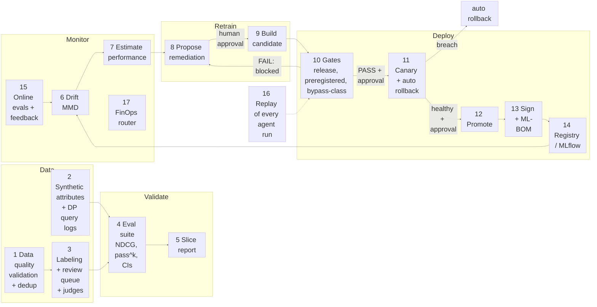

# Compass: MLOps summary

What was built for MLOps in this demo, stage by stage. Each stage says what it does, where it lives (tool, endpoint, file), where it shows in the UI, its row on the coverage board (`data/coverage.json`) with value and n or CI, whether the number is **measured** or rests on **synthetic** inputs, and the honest gaps.

> [!IMPORTANT]
> **Rules for this page.** Every number is copied from `data/coverage.json` or `docs/evidence/*`, with its n. Where the board has no number, none is given here. The catalogue, queries and relevance labels are the public Amazon ESCI dataset (measured against real labels). Prices, stock, the seasonal query stream, canary traffic and benign test sets are **synthetic or constructed**. Nothing here was run on a real retailer's data. The board tally: 18 real-measured, 9 real-no-metric, 9 script-ready-not-executed (GPU jobs never run), 0 absent, out of 36 techniques.

Related: [`FEATURE_CATALOGUE.md`](FEATURE_CATALOGUE.md) (UI and endpoints), [`USER_STORIES.md`](USER_STORIES.md).

Ops Copilot top 10 (OPS1 to OPS10: incident triage, metrics, runbooks, release notes, drift, eval clusters, alerts) and the "Cost & tokens" dashboard over `data/token_ledger.jsonl`: see [`FEATURE_CATALOGUE.md` §8.1](FEATURE_CATALOGUE.md#81-ops-copilot-top-10-ops1-to-ops10) and [`TOKEN_OPTIMISATION.md`](TOKEN_OPTIMISATION.md). MLOps top 10 (MLO1 to MLO10, stages 19-28 below): interleaving, CUPED A/B, skew, lineage, retrain trigger, fairness audit, config registry, SLO budgets, golden-set regression and shadow deploy — see §19-28 below, [`FEATURE_CATALOGUE.md` §9](FEATURE_CATALOGUE.md#9-mlops-top-10-mlo1-to-mlo10) and [`MLOPS_TOP10_SELECTION.md`](MLOPS_TOP10_SELECTION.md).

---

## 1. The lifecycle

[Zoom viewer](https://mermaid.live/view#pako:eNp1VG1P2zAQ_iunSP1EO1ZeBkMTElBASO1AVOLLsklOfEk9HDvYTlkG_PfdJSENaHzJ-c7Pne95fPFTlFqJ0RFEo9GTMiocwVMchRUWeCecEolGH0dNMLMmLNVfZDeO9g7LP3H08vIyGsUm0_YxXQkXYH4bGwBfJbkT5QqkCAJ-xNGMbBz95D0A-UCRKXAMHiqhVai_JW77eE1LSlDWwBZIlFXZp_jaUM4OLGtDvQWVggjBqaQK6JvcLZjdUDF0NWib-z5Ri4QSd2EuEtTK5FTZ4VrhI4Mr7HJ_VzLH1yQ08g2Hri1kHnfduq-Pa4ruwTmBKEOFtuL32dnlGErh_a_7MZxdbfrxmvD7sNQqReqktC58cGxh6Tas41MX7XIjoKPgF5g5lQVYLGabbnygnQM490EV3HKJLrOuECbdtGwN9zDdh2tDiiBRENqTLhmiTER63wMzxaJPD-BCmevSg7Mkt_ugXYfBCWW43dt22ddxWFD0EG6cLa1n2gVK1Vx0j0m0JMxXOK2UlpAKI4c6vz9MYqlt3QxWs-rL5JTDPX-GS_E6Gg41Co90Hw4d5soTCZRjSGq-oEmq6dsXoJM5fwpnwggapi0QVbBEXes32pTOMm6HSRV2MBBe5byxC0uV8xwv5pPT68VAi2Z7D26bTuiEbYLw__OWqnyAyeSYx7exuG7412bg4bpxvG7wrt3xobEkMUfJsPscR6uKhgBESX3TdcfRMyveQFkyxrLtwBcnV_MjAtj0HiVju3IDyM3JcsniDAqSdAwi02EShyJdNfn8E_5PyA14hUKHVf2uJq1akirveOUtr9aVjj0a6IFHPxUr_IUULrWowWakFL8LIkcTwFU8dDD51FGPxhAVSL-IkvzMtU8fv4cSM1HpQE_cPz81qWE)

**UI surface:** `web/src/ops/LifecycleStepper.tsx` renders the stages `Data`, `Validate`, `Deploy`, `Monitor`, `Retrain` (from `LIFECYCLE` in `shared/src/index.ts`) and maps agents to stages: Data Quality and Labeling → Data, Eval → Validate, Drift Monitor and FinOps Router → Monitor, Remediation → Retrain, Release → Deploy.

## 2. Autonomy tiers by stage

Tier rules come from the Ops Copilot system prompt in `bff/src/ops/prompt.ts`: **T0 observe** (always allowed), **T1 recommend** (never changes production), **T2 act with approval** (only after a human approves on an approval card; approvals arrive over HTTP, the agent cannot approve), **T3 act within guardrails** (the eval gate verdict and automatic rollback). Enforcement is in `services/policy-mcp/src/policy_mcp/policy.py` (`TIER`, `NEVER_EXPOSED`) and in the `_guard(agent, tier, ui)` decorator in `services/ops-mcp/src/ops_mcp/tools.py`.

| Stage | Agent | MCP tool(s) | Tier (prompt.ts / policy.py) |
|---|---|---|---|
| Data quality | Data Quality | `run_data_validation` | T1 |
| Synthetic data, DP logs, selection | Data Quality | `generate_synthetic_attributes`, `generate_dp_query_logs`, `run_data_selection` | T1 (not in `TIER`, so no approval needed) |
| Labeling | Labeling | `label_queries` (T1), `record_labels` | **T2** |
| Human label review | human | ops-http `POST /labels/review` (`review_label` never exposed to agents) | human only |
| Eval suite | Eval | `run_eval_suite` | **T3** |
| Preregistered gate | Eval | `gate_preregistered_candidate` | **T3** |
| Drift | Drift Monitor | `compute_drift` | T0 |
| Estimate performance | Drift Monitor | `estimate_performance` | T0 |
| Propose remediation | Remediation | `propose_remediation` | T1 |
| Approve remediation | human | ops-http `POST /remediations/{id}/approve` (`approve_remediation` never exposed) | human only |
| Build candidate | Remediation | `build_candidate` | **T2** |
| Canary | Release | `start_canary` | **T2** in policy.py; `_guard` in tools.py labels it T3 (see gap below) |
| Canary status | Release | `get_canary_status` | T0 |
| Automatic rollback | guardrail watcher in ops-http | `POST /models/rollback`, audited as T3 | **T3** |
| Manual rollback | Release | `rollback` | **T2** in policy.py; `_guard` labels it T3 |
| Promote | Release | `promote` | **T2** |
| Sign, ML-BOM | Release | `sign_model`, `generate_mlbom` (T3 in `_guard`); `verify_model_signature` (T0) | T3 / T0 |
| Registry | Release | `get_registry` | T0 |
| FinOps router | FinOps Router | bff `GET /api/ops/router`, `GET /api/ops/finops` (no MCP tool) | T0 (report only) |

> [!NOTE]
> **Tier label mismatch in code.** `policy.py` treats `start_canary` and `rollback` as T2 (approval required, and this is what is enforced before the tool runs). The `_guard` decorator in `tools.py` tags the same tools T3 for audit and UI. Both files are as they are today; this document does not change either.

---

## 3. Stage by stage

### 1. Data quality and validation

- **What it does.** Hand-written expectations over the catalogue: missingness, dietary tag coverage, MAD price outliers; near-duplicates with MinHash LSH and semantic duplicates with FAISS cosine over bge-small.
- **Where.** Tool `run_data_validation`; `services/ops-mcp/src/ops_mcp/dq.py` (`run`, `near_duplicates`, `semantic_duplicates`).
- **UI.** Beat 8a on `/ops/8a`, A2UI report card.
- **Coverage rows.** Technique 4 *Validation gates* and 5 *MinHash + semantic dedup*: both **real-no-metric**. The report goes back to the agent and is not written to `data/`, so no number is claimed.
- **Measured vs synthetic.** Runs on the real 25,003-row ESCI catalogue. Price outliers are checked on synthetic prices.
- **Gaps.** Not an ODCS data contract. No duplicate rate persisted.

### 2. Synthetic attributes and DP query logs

- **What it does.** (a) Generate → verify → resample loop for product attributes, grounded against the real ESCI text. (b) Differentially private query log release (Laplace / analytic-Gaussian histogram). (c) Model-based data selection (coverage minus redundancy).
- **Where.** Tools `generate_synthetic_attributes`, `generate_dp_query_logs`, `run_data_selection`; `scripts/synth_attributes.py`, `scripts/dp_query_logs.py`, `scripts/select_data.py`; outputs `data/synth_attributes.json`, `data/dp_query_logs.json`, `data/dp_utility_curve.csv`, `data/selection_report.json`.
- **UI.** Coverage board rows 2, 3, 6.
- **Coverage rows (real-measured).**
  - T2 verified synthetic data: acceptance after all 3 verification stages 1.0 (n=25); first-attempt acceptance 0.8 (n=25); cost per accepted attribute set $0.02896.
  - T3 DP synthetic data: ε 1.0, δ 1e-06; verbatim real queries in the release 0 (n=2000); top-50 overlap with the true histogram at the released ε 0.16.
  - T6 model-based selection (**negative**): NDCG@10 full catalogue 0.5725 (n=200); model-selected 40% 0.3736 (n=200); random 40% 0.4228 (n=200); delta vs random −0.0492 (n=200).
- **Measured vs synthetic.** Measured on this machine; the attributes produced are synthetic by design.
- **Gaps.** n=25 attribute sets is small. The model-based selector is worse than random here and is reported that way.

### 3. Labeling, human review queue and LLM judge

- **What it does.** Claude labels shopper queries with a confidence; items below `LOW_CONFIDENCE = 0.7` go to a human review queue. Separately, an online judge scores traced sessions against ESCI gold with Cohen's κ and Wilson CIs.
- **Where.** Tools `label_queries`, `record_labels` (T2); `services/ops-mcp/src/ops_mcp/labeling.py` (`record`, `review_queue`); ops-http `GET /labels/review_queue`, `POST /labels/review`; judge in `services/ops-mcp/src/ops_mcp/online_eval.py` (`agreement`, `_kappa`, Wilson CI).
- **UI.** Beat 8a approval card and review queue; `/coverage` "judges" panel (lexical vs LLM, screenshot `docs/ui/29-coverage-judges-lexical-vs-llm.png`).
- **Coverage rows.**
  - T1 LLM-assisted labeling: **real-no-metric** (κ computed per batch but not persisted; the 0.7 threshold is a proposal, not calibrated).
  - T19 calibrated judges (**negative**): the demo's **lexical** judge agrees with ESCI gold 0.623, CI [0.5607, 0.6814] (n=244); Cohen's κ −0.0762 (n=244), against a gold relevant base rate of 0.7254. Reported as unusable.
  - `judges` / `evidence` key `spike-llm-judge` (**external, not run in this repo**): LLM judge (claude-opus-5 via Claude Code CLI, headless, no tools) κ 0.4901, 95% cluster-bootstrap CI [0.3796, 0.5958] (n=600, 60 query clusters); observed agreement 0.7167 (n=600); recall on human-Irrelevant 0.146 (n=41); self-agreement κ 0.94 (n=150). Preregistered verdict PASS, near the floor. Source: `docs/evidence/spike_llm_judge_result.md`.
- **Measured vs synthetic.** Both κ values are measured against real ESCI human labels.
- **Gaps.** The in-demo judge is lexical, not an LLM. The spike κ is an Amazon-catalogue number and predicts nothing about a real retailer's labels. The LLM judge is near-blind on Irrelevant items.

### 4. Eval suite: NDCG, pass^k, eval statistics

- **What it does.** Paired NDCG@10 on identical ESCI queries with a 1000-resample percentile bootstrap; agent trajectory evals with k independent runs per task; a release gate script that exits 1 on failure.
- **Where.** Tool `run_eval_suite` (T3); search-svc `POST /eval/ndcg`, `POST /eval/compare` (`services/search-svc/mlops.py`, `engine.py`); `scripts/run_evals.py` (`main`, `score_runs`, `pass_k`); `evals/tasks.yaml`, `evals/results.json`; bff `GET /api/eval/ndcg`, `GET /api/eval/passk`.
- **UI.** `web/src/ops/OpsEvals.tsx` (offline evals), gate card in beat 8b.
- **Coverage rows (real-measured).**
  - T7 hybrid search + rerank: NDCG@10 BM25 0.5431, vector 0.5591, RRF 0.5725, RRF + cross-encoder 0.6027 (each n=200); p50 latency rrf_rerank 97.4 ms (n=200).
  - T20 eval statistics: champion 0.6027 vs candidate 0.6036 (n=200), paired delta 0.0009, CI [0.0, 0.00271], 1000 resamples.
  - T21 pass^k (**null**): k=3; pass^k state-based 0.8 (n=5 tasks), strict 0.4 (n=5), pass@1 0.8 (n=5). The failing `school_lunches_nut_free` task was kept in the suite.
  - T18 evals in CI: gate verdict PASS, candidate p95 115.6 ms against a 150 ms threshold.
- **Measured vs synthetic.** NDCG is measured on real ESCI qrels. pass^k tasks check final carts built on synthetic prices and stock.
- **Gaps.** 5 tasks × k=3 is too few for a CI and none is claimed. `ci/eval-gate.yml` is an example workflow, not installed, so nothing is enforced on a PR.

### 5. Slice report (B07)

- **What it does.** NDCG@10 per rules-based query class for BM25, dense, hybrid and hybrid + rerank, with bootstrap CIs; picks the worst slice (n ≥ 30) and re-measures one targeted fix with a paired CI.
- **Where.** `scripts/slice_report.py`, classifier `services/search-svc/query_types.py` (`classify`), fix `services/search-svc/slice_fixes.py` (`use_case_rank`, variant `head_only`); output `data/slice_report.json`.
- **UI.** `/coverage` slice panel (`web/src/coverage/SliceAndBypass.tsx`, screenshot `docs/ui/30-coverage-slice-report.png`).
- **Coverage row** (`slice_report`, real-measured, test split n=1008, 2000 resamples):
  - Worst slice `use_case`: rrf_rerank NDCG@10 0.5924, CI [0.5247, 0.6568] (n=71).
  - Targeted fix (**null**): paired delta −0.0024, CI [−0.0138, 0.0084] (n=71), "no significant change".
  - Regression check on all queries: paired delta −0.0002, CI [−0.0009, 0.0006] (n=1008).
- **Gaps.** Query classes are hand-written rules, not validated against human labels. The worst slice was chosen on the test set. No multiple-comparison correction.

### 6. Drift (MMD, seasonal stream)

- **What it does.** MMD² between reference and window embeddings with a permutation test.
- **Where.** Tool `compute_drift` (T0); search-svc `POST /drift` (`MLOps.mmd_perm` in `mlops.py`); recorded by `scripts/record_lifecycle.py` into `data/lifecycle_measured.json`.
- **UI.** Beat 8b drift chart card; lifecycle stepper Monitor stage.
- **Coverage row** T30 (real-measured): permutation p-value 0.0033 (n=150 window, 300 permutations); MMD² 0.0471 (n=150). Alert raised.
- **Measured vs synthetic.** The test is measured; **the seasonal stream is a constructed query set, not observed traffic**.
- **Gaps.** One recorded run.

### 7. Estimate performance (label-free)

- **What it does.** Maps retrieval confidence to an estimated NDCG@10 without labels.
- **Where.** Tool `estimate_performance` (T0); `MLOps.calibration()` in `services/search-svc/mlops.py`.
- **UI.** Beat 8b, alongside drift.
- **Coverage row** T31: **real-no-metric** (no artefact written). The `lifecycle.drift` block records est. NDCG@10 now 0.4497 vs reference 0.6811 for the one recorded drift run (window 150), with no CI.
- **Gaps.** This is a retrieval-confidence regression, **not** NannyML CBPE/DLE.

### 8. Propose remediation (cost-aware)

- **What it does.** Proposes T0–T3 tiered options for an alert, with a gate outlook and a cost model (ROI and p95 eligibility over measured inputs). An MLE search agent explores the ranking config space on a budget.
- **Where.** Tools `propose_remediation` (T1), `run_mle_search`; `tools.py` (`propose_remediation`, `gate_outlook`, `cost_model`), `measure.py` (`measure_p95`), `mle_search.py` (`search`); ops-http `GET /remediations`, `POST /remediations/{id}/approve|reject`.
- **UI.** Beat 8b remediation options card with approval.
- **Coverage rows.**
  - T32 cost-aware retrain triggers (real-measured): current p95 101.2 ms (n=30); measured rebuild cost $0.000003. Business value per 0.01 NDCG is **not supplied**; ROI is shown as a break-even threshold. The trigger currently **denies every remediation** because nothing beat the champion.
  - T16 MLE search agents (**null**): 10 trials, $0.004179 spent; best dev delta 0.0009, CI [−0.00217, 0.00417] (n=150); sealed holdout delta 0.00167, CI [−0.00134, 0.00504] (n=200).
  - T33 guardrailed remediation tiers: **real-no-metric** (tiers enforced by policy-mcp; no incident history to measure).
- **Gaps.** No revenue signal. Declared reversibility is asserted by the tier table, not verified at run time.

### 9. Build candidate

- **What it does.** Builds a candidate model version from an approved remediation; the presenter toggle `presenter_worse=true` builds a reranker-off candidate so the gate fails on stage.
- **Where.** Tool `build_candidate` (T2); search-svc `POST /models/candidate`; `buildOpsPrompt` in `bff/src/ops/prompt.ts`.
- **UI.** Beat 8b "worse candidate" toggle and registry card.
- **Coverage row.** Measured through the gate below (`lifecycle.reranker_off_gate`).
- **Gaps.** Candidates are ranking-config variants (weights, rerank on/off), not retrained models.

### 10. Gates: release, preregistered, bypass-class

- **Release gate.** Thresholds (`gate_config.release_gate`): NDCG delta CI lower ≥ −0.005; p95 ≤ 150 ms; red-team blocked = 1.0; pass^k ≥ 0.6. Recorded red run (`lifecycle.reranker_off_gate`): champion v4 0.6068 vs candidate v2 0.5725, delta −0.03428, CI [−0.05562, −0.01453] (n=200), **gate_passed false**.
- **Preregistered gate going red (B08).** Candidate `late_interaction` (record M22). Ops button "Gate a preregistered null" → bff `POST /api/ops/gate-preregistered` → ops-http `POST /gates/preregistered/late_interaction` → search-svc `POST /eval/late_interaction`, live. Prior measurement (T9, **null**): NDCG@10 0.5896 vs production 0.6027; paired delta −0.01315, CI [−0.03164, 0.00427] (n=200); p95 181.5 ms (n=200), above the 150 ms threshold. UI screenshot `docs/ui/34-ops-gate-red-late-interaction.png`.
- **Bypass-class gate (B10).** Red-team findings are grouped as `<language>/<operator_family>` (obfuscation, framing, direct); open classes block the release unless a named person has signed an unexpired override (`data/bypass_overrides.json`). Code `services/ops-mcp/src/ops_mcp/bypass_gate.py`, `services/policy-mcp/src/policy_mcp/bypass_gate.py`, `redteam.py`; report `scripts/bypass_gate_report.py` → `data/bypass_gate.json`. UI `docs/ui/33-coverage-bypass-class-gate.png`.
  - T22 (**negative**): attack success rate against the pre-B10 detector 0.4954 (n=109); seed regression suite block rate 1.0 (n=8).
  - Recorded bypasses still bypassing: before 54 of 54, Wilson CI [0.9336, 1.0]; after 0 of 54, CI [0.0, 0.0664] (**in-sample**).
  - Adaptive ASR, same seeds 1–3: before 0.495, CI [0.4268, 0.5634] (n=202); after 0.2057, CI [0.1565, 0.2656] (n=209).
  - Adaptive ASR, new seeds 11–13: before 0.4051, CI [0.3387, 0.4752] (n=195); after 0.3333, CI [0.2714, 0.4016] (n=198).
  - Benign false positives after, per language: en 0.1 (n=30), code-switched 0.0333 (n=30), es 0.0 (n=30). The benign set was authored by the implementing agent.
- **Gaps.** The seed suite passing 8/8 says little while adaptive ASR on unseen seeds is still 0.3333. The "after" replay is in-sample.

### 11. Canary and automatic rollback

- **What it does.** Starts a percentage canary on simulated replayed ESCI traffic; the ops-http guardrail watcher polls every 2 s and calls `POST /models/rollback` unattended on a breach, writing a T3 audit row.
- **Where.** Tools `start_canary`, `get_canary_status`, `rollback`; search-svc `POST /canary`, `GET /canary/status`, `POST /canary/traffic`, `POST /debug/inject_latency`; watcher `services/ops-mcp/src/ops_mcp/guardrail.py`; ops-http `GET /guardrail/status`, `POST /guardrail/check`; bff `POST /api/ops/inject-latency`.
- **UI.** Beat 8b canary card; presenter "inject latency" button (input `demo_inputs.inject_latency_ms` = 900, an input, not a measurement).
- **Guardrail rule** (`gate_config.canary_guardrail`): roll back when canary p95 > 150 ms **and** > 1.2 × champion p95, or paired NDCG drop > 0.02; minimum 20 samples.
- **Coverage row** T28 progressive delivery: **real-no-metric** (no arm delta; canary traffic is simulated).
- **Evidence** `docs/evidence/canary_rollback_timing.json`: injection to rolled back, **median 1.37 s (n=3)** (runs 1.46, 1.14, 1.37 s); breach visible to rolled back median 0.72 s (n=3). No CI.
- **Gaps.** Bounded by the 2 s poll interval. Laptop CPU and simulated traffic; says nothing about production. In that evidence run the canary was started on search-svc directly, not through the gated tool. One false-positive breach from CPU contention in 5 attempts.

### 12. Promote

- **What it does.** Promotes a candidate to champion after a passing gate and a human approval.
- **Where.** Tool `promote` (T2); ops-http `POST /promotions/{version}/approve`; search-svc `POST /models/promote`.
- **UI.** Beat 8b approval card, registry card.
- **Coverage row.** None of its own.
- **Gaps.** No measurement; promotion is a registry alias change.

### 13. Signing and ML-BOM

- **What it does.** Signs a model manifest with the OpenSSF `model_signing` package using a local demo elliptic key (falls back to an HMAC manifest, labelled "NOT OpenSSF"); verification fails on a tampered manifest. Generates and schema-validates a CycloneDX ML-BOM.
- **Where.** Tools `sign_model`, `verify_model_signature`, `generate_mlbom`; `services/ops-mcp/src/ops_mcp/signing.py`, `mlbom.py`; keys in `data/ops_keys/`.
- **UI.** A2UI `mlbom` card in the ops plane.
- **Coverage rows** T34, T35: **real-no-metric** (boolean results; no number).
- **Gaps.** Local demo key, not Sigstore keyless bound to a CI identity. No admission controller checks the signature before serving. The ML-BOM covers model, config, encoder and reranker, not the serving image.

### 14. Registry and MLflow

- **What it does.** Model-version registry in MLflow (sqlite) plus a JSON mirror: each version is an MLflow run (params, config artifact, metrics) with champion and candidate aliases.
- **Where.** `MLOps` / `Registry` in `services/search-svc/mlops.py`; `data/mlflow.db`, `data/mlruns/`, `data/registry.json`; search-svc `GET /models`; tool `get_registry` (T0); bff `GET /api/ops/registry`.
- **UI.** Registry card in `OpsDashboard.tsx`.
- **Coverage row.** Referenced by T20 (`Registry` symbol); no metric of its own.
- **Gaps.** Local sqlite; not Element or a shared registry.

### 15. Online evals and feedback sample

- **What it does.** OTel GenAI spans on agent runs; sessions exported and judged; shopper 👎 plus reason is stored as an online-eval sample.
- **Where.** `bff/src/otel.ts` (`withGenAiSpan`), `bff/src/ops/onlineEval.ts` (`exportSessions`), `services/ops-mcp/src/ops_mcp/online_eval.py` (`sample`, `agreement`); bff `POST /api/ops/online-evals/export`, `GET /api/ops/online-evals/agreement`, `GET /api/ops/tracing`; feedback `POST /api/session/:sid/feedback` → `data/online_feedback.jsonl`; ops-http `POST /online_evals/sessions`, `GET /online_evals/agreement`, `GET /online_evals/sample`.
- **UI.** `OpsEvals.tsx`; chat thumbs (story AI1b, `ai-timeline.spec.ts`).
- **Coverage row** T29 (**negative**): 400 sessions judged; 244 pairs with ESCI ground truth; lexical judge agreement 0.623, CI [0.5607, 0.6814] (n=244); κ −0.0762 (n=244); 20 Jaeger traces visible. Verdict: the online lexical judge is not fit to gate anything.
- **Gaps.** No LLM judge in the online loop. Feedback rows are collected but not yet reported on the board.

### 16. Replay (B14)

- **What it does.** Records every AG-UI run (shopper and ops) event by event and replays it verbatim.
- **Where.** `bff/src/replay/eventLog.ts` (`recording`, `RunRecorder`, `listRuns`, `readRun`); `data/agui_runs/`; bff `GET /api/replay/runs`, `GET /api/replay/runs/:id`.
- **UI.** `/ops/replay` and `/ops/replay/:runId` (`web/src/ops/ReplayRoute.tsx`); linked from each chat turn. Walkthrough test "7 session replay".
- **Coverage row.** None (an audit feature, not a technique).
- **Gaps.** Only runs streamed since recording was added exist.

### 17. FinOps router (beat 8c)

- **What it does.** Routes each query to a cheap arm (lexical or hybrid) or the Claude arm, escalates to premium when the rank-1 / rank-3 margin is below 0.15, and writes a route receipt; compares against an always-premium control.
- **Where.** `bff/src/ops/router.ts` (`decide`, `route`, `routerReport`, policy `sparky-router-1.0.0`), `bff/src/ops/finops.ts`; bff `POST /api/route`, `GET /api/ops/router`, `GET /api/ops/finops`.
- **UI.** `/ops/8c` (screenshot `docs/ui/11-ops-8c-light.png`).
- **Coverage row** T26 (**negative**, n=40 queries): cost per 1k with cascade $0.002585; routing without cascade $0.00052; always-premium control $0.002456. Saving vs always-premium: without cascade 78.8%; **with cascade −9.4%** (34 escalations of 40).
- **Gaps.** Cost uses `USD_PER_CPU_MIN = 0.0017`, a stated constant. The cascade threshold is untuned and loses money on this traffic.

### 18. Lifecycle stepper

- **What it does.** Shows which lifecycle stage the Ops Copilot loop is in and which agents acted, with tier badges and status dots (running, done, blocked, idle, skipped).
- **Where.** `web/src/ops/LifecycleStepper.tsx`; state `state.ops.stage` from `bff/src/ops/reducer.ts`.
- **UI.** Top of every `/ops/:beat` page.
- **Coverage row.** None (presentation).

### 19-28. MLOps top 10 (MLO1 to MLO10)

Ten laptop-runnable capabilities selected in [`MLOPS_TOP10_SELECTION.md`](MLOPS_TOP10_SELECTION.md) as recommended by the researched MLOps/Search TDs but not already built above (stages 1-18). Each is a real ops-mcp tool in `services/ops_mcp/mlops_top10.py`, exposed as an `ops_insight` A2UI card through policy-mcp's tier guard, same pattern as the Ops Copilot top 10 (§17 note, `FEATURE_CATALOGUE.md` §8.1). Full stories: [`USER_STORIES.md` §MLOps top 10](USER_STORIES.md#mlops-top-10-mlo1mlo10); technical detail and diagram: [`FEATURE_CATALOGUE.md` §9](FEATURE_CATALOGUE.md#9-mlops-top-10-mlo1-to-mlo10).

| # | Capability | Tool | Tier | Coverage row (n, key metric) | Measured / synthetic |
|---|---|---|---|---|---|
| 19 | Team-draft interleaving pre-screen | `interleave_rankers` | T1 | MLO1: n=200, sign-test p=0.3156, preference CI95 [-0.05, 0.18] | Real ESCI queries; clicks simulated from judgments |
| 20 | CUPED + sequential (mSPRT) A/B | `ab_sequential_test` | T1 | MLO2: n=400 sessions, CUPED variance reduction 64.7%, ΔNDCG@10 CI95 [-0.0356, 0.0225] | Sessions re-randomised over logged data, not live traffic |
| 21 | Training-serving skew check | `skew_check` | T2 | MLO3: n=11,612 rows, PSI 0.0021-0.0114 (below 0.2 threshold) | Synthetic commerce features on both sides |
| 22 | Data/model lineage graph | `lineage_query` | T0 | MLO4: 188 nodes / 299 edges | Real MLflow run history; some edges code-declared not logged |
| 23 | Retraining trigger + DAG | `retrain_trigger` | T2 | MLO5: n=8 DAG steps, fired in 3.6 s on drift p=0.0033 | Constructed seasonal drift stream |
| 24 | Fairness + sponsored-vs-organic exposure audit | `exposure_audit` | T1 | MLO6: n=200 queries, exposure gap CI95 [-0.0015, 0.0027] | Synthetic sponsored flag; 1P/3P not measurable |
| 25 | Prompt/agent config registry with eval-on-change | `prompt_registry_diff` | T2 | MLO7: n=334 ledger turns, hash `b182b24b72fb`, eval verdict pending | Real token-ledger turns |
| 26 | Model SLOs + error budgets + release freeze | `slo_budget_status` | T2 | MLO8: n=1,070 events, 3 SLOs, **freeze active on this run** | Real session/ledger data; targets are demo-set |
| 27 | Golden-set regression + eval dataset versioning | `golden_set_diff` | T1 | MLO9: n=200, ΔNDCG@10 -0.0302, CI95 [-0.0507, -0.0078] | Real ESCI human judgments |
| 28 | Shadow deployment | `shadow_deploy_diff` | T1 | MLO10: n=40 queries, overlap@10 0.535, CI95 [0.4725, 0.5925] | Replayed queries; no shadow result reaches a shopper |

- **Gaps.** MLO1/MLO2 rest on simulated clicks and re-randomised (not live-split) sessions; MLO4's cross-artefact edges are declared from engine code rather than OpenLineage events; MLO6 cannot measure 1P/3P exposure (no seller field in ESCI); MLO7's eval-on-change had not accumulated enough ledger turns per role to report a completed before/after at capture time.

---

## 4. Not done, or would need the client's own data

- **GPU work never run.** 9 techniques are script-ready-not-executed: LoRA/QLoRA, DPO, RLVR + verifier, on-policy distillation, FP4 training, research replication agent, PagedAttention + prefix cache, EAGLE-3, PD disaggregation. No scores are known.
- **Real traffic and labels.** Drift uses a constructed seasonal stream and the canary uses simulated traffic. Online evals, slice classes and judge calibration would need the client's own query logs, a human gold set and agreed κ thresholds.
- **A usable judge in the loop.** The in-demo judge is lexical (κ −0.0762, n=244). The LLM judge (κ 0.4901, n=600) was an external spike on ESCI and is not wired in.
- **Business value.** No revenue per NDCG point, so the retrain trigger reports break-even only and currently denies every remediation.
- **CI enforcement.** `ci/eval-gate.yml` is a template, not an active workflow.
- **Supply chain.** Sigstore keyless signing bound to a CI identity, an admission controller, and a full serving-image SBOM.
- **Platform integration.** No Element, shared model registry, production serving or incident history. Rollback timing (median 1.37 s, n=3) is a laptop number.
- **Robustness.** Adaptive attack success on unseen seeds is still 0.3333 (n=198) after the B10 fix.
