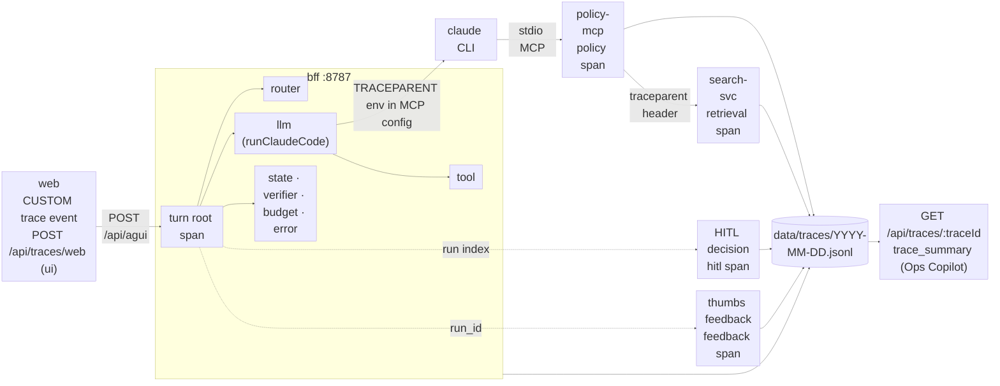

# Deep tracing

Every AG-UI turn is **one trace**. Spans are created at the code points that do the work (never synthesised
afterwards), share one `traceId` across bff, policy-mcp and search-svc, and are written to a local JSONL store.
OTLP export to Jaeger is still available (`OTEL_ENABLED=1`) but nothing depends on it.

| Switch | Default | Effect |
|---|---|---|
| `TRACE_FILE` | on | `0` disables the JSONL sink (and, with OTLP off, span creation) |
| `TRACE_FILE_MAX_MB` | 50 | rotate `YYYY-MM-DD.jsonl` → `.1.jsonl`; prune oldest files past 2× the cap |
| `OTEL_ENABLED` | off | also export OTLP/HTTP to `OTEL_EXPORTER_OTLP_ENDPOINT` (Jaeger :4318) |
| `OTEL_CAPTURE_CONTENT` | off | `1` adds raw prompt/argument text (local debugging only) |
| `TRACE_CAPTURE` | **on** | `0` turns off prompt/output text capture on `llm` spans. Separate from `OTEL_CAPTURE_CONTENT`: captured text is masked and truncated first (see Redaction). Switchable at runtime via `POST /api/traces/config {capture}` and shown in the Inspector's Trace tab |
| `SPARKY_TRACE_DIR` | `data/traces` | store location (tests use a temp dir) |

## Store

`data/traces/YYYY-MM-DD.jsonl`, one span per line, same schema from TypeScript (`bff/src/trace/jsonl.ts`) and Python
(`sparky_trace.py`, one copy in `services/shop-mcp/src/shop_mcp/`, a byte-identical copy in `services/search-svc/`):

```json
{"traceId":"32 hex","spanId":"16 hex","parentId":"16 hex|null","name":"llm Shopper","kind":"llm","service":"sparky-bff",
 "start":1790000000000.1,"end":1790000010845.9,"attrs":{"gen_ai.usage.input_tokens":41210},"status":"ok|error|unset","events":[]}
```

`data/traces/runs.jsonl` maps AG-UI run ids **and** replay run ids (`data/agui_runs/<id>.jsonl`) to their trace.
`data/traces` is in `.claude/settings.json` deny rules (generated, large).

## Span catalogue (`sparky.kind`)

| kind | where (real code point) | service | key attributes |
|---|---|---|---|
| `turn` | `aguiBridge` root span (`bff/src/agui/bridge.ts`) | sparky-bff | `sparky.session`, `sparky.surface` (shopper/ops), `sparky.layout` (`unreported` until web sends it), `sparky.beat`, `sparky.run_id`, `sparky.replay_run_id`, `sparky.question.sha256_16/chars`, `sparky.mode`, `sparky.aborted` |
| `router` | `routeIntent` in `shopperLive` | sparky-bff | `sparky.router.route`, `.reason`, `.tier`, `.planner_skipped`, `.critic_gate` (the gate is decided after the worker; the outcome is on the critic `verifier` span), `.allow_list_size` (-1 = all tools), `.economy` |
| `llm` | `runClaudeCode` (every model call) | sparky-bff | `gen_ai.request.model`, `sparky.role`, `sparky.llm.thinking`, `sparky.prompt.sha256_16/chars`, `gen_ai.usage.input_tokens/output_tokens`, `sparky.llm.cache_read_tokens`, `.cache_creation_tokens`, `.cache_read_ratio`, `sparky.cost_usd`, `sparky.llm.ttft_ms`, `.stream_ms`, `.total_ms`, `.stop_reason`, `.aborted`, `.timed_out`, `.tool_calls`, `.ok`, `.error_reason`, `sparky.intent`, `sparky.llm.system_prompt.sha256_16/.version/.chars`, `sparky.llm.reasoning_tokens_available` (always **false**: the Claude CLI does not report reasoning tokens and we never estimate them), and with `TRACE_CAPTURE=1` the masked `sparky.prompt.text`, `sparky.llm.output.text`, `sparky.llm.system_prompt.text` each with a `.text_truncated` flag |
| `tool` | `AguiRun.toolUse` → `toolResult` (each MCP call the CLI made) | sparky-bff | `gen_ai.tool.name`, `sparky.tool.arg_keys`, `.args.sha256_16`, `.latency_ms`, `.blocked`, `.rule`, `.refused_by`, `.result_count`, `.tier` (ops) |
| `policy` | `forward.call` in policy-mcp | policy-mcp | `sparky.policy.tool`, `.role`, `.tier`, `.decision` (allow/refuse), `.rule`, `.bypass_class`, `.lang` (B10 `class_of`), `.injection_flag`, `.injection_signals`, `.text.sha256_16/chars`, `.check_ms`, `.total_ms`, `.hitl_mode` |
| `retrieval` | `POST /search` in search-svc, legs timed inside `Engine.search` | search-svc | `sparky.retrieval.query.sha256_16/chars`, `.mode`, `.k`, `.filters`, `.bm25_count/_ms`, `.dense_count/_ms`, `.fusion` (rrf k=60), `.fusion_count/_ms`, `.rerank_count/_ms`, `.topk_ids`, `.zero_result`, `.index_version`; `.normalise`, `.spell` and `.relaxation` state plainly that /search does none of these today |
| `hitl` | decision routes: `POST /api/session/:sid/actions/:aid/:decision`, `POST /api/mandates/:id/:decision` | sparky-bff | `sparky.hitl.subject` (cart_proposal/checkout_mandate), `.decision`, `.wait_ms` (shown → decided), `.undo`, `.outcome`; span starts when the proposal/mandate was shown, on the originating trace |
| `verifier` | `runVerifier` (session verifier) and `critic()` | sparky-bff | `sparky.verifier.stage` (session_verifier/critic), `.verdict`, `.could_not_do`, `.violations`, `.omissions`, `.skipped`, `.skip_reason`, `.revision` |
| `state` | `AguiRun.pushState` (each STATE_DELTA) | sparky-bff | `sparky.state.keys`, `.key_count`, `.bytes`, `.sync_ms` (diff + SSE write + storefront publish), `.storefront_sync` |
| `budget` | end of turn; follow-up response cache lookup | sparky-bff | `sparky.budget.mode`, `.left_usd`, `.session_cost_usd`, `sparky.cache.read_ratio` (turn), `.read_tokens`, `.response_hit`, `.response_cache`, `.age_ms` |
| `error` | failed CLI run, tool error, refused turn, bridge exception | sparky-bff | `sparky.error.source`, `.reason`, `.timeout`, `.aborted`, `.tool`, `.unavailable`. **There is no retry attribute: `bff/src/llm/` has no retry path at all.** A model call that times out (`bff/src/llm/claudeCode.ts` idle timeout) or fails is reported once and refused — never re-run, because the CLI run may already have executed MCP tool calls (cart writes, approvals, runbooks) whose side effects a second run would repeat. The other failure classes (`spawn-failed`, `not-authenticated`, `no-tools`) are local misconfiguration that a retry cannot fix |
| `feedback` | `POST /api/session/:sid/feedback` with `run_id` | sparky-bff | zero-length span + `feedback` event under the turn root: `sparky.feedback.label`, `.reason`, `.sample_id`, `.source` (thumbs; the lexical judge runs later in ops-mcp and is not attached per turn). The `data/online_feedback.jsonl` row written by the same request now also carries `trace_id` (null when the turn had no trace); rows written before this field lack the key and are still reachable through the `run_id` -> trace lookup |
| `ui` | browser batches via `POST /api/traces/web`, sent at run end by `web/src/lib/trace.ts` | sparky-web | `ui send→first token` (`sparky.ui.first_token_ms`: composer send → next frame after the first answer token), `ui a2ui render` (`sparky.ui.a2ui_render_ms`: surface event → next frame after the surface store update, `.surface_id`), `ui web vitals` (`sparky.ui.lcp_ms`, `.inp_ms`: largest LCP / worst interaction duration seen on the page so far); all carry `sparky.layout` (shop-site/shop-chat/shop-split/shopper-plane/ops-dock) and `sparky.agent`. The same layout is sent in agent state, so the `turn` root's `sparky.layout` is no longer `unreported` for new turns |

Existing `withGenAiSpan` (FinOps search router, `bff/src/ops/router.ts`) now also writes to the store with kind `router` (it routes a search between arms; no model call).

## Propagation

- **bff → policy-mcp.** The Claude CLI, not the bff, is policy-mcp's MCP client, so there is no MCP request the bff could
  stamp `_meta.traceparent` on. Instead `runClaudeCode` writes `TRACEPARENT` (the `llm` span), `TRACE_FILE` and
  `SPARKY_TRACE_DIR` into the per-run MCP config env (`injectTraceparent`). policy-mcp is spawned per CLI run, so its
  `policy` spans are children of that `llm` span. The bff `tool` span and the `policy` span for the same call are siblings.
- **policy-mcp / shop-mcp / ops-mcp → search-svc.** `search_client` adds a `traceparent` header from the active span;
  search-svc records a `retrieval` span only when that header is present (no parent → no span).
- **Later requests.** HITL decisions, feedback and follow-ups find the turn through `runs.jsonl` and parent to the turn root.
- **Client.** `CUSTOM` event `trace` `{traceId, spanId, runId, replayRunId}` right after `RUN_STARTED`; browser spans reuse that traceId.

## Viewer

The chat **Inspector -> Trace** tab (`web/src/components/TraceInspector.tsx`) is the per-turn LLM observability panel:
turn header (intent, route reason, tokens in/out/cache, cost, total, ttft, verdict, copyable trace id, "View trace"),
a generations list with expandable Prompt / Output / Tokens & cost / Metadata tabs, tool-call rows with arguments,
result size, latency and service, the retrieval/policy/HITL/verifier rows of the same trace, and the capture toggle.
Above it, `TokenStrip` shows the session's spend against `SESSION_COST_BUDGET_USD`; `/ops/tokens`
(`web/src/ops/OpsTokens.tsx`) is the full token meter. Specs: `web/e2e/inspector-trace.spec.ts` (`@llm`),
`web/e2e/token-meter.spec.ts` (`@nollm`). Screenshots: `docs/ui/inspector_trace_{light,dark}.png`, `docs/ui/token_meter_{light,dark}.png`.

`/ops/traces` (recent traces), `/ops/traces/:traceId` and the Trace tab on `/ops/replay/:runId?tab=trace` render a waterfall (`web/src/ops/TraceWaterfall.tsx`): bars by start/duration coloured by kind, service label, kind filter chips with counts, click a row for its attributes. Each chat run timeline has a "View trace" link. Specs: `web/e2e/tracing.spec.ts`, `web/e2e/guide.spec.ts` (@llm).

## Redaction and text capture

Tool arguments, search queries, questions and feedback comments are recorded as `sha256_16` + `chars` only
(`redact()` in `bff/src/otel.ts`, `sparky_trace.redact`); raw text for those appears only with `OTEL_CAPTURE_CONTENT=1`.

**Prompt and output text on `llm` spans** is different: it is captured by default so the Inspector's Trace tab can show
what the model was actually asked and what it actually said. Before any of it reaches a span, `maskText()` replaces
email addresses (`[email]`), digit runs of 12+ characters (`[number]`) and secret-like tokens — `sk-`/`ghp_`/`xox…`
prefixes and any 40+ character word (`[secret]`) — and each field is truncated to **8 KB** with a `…text_truncated`
flag beside it. `TRACE_CAPTURE=0` (or the panel's toggle) turns capture off, leaving only the hash and length.
Captured text is written **only** to `data/traces`; `data/token_ledger.jsonl` never carries prompt or output text.
Tests: `bff/src/trace/detail.test.ts` (masker + truncation), `bff/src/trace/tree.test.ts` (both switch positions against
a fake CLI, and that the ledger stays text-free), `bff/src/ops/router.test.ts` (`redact` in both positions).
Tests: `bff/src/trace/tree.test.ts` (runs `runClaudeCode` against a fake CLI and an `AguiRun` tool call with a secret, then
asserts the secret is absent from every line) and `services/policy-mcp/tests/test_trace.py`, `services/search-svc/tests/test_sparky_trace.py`.

## API

| Endpoint | Returns |
|---|---|
| `GET /api/traces?limit=20` | newest traces: root name, start, duration, span count, `kind_counts`, error count, services, root attrs |
| `GET /api/traces/:traceId` | `{root, orphans, span_count, kind_counts, services, duration_ms}`; each node has `children`, `duration_ms` |
| `GET /api/traces/run/:runId` | the `runs.jsonl` row (AG-UI run id or replay run id). `GET /api/replay/runs/:id` also carries `trace_id` |
| `GET /api/traces/run/:runId?detail=full` | that row **plus** `detail`: the per-call view the Inspector renders — `totals`, `generations[]` (per model call: role, intent, model, all token fields, cost, ttft/stream/total, stop reason, ok, captured prompt/output/system prompt), `tools[]`, and the `retrieval`/`policy`/`hitl`/`verifier`/`router`/`budget`/`error`/`ui` spans of the same trace. Assembled in `bff/src/trace/detail.ts` (pure, `detail.test.ts`) |
| `GET /api/traces/config` | current tracing + capture state (`file_sink`, `capture_text`, `capture_text_max_bytes`) |
| `GET /api/tokens/ledger` | filtered, paged `data/token_ledger.jsonl` lines: `from,to,plane,role,model,ok,run_id,intent,min_cost` + `limit,cursor`; returns `rows`, `next_cursor`, `total`, `facets` |
| `GET /api/tokens/summary` | `group_by=role\|model\|plane\|intent\|hour` over the same filters: `totals`, `buckets[]` (calls, errors, tokens, cost, cache-read share, p50/p95 ttft), `by_hour`, `facets` and the `SESSION_COST_BUDGET_USD` budget state |
| `POST /api/traces/web` | `{spans:[{traceId, spanId, parentId, name, kind:"ui", start, end, attrs, status}]}` → `{accepted}`. ≤50 spans, ≤64 KB, ≤24 primitive attrs, timestamps within 24 h, content-like keys (`text`, `query`, `prompt`, …) hashed |
| `POST /api/traces/config` | `{file?: boolean, capture?: boolean}`, localhost only: runtime switches for the JSONL sink (overhead bench) and for prompt/output capture (the Trace tab's toggle) |

Ops Copilot: `trace_summary(trace_id="latest")` (T0, ops-mcp `copilot.py`, proxied and tier-registered in policy-mcp, same
`ops_insight` shape as OPS9 `replay_summary`): span counts per kind, slowest spans, errors, policy refusals, zero-result
searches, LLM cost and cache-read ratio, each cited to a span id.

## Flow



[Zoom viewer](https://mermaid.live/view#pako:eNptVGFr2zAQ_SuHIJDC0vTDICGMQnHLFkjW0maDUY8iS-dYmy0ZSU7btf3vu1OcJhnzB0v33vOdpHfWi1BOo5iBGAxejDVxBi-5iBU2-F16I4saQy4SWDob78wf5DAXH6ftUy7e3t4Gg9yWtXtUlfQRFre5BXjE4j4X9P5U-PF59u1udb2E6KVCwA3amOCb67sVjGVrxokJY9LDsDMnufjJSUJXrL1sKyjKEigdD7PpZDrpeYDYeUsED-CdixBaad9Z77qInvjt5B2v64ZAesPQdzarZacxo0M42ed1rua8NLxjjQmKsBBlRMi7s7NiAhv0pjTod3HR6TXGXYTeu11VtJoHVRvKoVJJyBbznm1dbdQzMdvJqFFtOqFteLirgNKriteRJqOwUUnpMXqDG1kfiisTeRtf5qsFaFQmGGeTmolDYcluxaprigAloi6k-p2Eu-BoCdF5vB_mQssod9b9oGe0XI4uL09_BWfp2E6SmNyl1J-vjo2epXGuU400fwhd00j_DMPrNkDmWlO7uDOE-2I0On_Nxb5l5LozuXhNLcCa1AMk6l0_gshqjtlxDpOthzxbeyCgOqvbi-zq5uL26uuKrNuAsbDMbkA5W5o1lyUjez_7L0LUxrGI2a1ve2d7TdppKz39AFCh1NyTr72l-wWdJi11JlXV-MQS9us_ggejmS0L5vjv4M0ke45L77FtrWMsNcMRUhb_fMWTBNHJiw8gGvSNNJqvhe1VwfeHxlJ2daQr4S-_im_b)

## Overhead (measured live)

`npx tsx scripts/trace_overhead.ts --n 10` on the running stack, 2026-09-17T16:23Z → `docs/evidence/tracing_overhead.json`.
Same real shopper turn (beat 1, HITL on, prompt "Find a cheaper ground coffee under $10, but do not change my cart.": Planner + Shopper with search_products + session verifier),
fresh thread per turn, TRACE_FILE switched ON/OFF alternately (ABAB) via `POST /api/traces/config`, latency measured client side
(POST → end of SSE stream).

| arm | n | p50 turn | p95 turn | min–max | p50 first token |
|---|---|---|---|---|---|
| TRACE_FILE on | 10 | 16302 ms | 17556 ms | 14489–17556 ms | 10490 ms |
| TRACE_FILE off | 10 | 16271 ms | 17646 ms | 14638–17646 ms | 10429 ms |

p50 delta: **+31 ms (+0.2%)**, with 20 spans per traced turn (p50).
That delta is far inside the ~3 s run-to-run spread of the model calls, so the honest reading is: no overhead is
detectable at n=10; it does not prove zero overhead. Traces that also include HITL, feedback and follow-ups carry ~30 spans.
